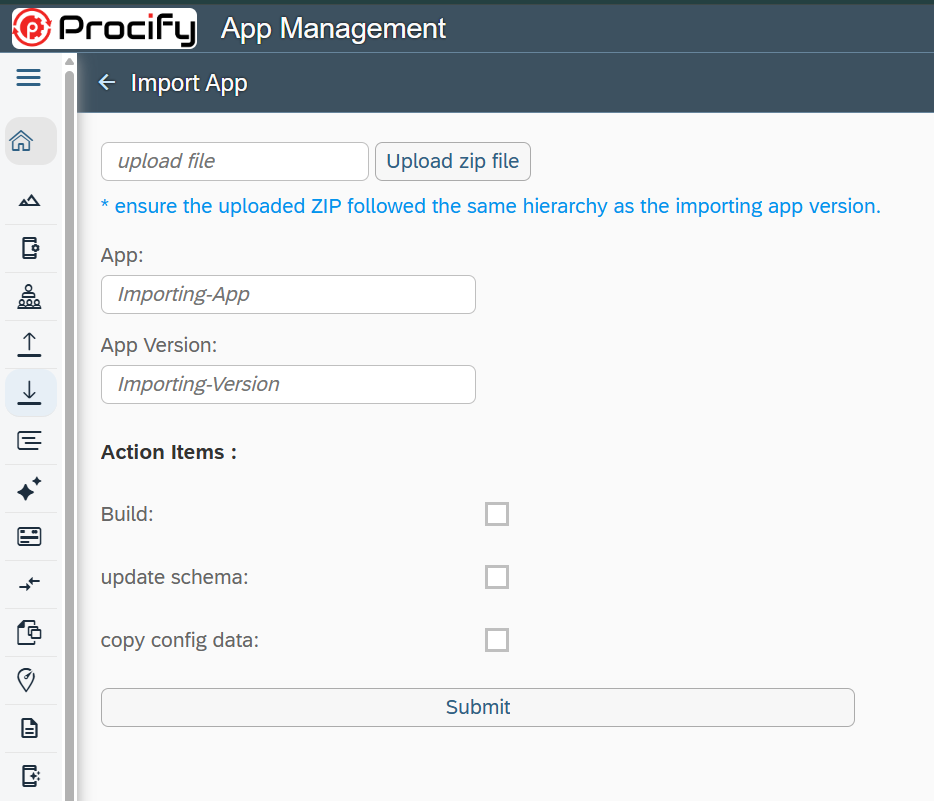

# Import App

Import App can be used to upload/import any application metadata from any server/system of Procify. Refer to export sections.

To import an app the following inputs are mandatory.

1.  **Upload Export zip:** Exported zip with the correct name like 5-flavor_name-1.zip.

2.  **Importing Account:** Account-id.

3.  **Importing App:** App with a version like app_name-1.

After filling out all fields click on import and then wait for a response we can also check the status of importing data by clicking on the check status button to ensure the task is completed or not.

