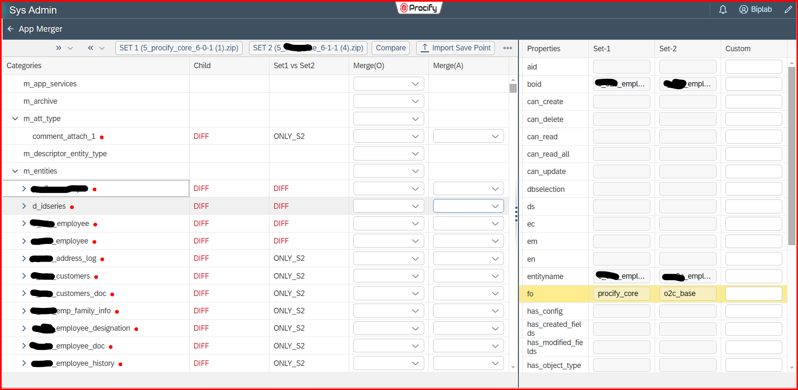

# Version Compare

App compare allows you to compare two Apps metadata(eg. Screens, entities. etc..) and pick/merge what you want from App1 and App2 then generate a 3rd App. The output of the App comparison is a new zip of metadata which can be imported to any app and that will have all screens, entities etc.. chosen in app comparison.

To compare any two applications, export metadata of the apps using Export App and upload them on the compare screens SET1 and SET2 click on compare. System will display what objects are contained in SET1(App1) and SET2(App2)

## Compare two App versions

To compare among two app versions, the compare screen requires two sets of exported **app zip files** as input. After comparison, the screen gives an object-wise difference. The following difference status is shown on the screen.

1.  Only in set-1

2.  Only in set-2

3.  Same (matches in both)

4.  Different

After comparison, one can change the metadata and merge it into one app, then download the merged zip.

The Downloaded merge zip can be imported into the **Import App page** to get the merged metadata in the application.
