# App Dependencies

App Dependencies is an Admin Tool that helps in managing the hierarchy of the applications.

App Inheritance is another cool feature of the procify which helps to improve the productivity and integrity of the application by packaging the development into relevant screens and objects and then using Inheritance which works similarly to object-oriented inheritance.

This tool manages the inheritance and sequence of the applications used or inherited.

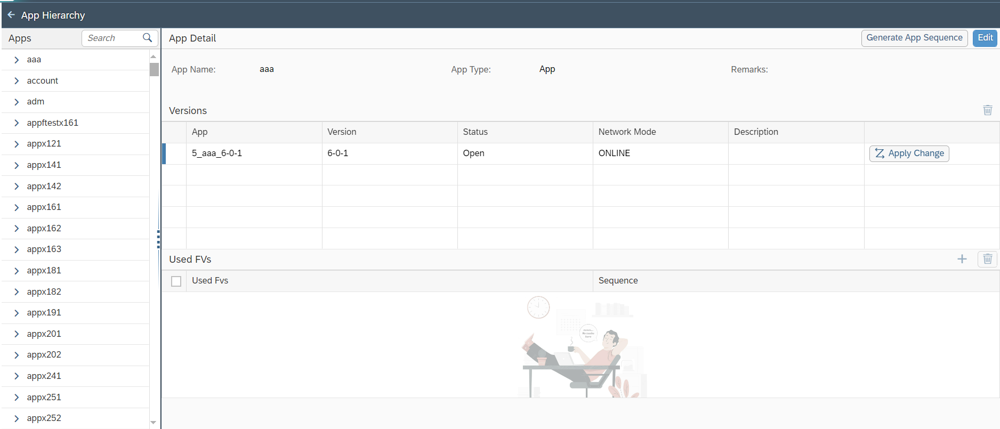

The App Dependencies screen has different sections

**Apps List**: This section of the editor will list all the apps available in the landscape along with their version.

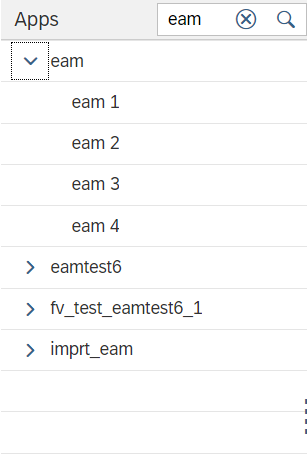

**App Detail:** The details of the selected app from the app list will be displayed in this section.

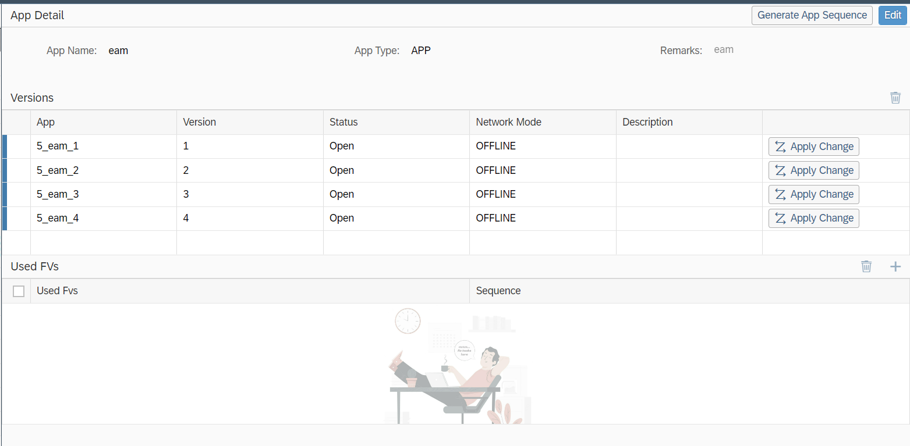

**Versions:** The versions table will list all the available versions of the selected app.

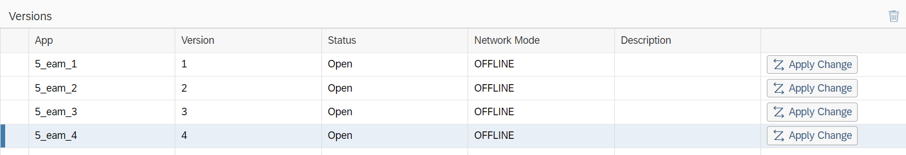

## Actions

### App creation

For creating a new app use the [Workspace Hub](https://docs.google.com/document/d/1KdP46c5_-BVEhWN5OgjVIcuHuZ_1Cf4-k7CZiMk5Tus/edit) application.

| **Column Header** | **Description**                                |
|-------------------|------------------------------------------------|
| App               | app name in fvid( aid_appName_version) format. |
| Version           | version of the app.                            |
| Network Mode      | App mode/network mode of that app version.     |
| Apply Changes     | Refer to the below section.                    |

### Apply Change

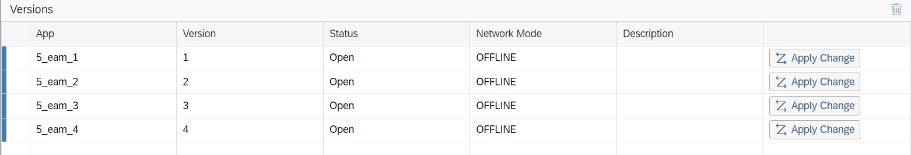

Apply change can be used to cleanup duplicate metadata from child App/ inheriting app

### Version Creation

Use the Workspace Hub application for new version creation.

### Used Fvs

The used Apps/Inherited Apps(Parent app) of the selected app version will be listed here.

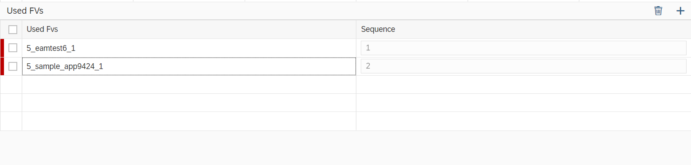

| **Column Header** | **Description**                                                   |
|-------------------|-------------------------------------------------------------------|
| Used Fv’s         | App name in FVid format                                           |
| Sequence          | Sequence of the used FVs based on which the app will be inherited |

## Process to Inherit Application

**Step 1:** Click on the application (these will be child applications) from the apps list you want to inherit from another application (you inherit from the parent app).

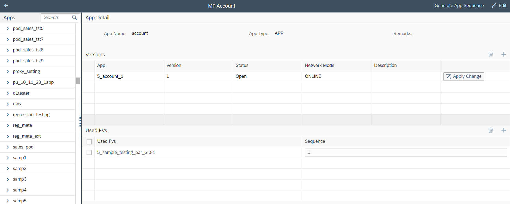

**Step 2:** Click on the **edit** button which is placed in the right corner of the screen.

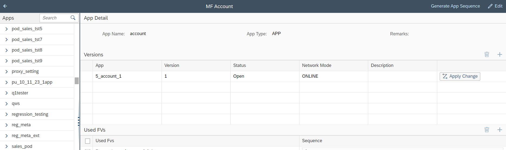

**Step 3:** Under the **Used FVs** section, click on the **Plus(+)** button.

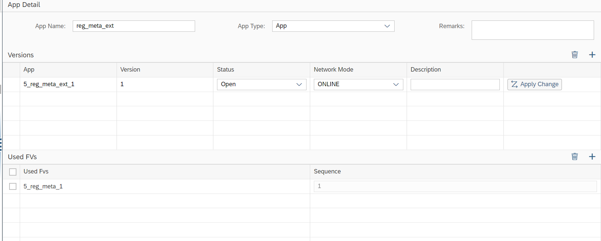

It will show a list of applications to select from.

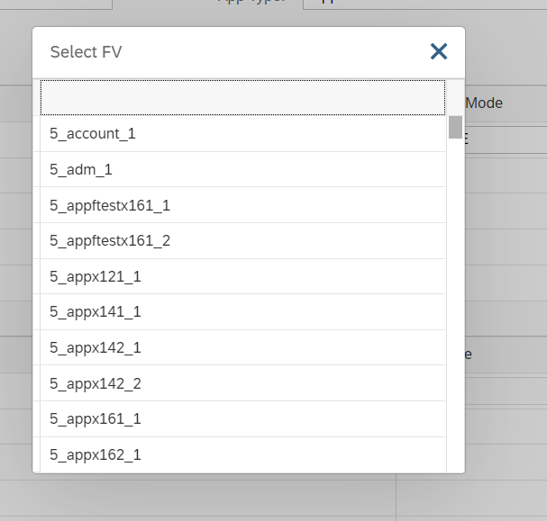

**Step 4:** Choose the parent application that you want to inherit from the list. Now, it will show in the **Used FVs** section.

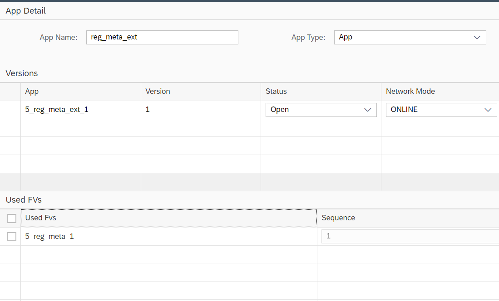

**Step 5:** Click on the **Save** button in the right corner of the screen.

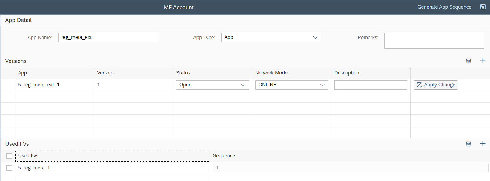

**Step 6:** After completing **Save,** click on the **Generate App Sequence** button to update the sequence for inherited apps.

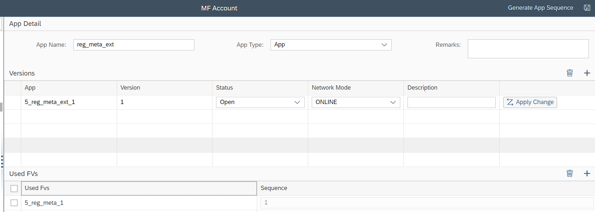

The process will be complete.

Now **Publish** the child application from the [Workspace Hub](https://docs.google.com/document/d/1KdP46c5_-BVEhWN5OgjVIcuHuZ_1Cf4-k7CZiMk5Tus/edit#heading=h.1fob9te).
