# Process to Use

mf(Workflow Designer)

- First the user should be assigned to **mf** to access this app.

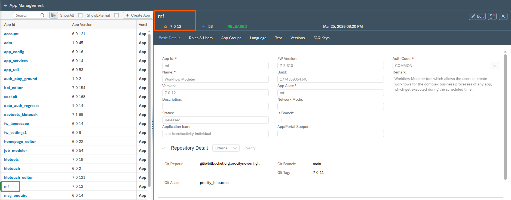

mf(Workflow Designer)

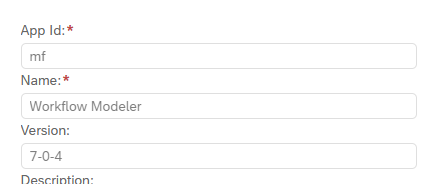

## 3.1.Workflow Modeler Screen

**Step 1:** Navigate to the Design Studio menu, go to the **Workflow Designer**.

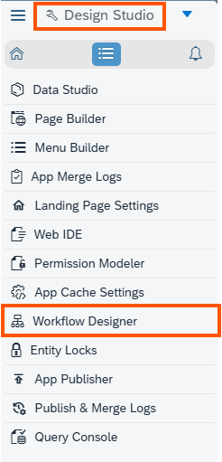

The screen will open as shown below:

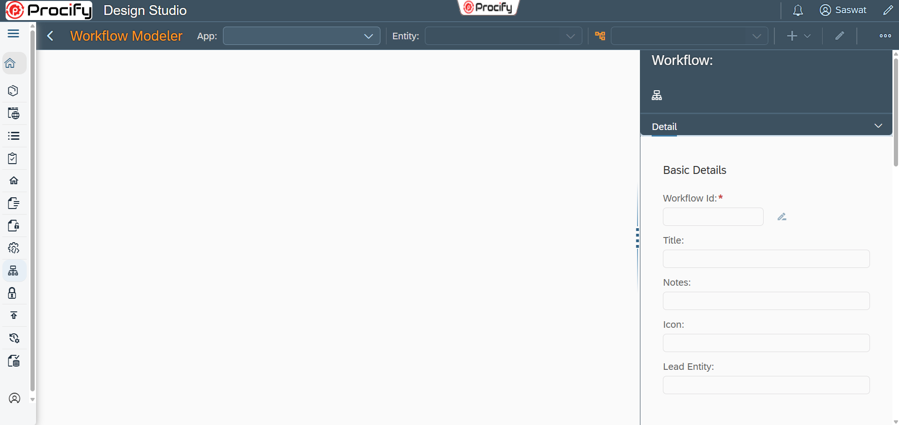

Users can select the apps, entities and create workflows for selected entities of an app.

Example:

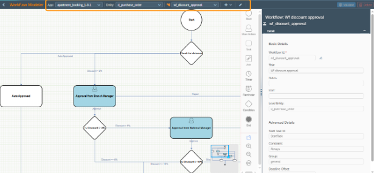

### Create workflow - 

**Purpose**: To design and set up a **new workflow** from scratch.

**Use Case**: When a user wants to define a **custom process flow** based on unique requirements or business rules.

### Copy workflow-

**Purpose**: To **duplicate an existing workflow** and make adjustments as needed.

**Use Case**: Useful when you want to create a similar workflow without starting from scratch.

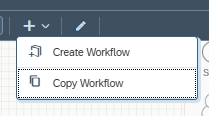

Once the edit mode is set, the save and revert option will be displayed to make the changes in your work flow.

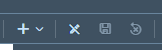

## 3.2.Workflow

Header details can be seen by clicking anywhere on the graph except shapes and connectors.

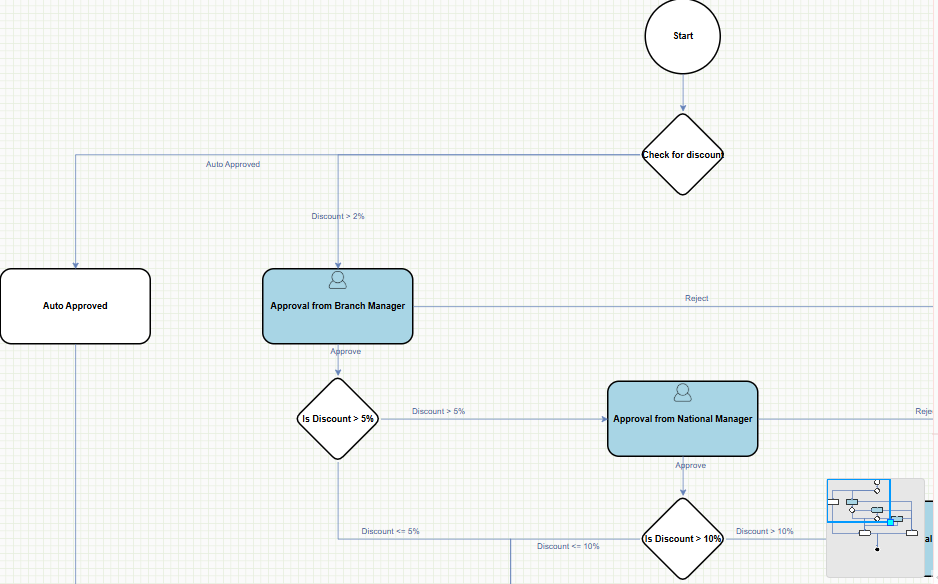

|  |  |
| --- | --- |
| **Elements** | **Description** |
| Detail | This is the building block of a workflow. It comes in various kinds of shapes and its details i.e. rectangular, diamond, circle etc. 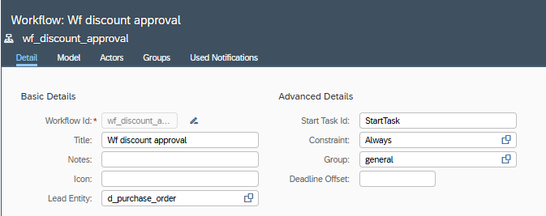 |
| Model | Models also have to be defined at the header level. This contains the definition of the $ variables i.e. ($D, $Q). These variables are used in the events and connectors for data processing based on the use case of workflow. 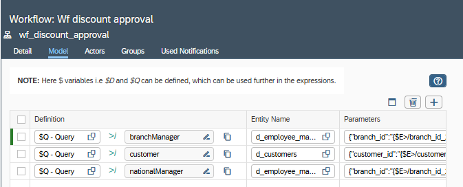 |
| Actor | Actors have to be defined at the header level, which can further be assigned to any user task. 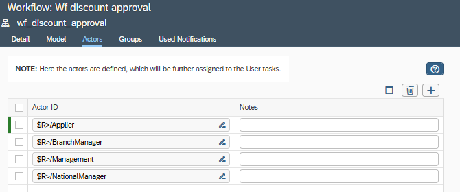 |
| Groups | Groups can be defined at the header level, which can contain the details of group id and its description according to user needs. 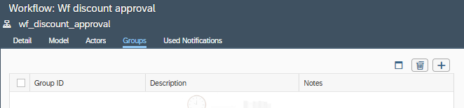 |
| Used Notification | Sends a **notification to administrators or designated approvers** when their action is required in the workflow. 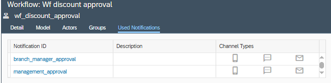 |

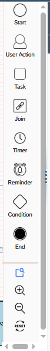
## 3.2.1.Task

There are different types of tasks:

### 3.2.1.1 Start

This is the entry point of the workflow, where the execution flow starts.

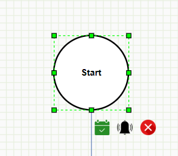

### 3.2.1.2 User Action

This kind of task contains an Actor, who is responsible for taking action in the business process.

> 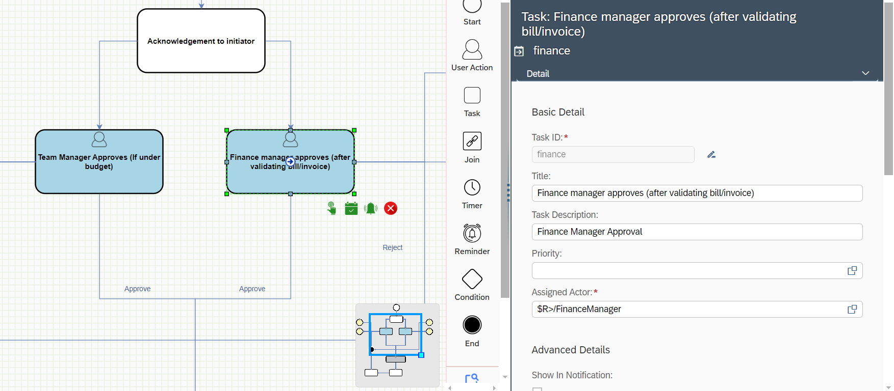

Note: The task description is required as it will be used to navigate to the detail screen in mobile view in the **My Tasks** screen.

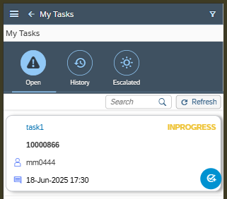

> 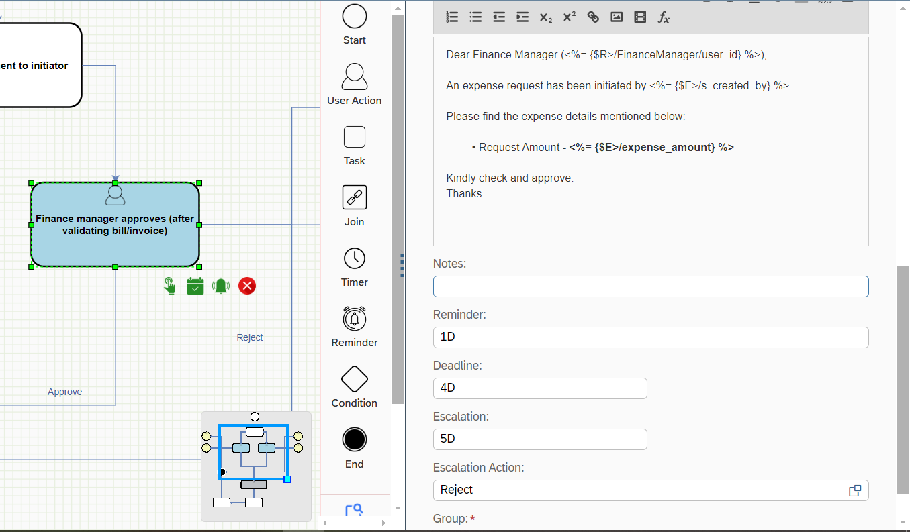

### 3.2.1.5 Join 

Join indicates the dependency between other tasks. This task is used when the process has to move forward only after the completion of a few user tasks. In technical terms, all the predecessor tasks of the Join tasks have to be completed before moving forward.

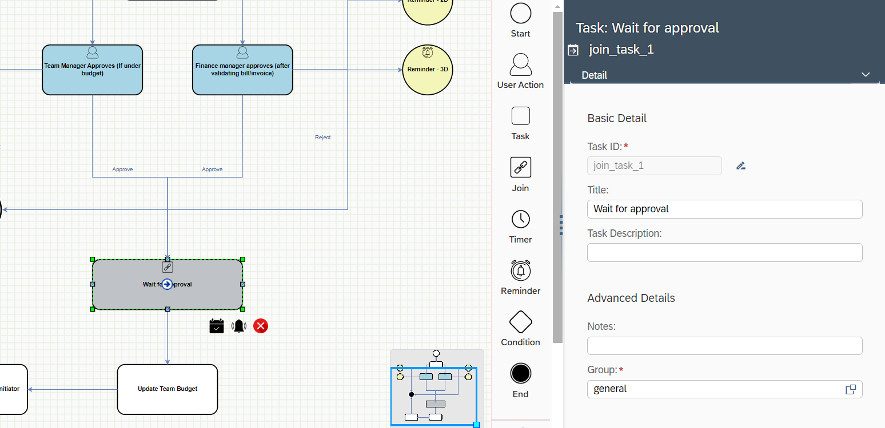

### 3.2.1.4 Timer Task 

This is also a normal task but gets executed when the timer expires.

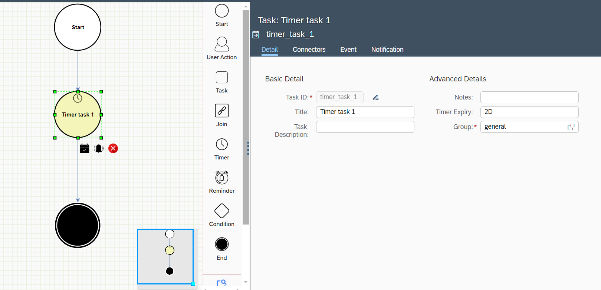

### 3.2.1.3 Reminder Task

This task can be added only with User Tasks. This is used for multiple reminders to the assigned user.

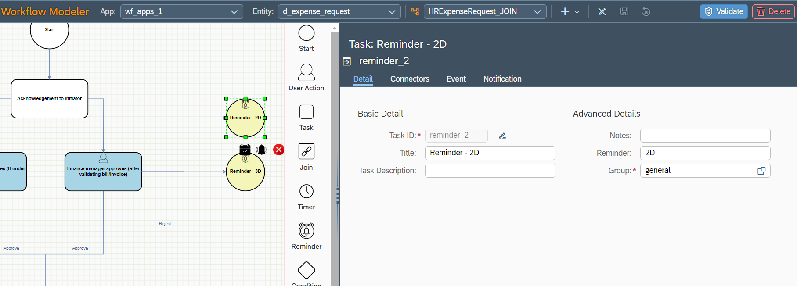

### 3.2.1.6 Condition Task

This is a diamond-shaped task used for conditional/decision-making  
Need syntax for condition task .

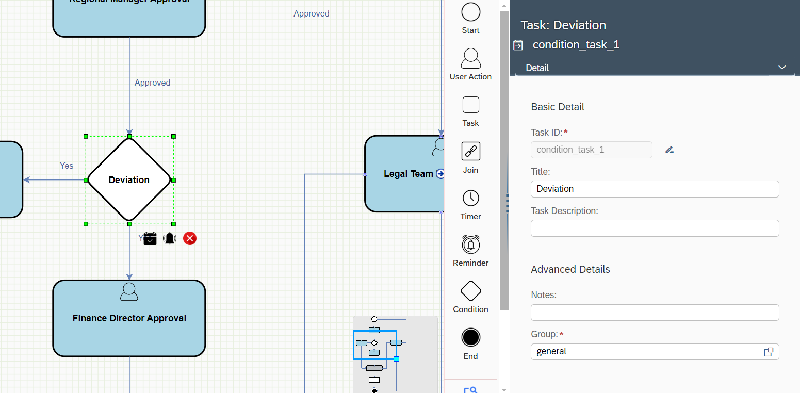

### 3.2.1.7 End Task

This is the end of the workflow. Whenever the execution flow reaches the end task shape, the workflow ends.

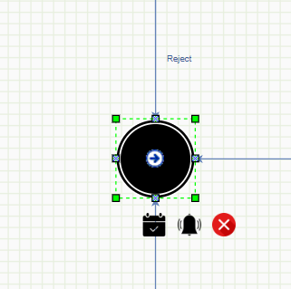

**NOTE:** We can send notifications/emails/sms through various tasks. Events can be attached to all kinds of tasks. It depends on the use case and the workflow design that leads to what and where of the specific things.

### 3.2.1.3 Block Task

These are normal tasks, used for sending email/sms/notifications and processing/updating the data.

> 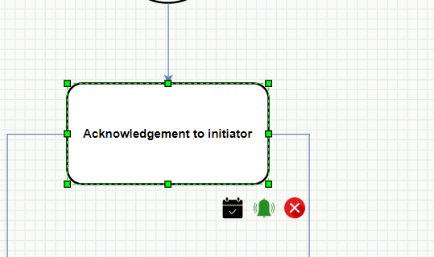
>
> 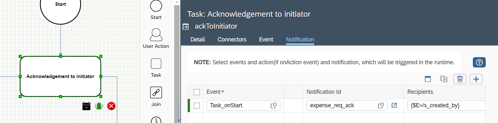

## 3.2.2. Elements of Task

Tasks contain the following elements:

### 3.2.2.1. Action

This is only for user tasks. All the actions defined for the user task, are shown in the UWL screen along with the task For adding actions for the user define task, priority is mandatory .

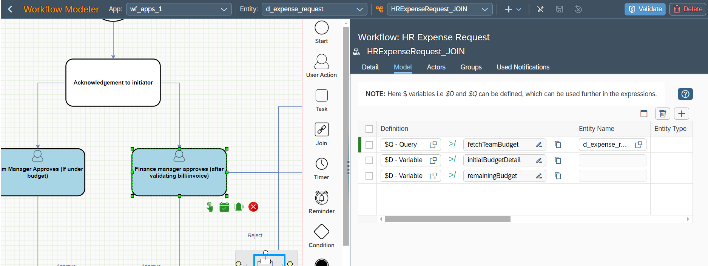

### 3.2.2.2. Event

There are 3 different types of events:

**HOOK Event :** Task_onStart, Task_onProcessing, Task_onEnd  
Hooks can be added in the event tab of the task. Used to manipulate the \$expressions by providing a left & right expression, on occurrence of the lifecycle event of the task execution.

**ACTION Event**: onAction

Action events can be added in the action tab of the task. This is also used for assignment operations of \$expressions but on occurrence of action taken by the user through UWL.

**SCHEDULE Event:** Task_onDeadline, Task_onEscalation, Task_onReminder

Schedule events can be added in User Task, if deadline,reminder,escalation are provided. On occurrence of these events through the scheduler, expression evaluation and assignment occurs based on process data provided.

All of these hooks can be called as methods of the Workflow class, where developers can write their own logic. Following standard has to be followed:

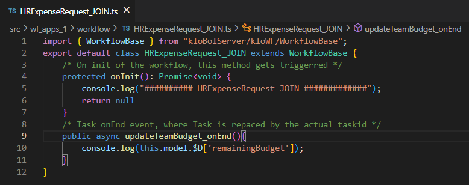

In the process column, the left side input is the path defined in the model, where the correct value will be evaluated and assigned. The right-side input can be a direct value or expression.

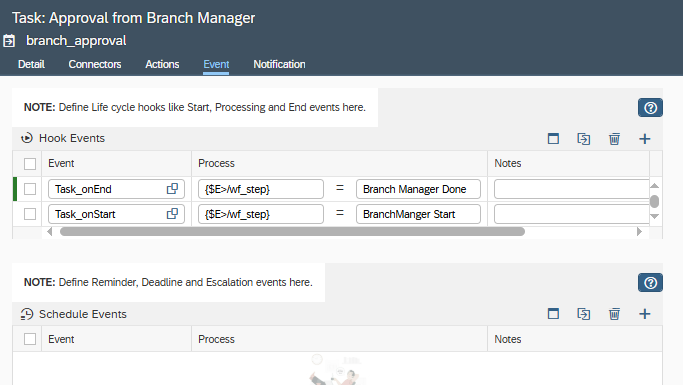

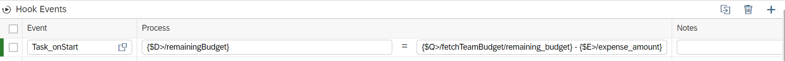

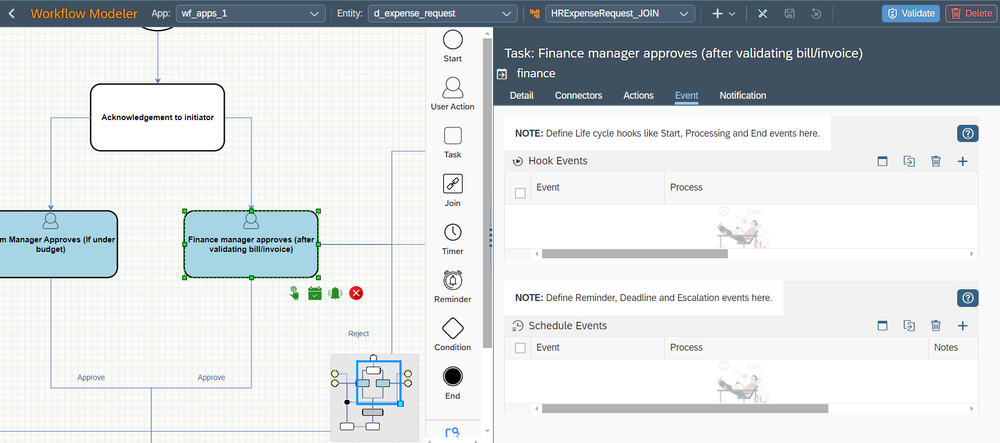

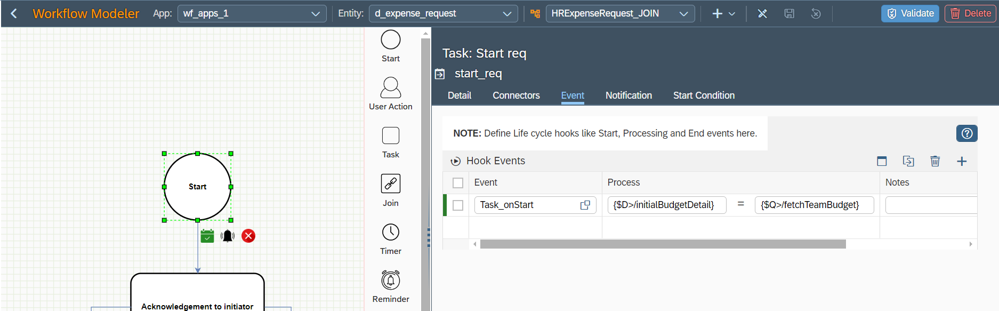

### 3.2.2.3. Notification

Hooks can be configured similarly to the **Event** tab.Instead of assigning values, **hooks are used to trigger notifications** (such as SMS or email).Based on the **template selected** and the **recipients specified**, a notification is automatically sent when the hook condition is met.

Click the **Detail** button next to the **Template VH** to view or edit the notification template configuration.

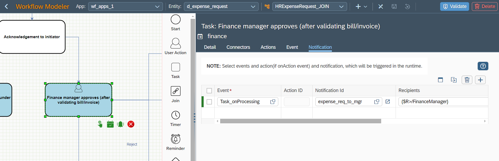

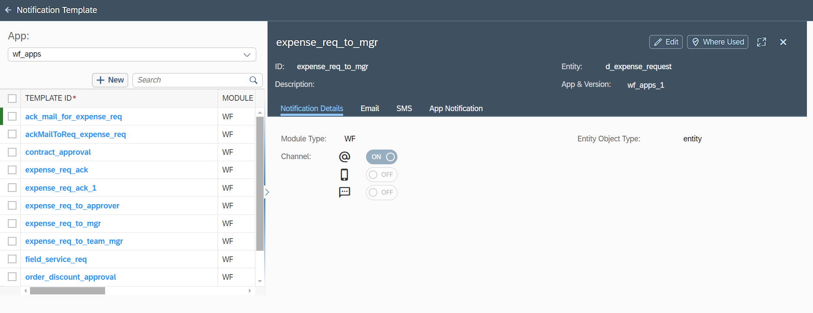

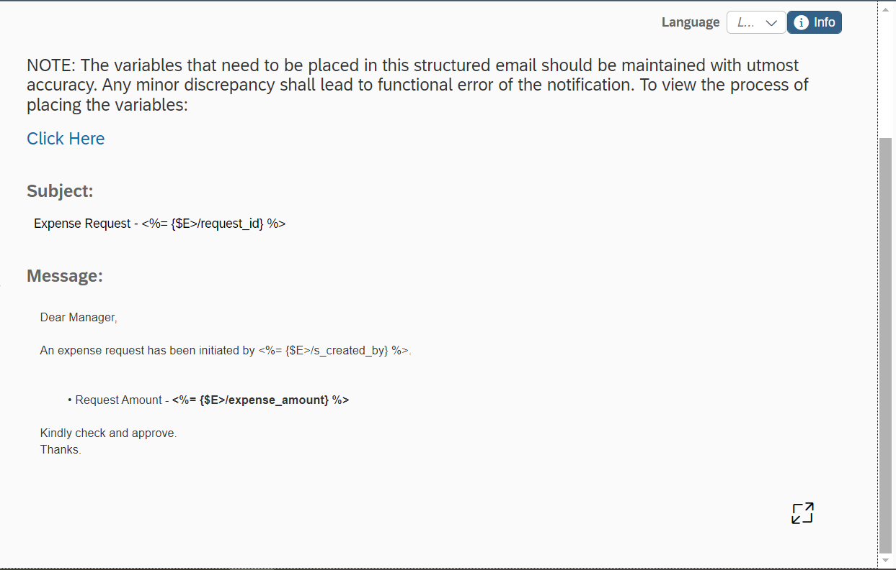

### 3.2.2.4. Connector List

This tab Displays all **outgoing connectors** from a specific task in the workflow.Each connector defines the **next step** in the workflow based on the user's action at the source task.The connectors typically represent different outcomes like approve/reject, ensuring that the process transitions correctly depending on user decisions.

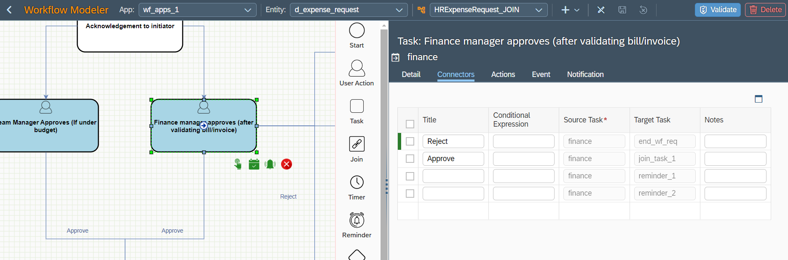

### 3.2.2.5. Start Condition

To trigger a workflow, an **entity action**, such as **onCreate, onUpdate,** or **onDelete** must be specified in the condition.

The expression field is **optional**. If an expression is provided, it must evaluate to **true** for the workflow to be initiated.

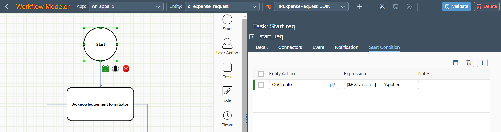

## 3.2.3. Actor

**Actors** are placeholders defined in the workflow as **expression variables**.  
At runtime, these expressions are evaluated and resolved to actual users, who will then perform the tasks assigned to them.

- The **Actor tab** is available at the **workflow header level**.

- To access it, **click anywhere on the canvas** except on shapes or connectors.

**Note**: All actors used in the workflow must first be maintained in the **mwfa_actor_resolver** table to ensure proper resolution during execution.

A task can be assigned to multiple users, and actor mappings are scoped to an application. See section 3.2.9.5.

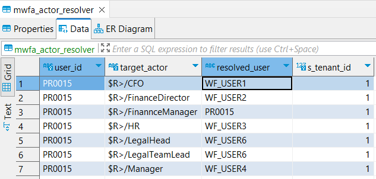

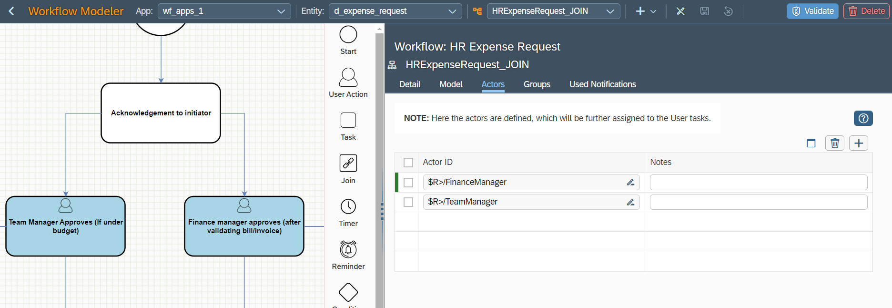

All those actors have to be defined here and can be further assigned to user tasks as mentioned in the below screenshot.

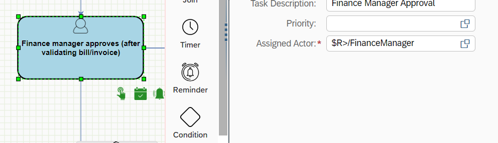

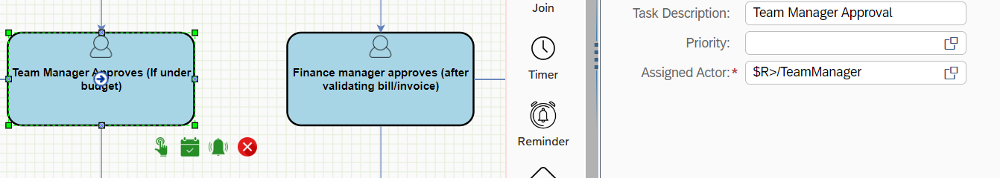

## 3.2.4 Model

The **Model List** is available at the **workflow header level**.  
Only **\$D (Data)** and **\$Q (Query)** type variables can be defined here.These variables can be used in expressions across the workflow, including in: events/notifications/connectors.

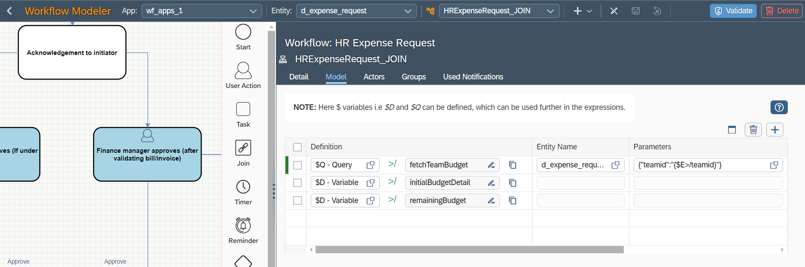

### 3.2.4.1 \$D: User-Defined

This is a user-defined variable, which can be defined in the model tab of the workflow header.It completely depends on the use case of the workflow, and how many \$D variables are required.

For instance, let's say the user has defined the variable **\$D\>/hasApproved** variable in the model section.Users can use this variable wherever expression is allowed, let it be task hooks or connectors or email/sms/notification templates.

**Example:** The defined variable is used in the connector. However, the value of this variable has to be either assigned through an event.

### 3.2.4.2. \$Q: Query

This is a query variable which can be defined in the model.

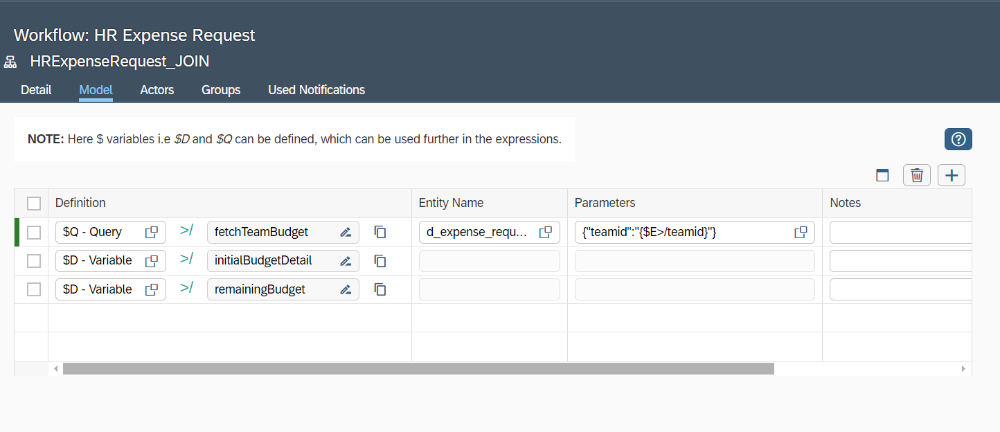

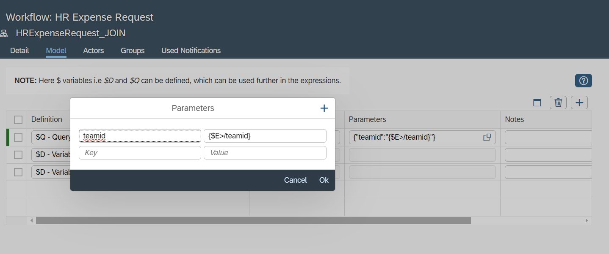

Workflow internally calls entity query with the given parameters. The resulting entity can be then available in the variable.

e.g. - \{\$Q\>/fetchTeamBudget\} in any expression returns a single entity object.

### 3.2.4.3. \$E: Lead Entity

**\$E** is predefined, hence the user cannot re-assign its value in the runtime. This contains the lead entity, upon which workflow is getting executed.

Users can access and assign values to the entity property in the following manner:

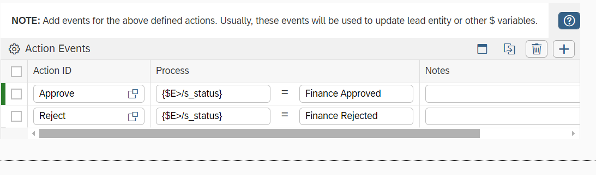

### 3.2.4.4. \$S: System

This is a system variable and cannot be declared by the user in the model.

**\$S** contains certain utilities.

For example - At any point \{\$S\>/now\} in an expression, returns the current timestamp in ms.

## 3.2.5 Group

The group is available in the header section of the workflow. This is a root entity and workflows can be mapped with groups. Individual groups can be mapped with different types of tasks in the same workflow.

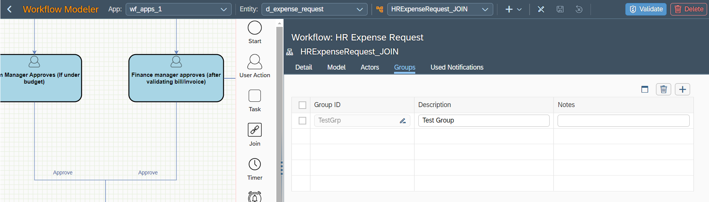

## 3.2.6 Used Notifications

This list is available in the header section of the workflow. Users can see the list of all the notifications used in the workflow.

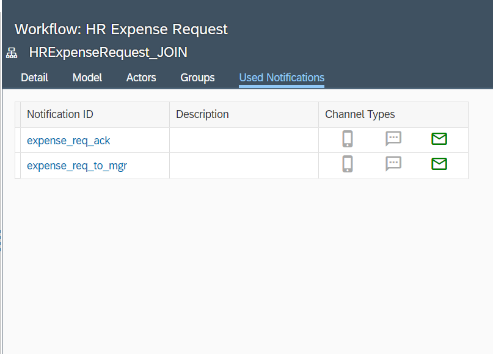

## 3.2.7.Workflow Manager

- **Mf** must be assigned.

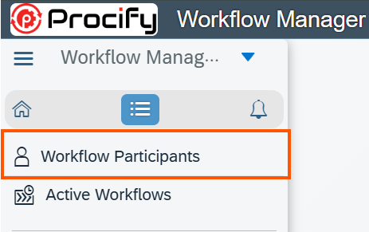
### 3.2.7.1.Workflow Participants;

Before proceeding with UWL, a **mf** must be assigned. Once assigned, the Workflow Participants section under the Workflow Manager will display a list of responsible actors along with their resolved user details and user IDs. The Workflow Manager can manage these actors by adding new ones, editing existing entries, or removing them from the workflow as needed.

Tasks can be assigned to multiple users. Actor mappings are scoped to an application.

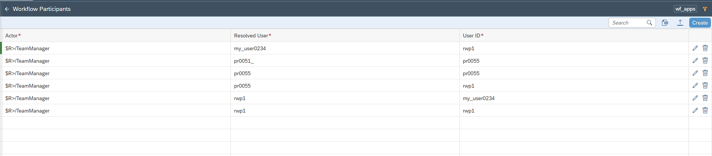

### 3.2.7.2.Active Workflows;

The **Active Workflows** screen provides a Workflow Status Diagram of the workflow that has been created. This visual display allows users to view the workflow’s structure and progression, but it is view-only and cannot be edited from this screen.

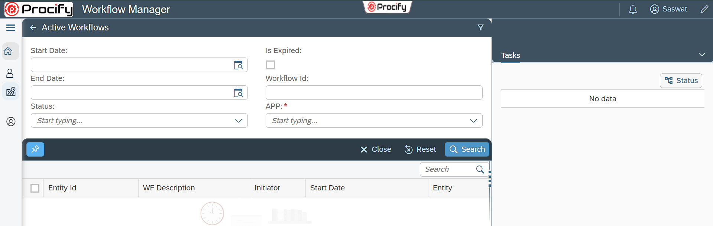

This diagram shows the current status of a workflow instance.The shapes marked indicates;

**green -\> Executed**

**Yellow -\> Pending**

**Red -\> Suspended, Failed, Expired**

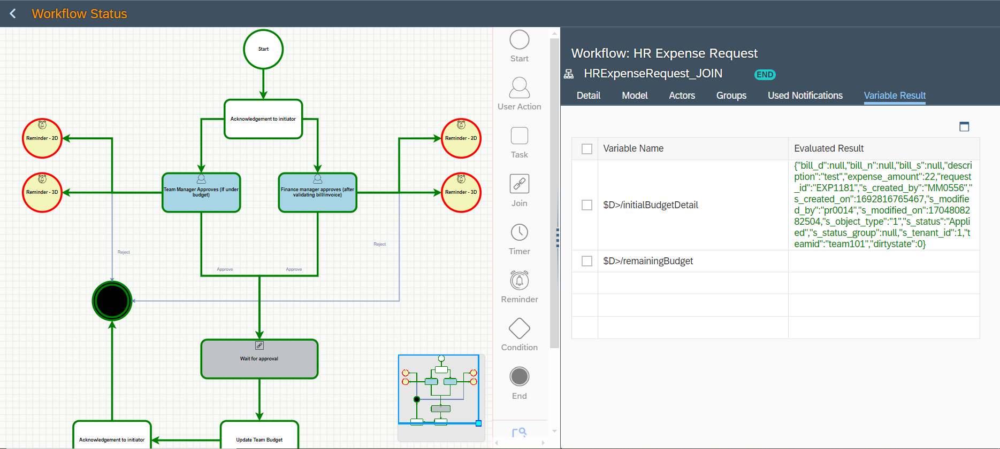

The Failed and Expired states are new. A workflow that fails moves to Failed, and a workflow whose deadline expires moves to Expired. Admins can also cancel running instances. See section 3.2.9.

In addition to the diagram, the evaluated results of \$D variables are also shown:

Once the workflow is checked and verified, it can be moved to the UWL (Universal Workflow List) for further processing or execution.

## 3.2.8. UWL (Universal Workflow List)

**UWL** must be assigned.

The **UWL (Universal Work List)** is a modifiable notification screen that displays tasks from the user tasks list. It reflects the tasks assigned to users and allows them to manage and process those tasks efficiently.

Navigate to **My Workspace** and then choose **My Submissions** to view the task details for the workflow created.

In the **My Tasks** screen, you will find options such as **Open**, **History**, and **Substituted**, which allow you to view the list of requests submitted for the actors' approval. These options provide a comprehensive view of the task statuses,remarks and their history.

Navigate to **My Workspace** and select **My Submissions** to approve or reject a created workflow .

For actors, the workflow tasks will be displayed in the **My Tasks** section, where you can review each task and take appropriate action such as approval or rejection.

## 3.2.9. Exception Handling

### 3.2.9.1. Failure Handling

When a workflow fails, it now moves to a Failed state and the failure reason is recorded.

### 3.2.9.2. Expiry

When a deadline expires, the workflow moves to a new Expired state.

### 3.2.9.3. Automatic Retry

Unexpected errors in scheduled steps are retried automatically. The retry count configurable.

### 3.2.9.4. Cancellation

Admins can cancel running workflow instances. The details of the cancellation, such as the reason for cancellation, are captured. An onCancel() hook is available to applications.
