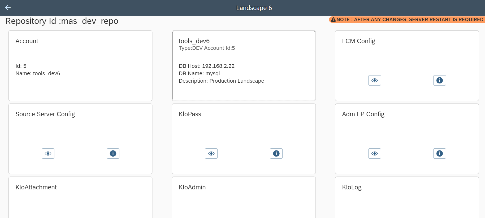
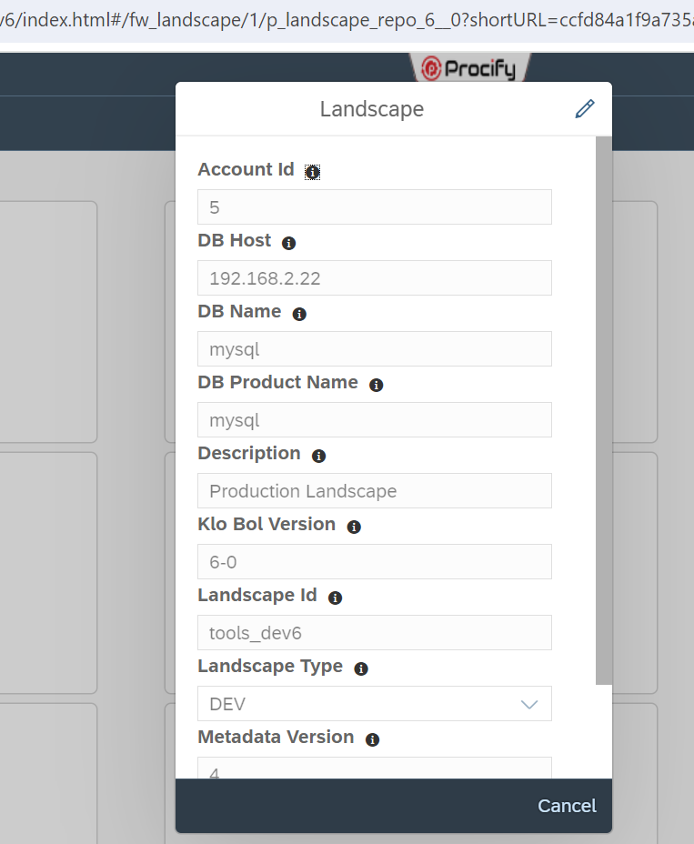

# Workspace Settings — Landscape

Landscape is a pop-up which contains various data such as DB Name, DB Product name, Description, klo Bol version, Landscape ID, Landscape Type, Metadata Version and Runtime ID. These data are editable and can be updated by users inside the landscape.

| **Fields**       | **Description**                                            |
|------------------|------------------------------------------------------------|
| Account ID       | Respective Account ID in which the work is taking place.   |
| DB Host          | This implies the database host                             |
| DB Name          | The name of the database in which the data is being stored |
| DB Product Name  | The database product name                                  |
| Description      | Description about the page                                 |
| Klo BOL Version  | The version of the BOL Editor                              |
| Landscape ID     | The landscape ID of the particular user.                   |
| Landscape Type   | The type of landscape the user is handling                 |
| Metadata Version | The metadata version used.                                 |
| Runtime ID       | Runtime ID                                                 |

###
