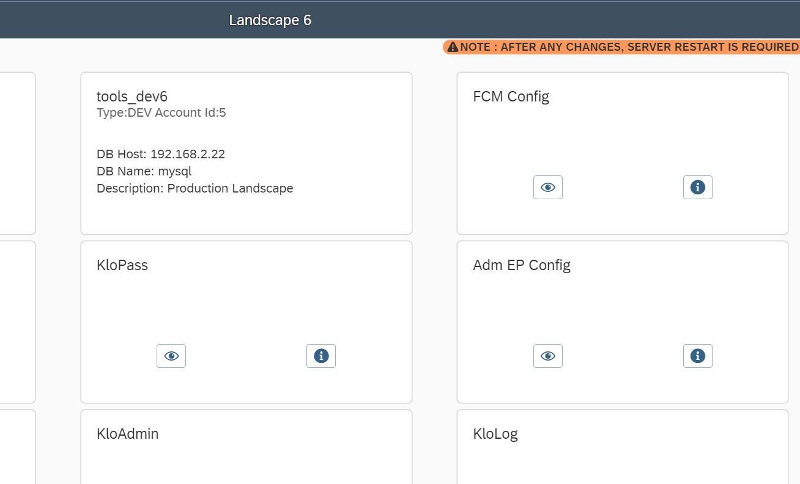
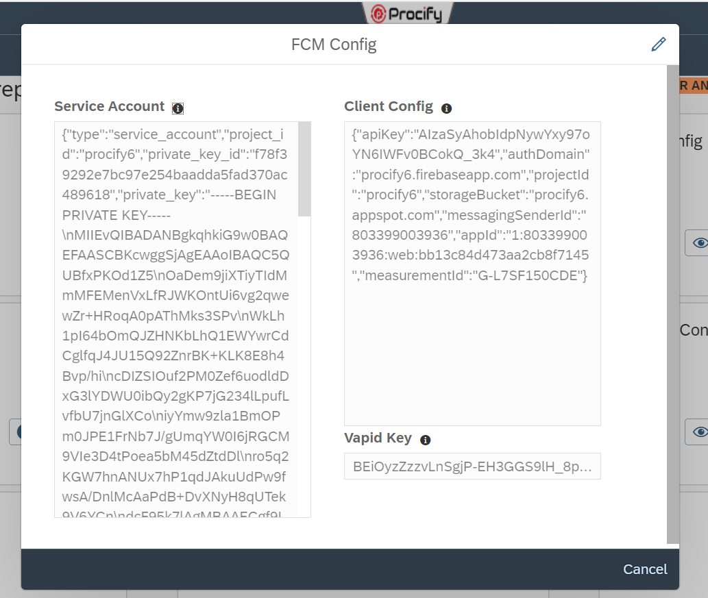

# Workspace Settings — FCMConfig

Proper JSON data must be given with all the mandatory fields.

**FCM_Config Mandatory Fields**

Service Account = \["type", "project_id", "private_key_id", "private_key", "client_email", "client_id"\];  
Client Config = \["apiKey", "authDomain", "projectId", "storageBucket", "messagingSenderId", "appId", "measurementId"\];
