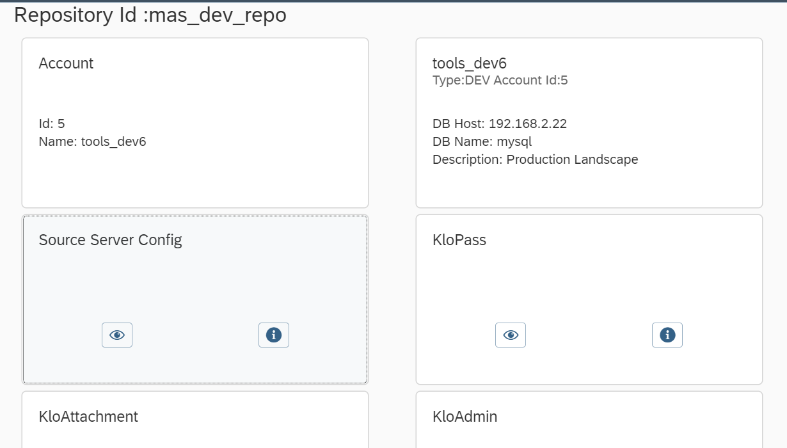
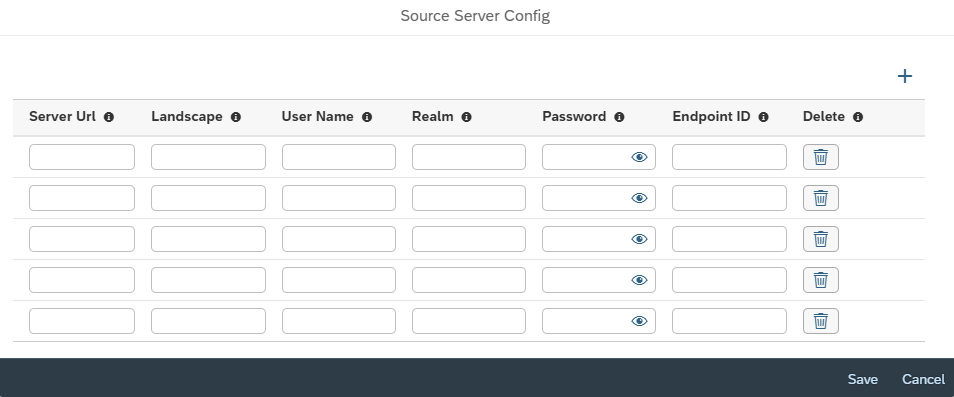

# Workspace Settings — Source Server Config(KloOnlineServer)

Maintaining the Source Server Config ensures the transport source systems are properly maintained within the specific system.

Explanation: [*KloServerOnline*](https://docs.google.com/document/u/0/d/1yugGgrPbaQ-sLD1VHvLcnoyIM77552HfnOH_VsoRKWA/edit)
