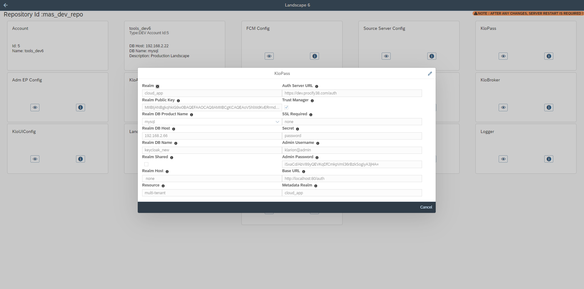

# Workspace Settings — KloPass

This dialog helps the users to edit klopass fields which include Realm, Realm Public key, Realm DB Product Name, Realm DB Host, Realm DB Name, Realm Shared, Realm host, Resource, Auth Server URL, Trust Manager, SSL required, Secret, Admin username, admin password, base url and metadata realm.

Description for the above fields are as follows:

| **Fields**            | **Description**                              |
|-----------------------|----------------------------------------------|
| Realm                 | This field shows the keycloak realm.         |
| Realm Public          | We can get the public key from keycloak      |
| Realm DB Product Name | Realm DB Product Name                        |
| Realm DB Host         | Realm Database Host IP Address               |
| Realm DB Name         | Realm Database Name                          |
| Base URL              | The portal in which the keycloak is running. |
| Auth Server URL       | Keycloak login URL.                          |
