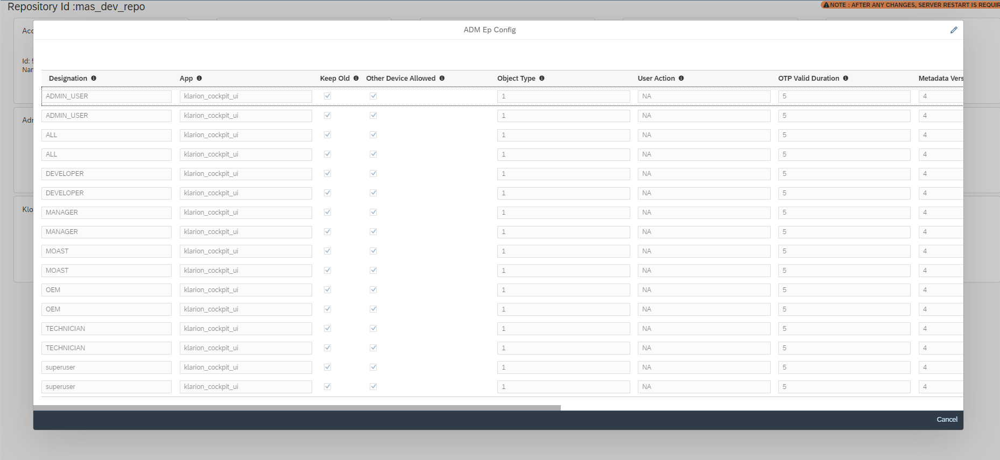

# Workspace Settings — Adm Ep Config

This dialog contains fields such as Designation, App Variant, Keep Old, Other Device Allowed, Object Type, Created By, Modified By, User Action, OTP Valid Duration, Is Raw, Metadata Version, Flavor Variant, Channel Type, Landscape, Deleted, Notification Type, Created On, Modified On, Delete.

[TABLE]
