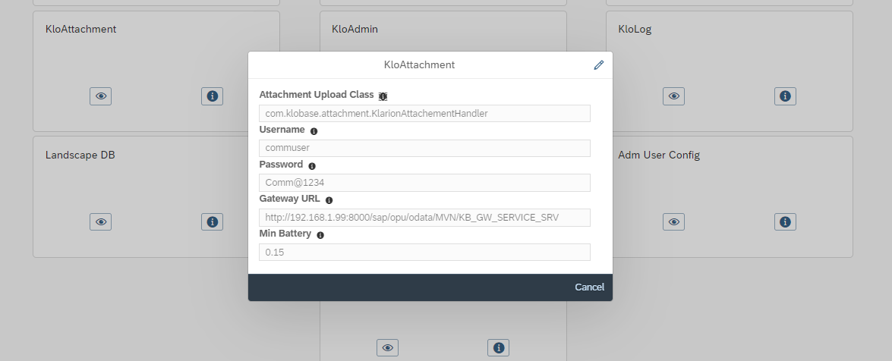

# Workspace Settings — KloAttachment

This tile provides the user to update the kloattachment data fields such as attachment upload class, username, password, gateway url and minimum battery.

Description for the above fields is as follows:

| **Fields**              | **Description**                                                           |
|-------------------------|---------------------------------------------------------------------------|
| Attachment Upload Class | Here we are providing the Java classpath.                                 |
| Username                | Username for gateway url.                                                 |
| Password                | Password for gateway url.                                                 |
| Gateway URL             | Here we maintain the SAP url. It is different for QA, DEV and production. |
| Min Battery             | Minimum battery required in the device.                                   |

###
