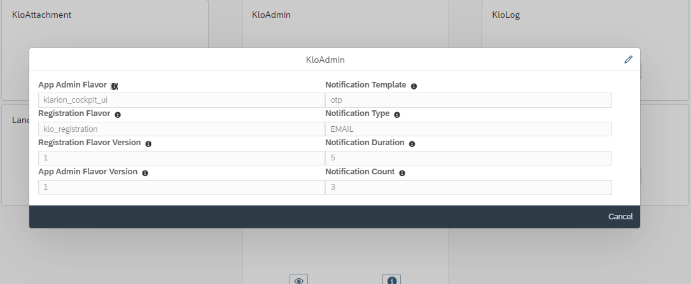

# Workspace Settings — kloAdmin

This tile allows the user to edit fields such as app admin flavor, registration flavor, registration flavor version, app admin flavor version, notification template, notification type, notification duration and notification count.

Description for the above fields are as follows:

| **Fields**            | **Description**                                                                                                                                                                                                                  |
|-----------------------|----------------------------------------------------------------------------------------------------------------------------------------------------------------------------------------------------------------------------------|
| Registration Flavor   | We have to mention what is the registration flavor here in this column. For ATL they require customization, so they have different names. (If you require some changes to be done in the flavor maintain that flavor name here.) |
| Notification Duration | If we are sending an OTP, it should be valid for a few minutes before it expires.                                                                                                                                                |
| Notification Count    | If the OTP is not received by the user, the number of times the user is allowed to click on resend the OTP. After the maximum attempts are over, the user is blocked in the keycloak.                                            |

###
