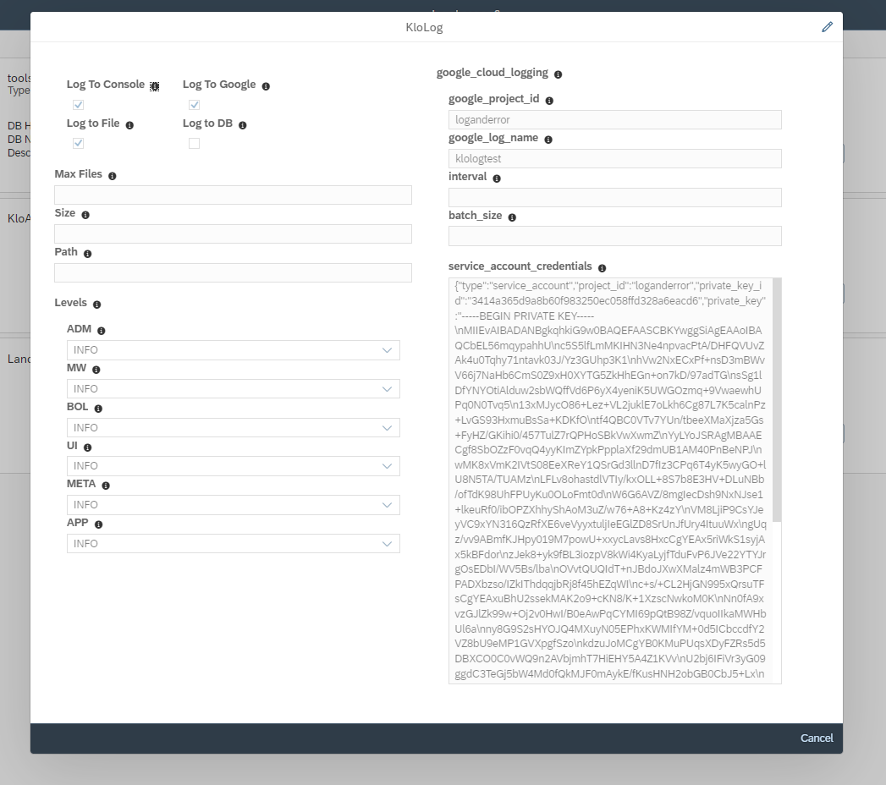

# Workspace Settings — kloLog

This dialog allows users to edit kloLog data fields such as enable query count and system CPU memory.

Proper JSON data must be given with all the mandatory fields.

**MM_KloLog Mandatory Fields**

Service Account= \["type", "project_id", "private_key_id", "private_key", "client_email", "client_id"\];
