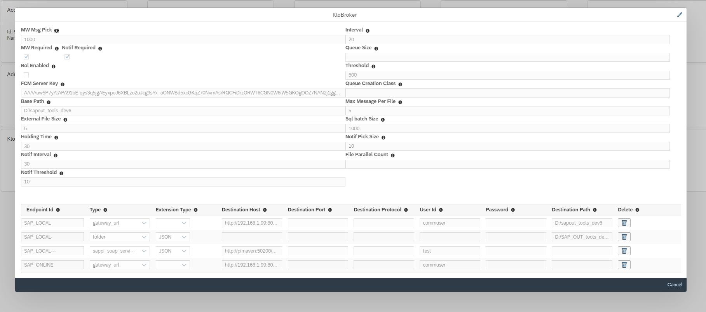

# Workspace Settings — kloBroker

kloBroker is a broker between tenants, clients, and external systems. It enables communication via messaging and queues. kloBroker runs on the master node in the kloSystem. There can be multiple instances, one per kloLandscape.

This dialog allows the user to modify klobroker fields such as mw_msg_pick, mw required, notif required, bol enabled, fcm server key, base path, external file size, holding time, notif interval, notif threshold, interval, queue size, threshold, queue creation class, max message per file, SQL batch size, notif pick size and file parallel count.

This dialog also allows CRUD on klobroker external fields which contain endpointid, type, destination host, destination port, destination protocol, user ID, password, and destination path.

Description for the above fields are as follows:

| **Fields**         | **Description**                                                                                                                                                                                     |
|--------------------|-----------------------------------------------------------------------------------------------------------------------------------------------------------------------------------------------------|
| MW Msg Pick        | This implies the number of messages middleware can pick from the tenant_q table.                                                                                                                    |
| MW Required        | This implies whether middleware is required or not.                                                                                                                                                 |
| Notif Required     | Server will send push notifications to the device. It will push all notifications to one table(ma_notification_queue).                                                                              |
| FCM Server Key     | To sync the message from the server to the device, fcm_server_key is mandatory.                                                                                                                     |
| Base Path          | SAP will put files in this folder and the server will pick files.                                                                                                                                   |
| External File Size | Size of the external files                                                                                                                                                                          |
| Notif Interval     | It will check in the queue at intervals whether the messages are present or not.                                                                                                                    |
| Notif threshold    | The Maximum number of notifications the server will pick.                                                                                                                                           |
| Interval           | For how much time the DB needs to be checked, the Server will check whether the file is available or not in the sap in the folder and if the file is available then it will process or it will not. |
| Threshold          | The number of messages the server will hold at a time.                                                                                                                                              |
| Notif pick size    | The number of notifications it can pick at a time                                                                                                                                                   |

###  1.8.1. KLO_BROKER_EXT

This will only consider **SAP_LOCAL** or **SAP_ONLINE**. It will not consider if it has any extra symbols or any extensions like **SAP_LOCAL\_** or **SAP_LOCAL**.

Description for the above fields are as follows:

| **Fields**       | **Description**                                                                                                                               |
|------------------|-----------------------------------------------------------------------------------------------------------------------------------------------|
| SAP_LOCAL        | If something is being saved in the DB, then it will go to tenant_q and save in the klarion db, then we need to push to SAP as a JSON message. |
| SAP_ONLINE       | When we are directly accessing the SAP server without saving in our db, in this case, we use SAP_ONLINE.                                      |
| TYPE             |                                                                                                                                               |
| Destination Host | Here we are maintaining the url provided by SAP.                                                                                              |
| User Id          | User Id provided by SAP for the url.                                                                                                          |
| Password         | Password provided by SAP for the url.                                                                                                         |
| Destination Path | When the type is a folder, then we specify a path here.                                                                                       |

###### Note : 

File processing. When processing SAP messages by file, **txn_user_id** has to be maintained in **KloBroker** configuration, or else, the generated messages will go to error q without user in transaction. The user ID maintained should have required application, row wise authorization(If required), permissions assigned.

