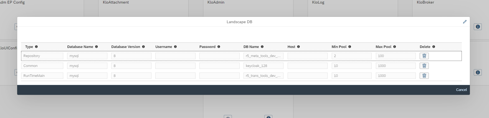

# Workspace Settings — Landscape DB

This dialog allows the user to update the landscape db fields such as database type, dbname, dbversion, username, password, host, min pool and max pool.

Description for the above fields:-

| **Fields**       | **Description**                                          |
|------------------|----------------------------------------------------------|
| Database Name    | Database client name.                                    |
| Database Version | Version of the DB client that is currently being used.   |
| Username         | Name of the DB user to connect to the database.          |
| Password         | Password to connect to DB.                               |
| DB Name          | Name of the database that is currently being used.       |
| Host             | IP address of the system which is currently being used.  |
| Min Pool         | Minimum connections that can be used by the application. |
| Max Pool         | Maximum connections that can be used by the application. |

