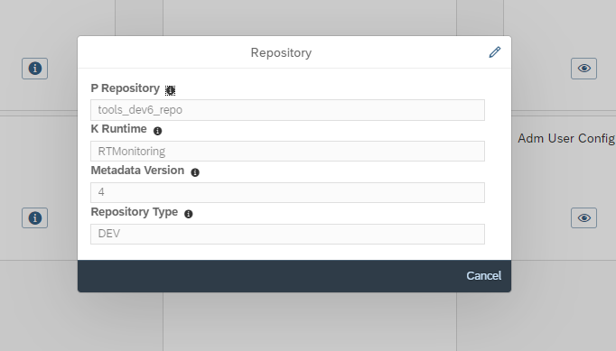

# Workspace Settings — Repository

This dialog allows the users to update the m_repository data fields such as **Landscape**, **P repository**, **k runtimes**, **Metadata Version**, and **Repository Type**.

