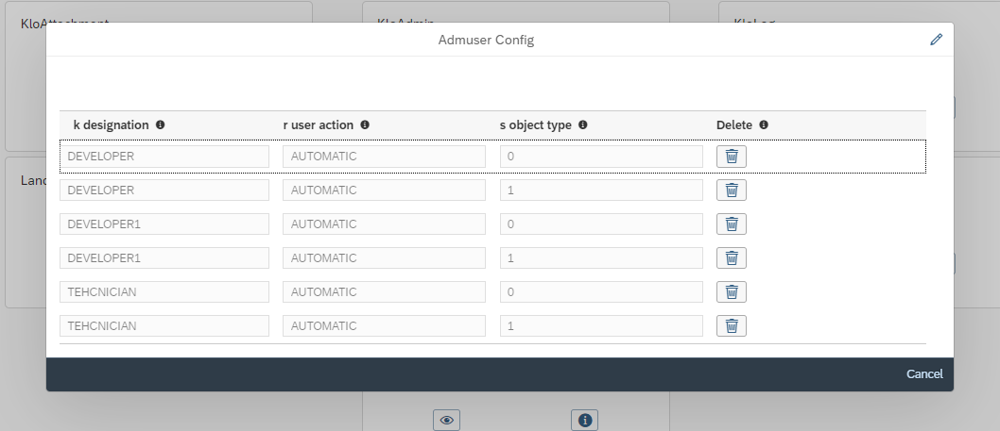

# Workspace Settings — Adm User Config

This dialog shows the data for **ma_adm_user_config** from the config file. Users can add a new entry, edit the existing data or delete any entry.

This dialog contains fields such as **k_designation**, **s_object_type**.

Description for the above fields are as follows: -

[TABLE]

