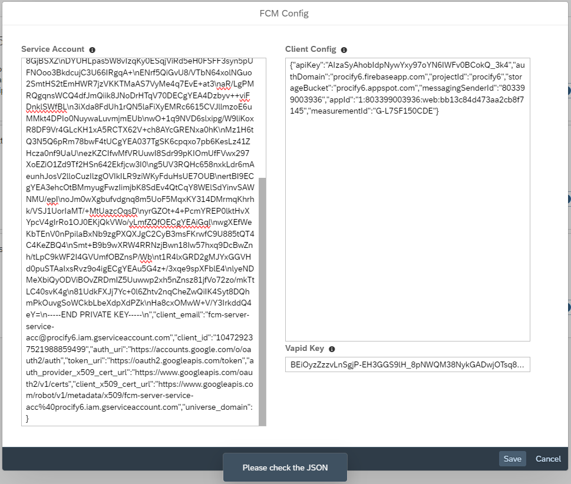
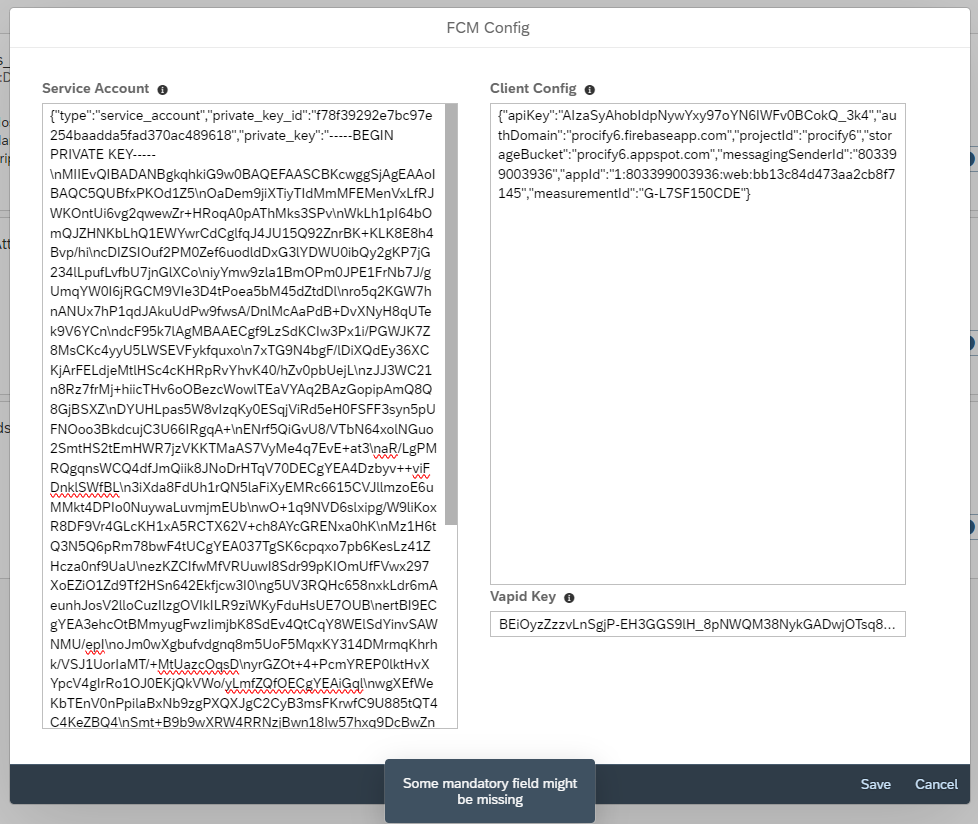
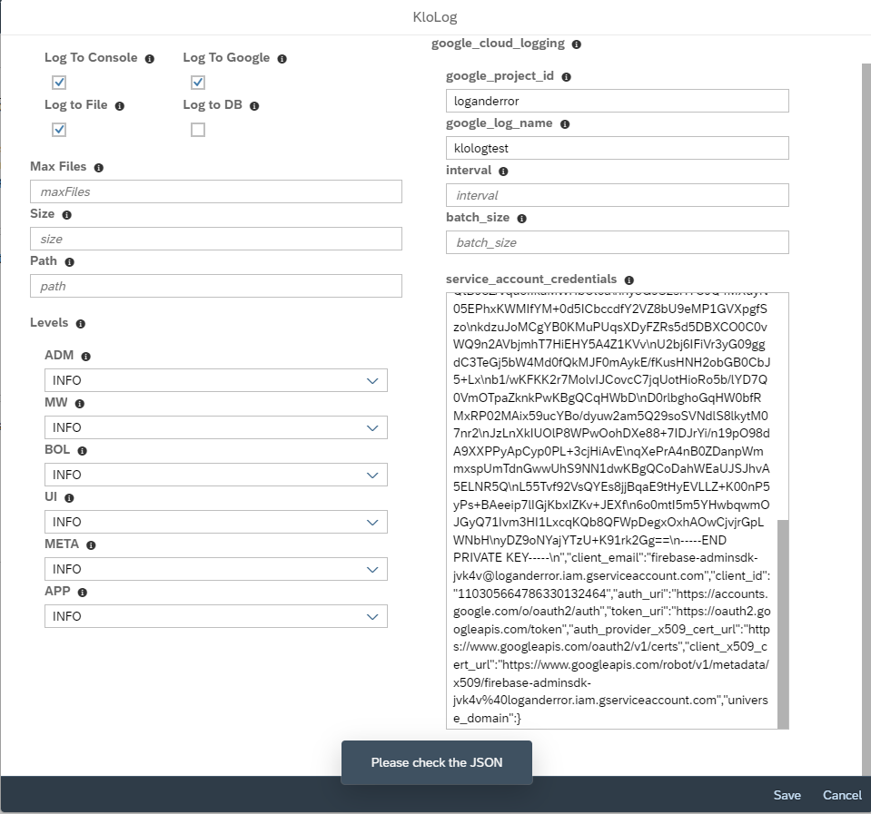
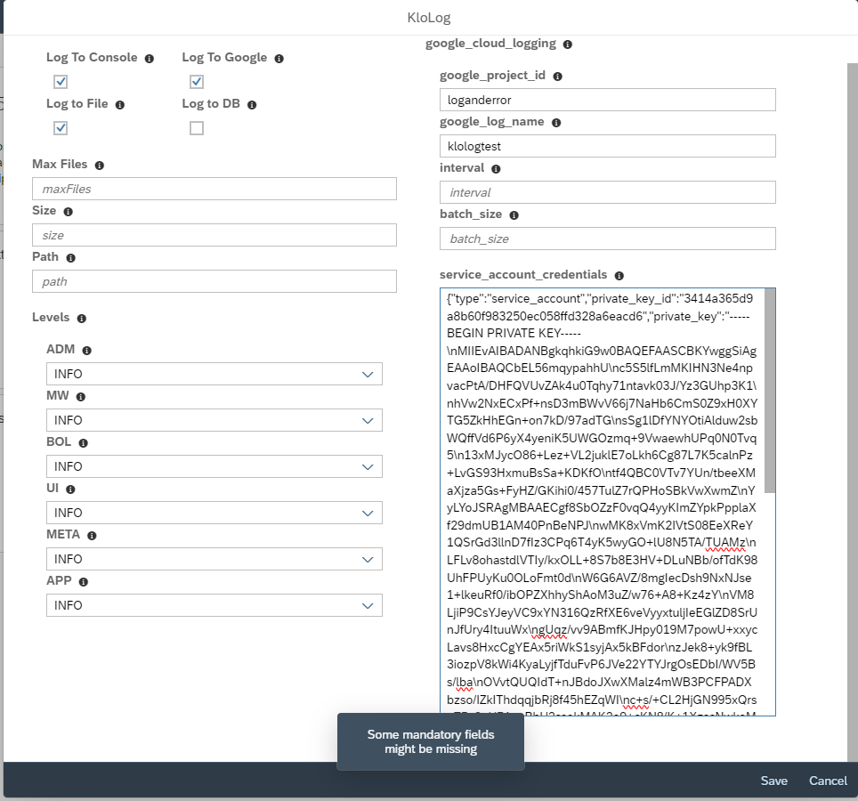
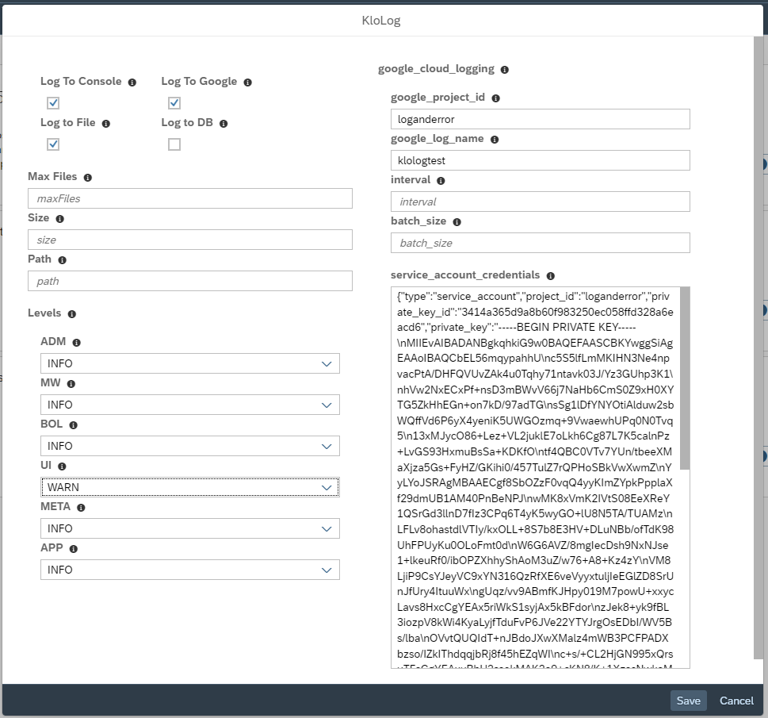
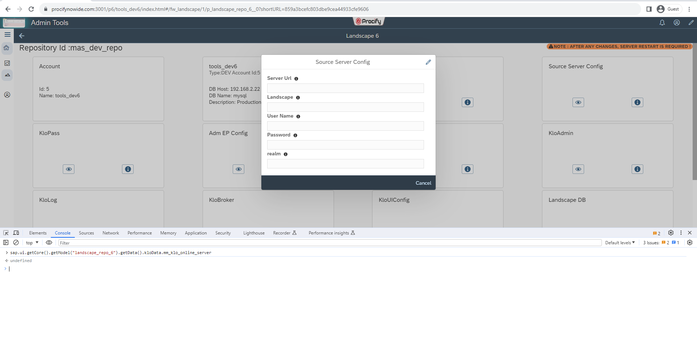
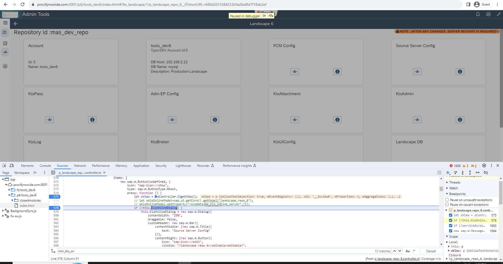
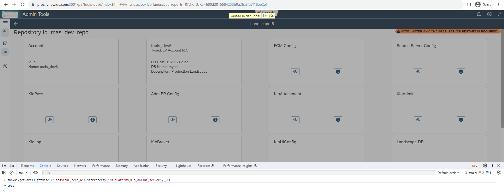
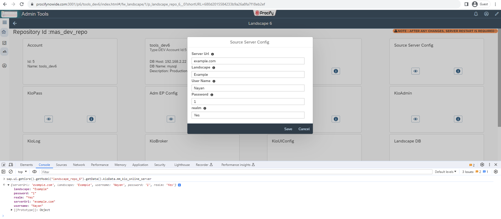

# Workspace Settings — Test For Newly Added/Modified Properties.

**Only limited crud operations were done.**

Data changes in the model were confirmed.

##  FCM Config 

Correct json needs to be passed to SAVE  
  
  

Mandatory fields are required to SAVE (“project_id” was removed to check the above)

###  Mandatory Fields:

| **Fields**      | **Required**                                                                                             |
|-----------------|----------------------------------------------------------------------------------------------------------|
| Service Account | \["type", "project_id", "private_key_id", "private_key", "client_email", "client_id"\];                  |
| Client Config   | \["apiKey", "authDomain", "projectId", "storageBucket", "messagingSenderId", "appId", "measurementId"\]; |
| Vapid Key       | Mandatory                                                                                                |

## KloLog

  
Correct JSON needs to be passed to SAVE.  
  
  
Mandatory fields are required to SAVE.(“project_id” was removed to check the above)

###  Mandatory Fields:

| **Fields**      | **Required**                                                                            |
|-----------------|-----------------------------------------------------------------------------------------|
| Service Account | \["type", "project_id", "private_key_id", "private_key", "client_email", "client_id"\]; |

Change the **UI** of **Levels** to Test.

## Source Server Config

**\*\*DON’T SAVE\*\***

As there isn’t a property for Source Server Config  
Property needs to be added manually for now to test. (not mandatory to test)  
  
  
  
While on this breakpoint  
  
  
Run the bellow line in the console;  
sap.ui.getCore().getModel("landscape_repo_6").setProperty("/kloData/mm_klo_online_server",{});  
  
It will create a property named “mm_klo_online_server” in the config.  
  
  
  
Changes will be noticed in the Model.  
**\*\*DON’T SAVE\*\***
