# Workspace Settings — Configs

Only the below configs are available for now:

- mm_notification

- ma_notification_config\*

- mm_kloattachment

- m_repository

- mm_klolog

- mm_klopass

- mm_klobase\*

- mm_kloadmin

- fcm_config

- mm_landscape

- mm_klobroker

- mm_klobroker_ext

- ma_adm_user_config

- ma_adm_ep_config

- mm_landscape_db

- Logger

- notification

- Sap configuration

## 1.15. Sap Config

### 1.15.1 Application creation Wizard

#### **1.15.1.1. Business Requirement**

Application configuration wizard is to create a new application in the system by taking the necessary information, an application can also be created by taking a reference of an existing application.

#### **1.15.1.2. Prerequisites**

- All configuration tables in the system.

- The Application wizard and its components in the system.

#### **1.15.1.3.Process Flow**

**Path** : Wizards → Application Wizard

**Tcode** : /MVN/APP_WIZARD

**Report** : /MVN/RP_APP_WIZARD

Execute the **Tcode** or use **Menu** to open the wizard. It enters the start page of the wizard as shown below.

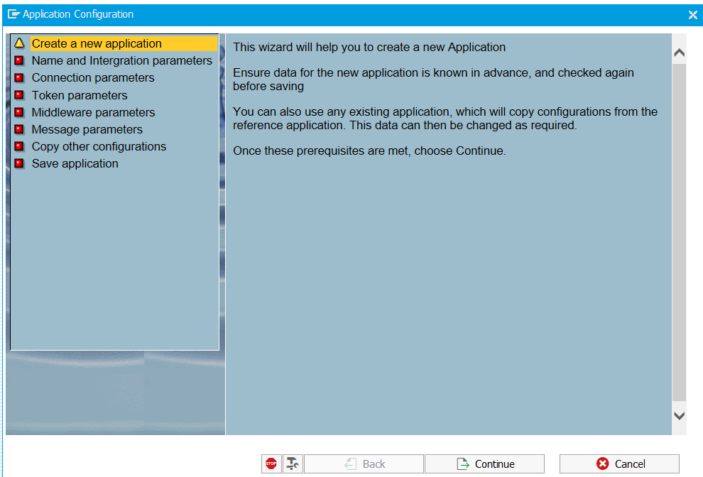

##### **Wizard steps**

- Please read the guidelines provided in each step of the wizard carefully before proceeding with the execution of that step.

##### **Name and Integration parameters**

- This step is for setting up the application configuration.

| **Input**           | **Purpose**                                                                      | **Possible values**           |
|---------------------|----------------------------------------------------------------------------------|-------------------------------|
| Application-Version | App and version of the newly created app.                                        | Eg:eam-1                      |
| Integration Mode    | Integration mode of app                                                          | Online/ Offline               |
| Integration Type    | Integration type of app                                                          | File/Gateway/PI or PO         |
| Reference From      | All Informations will be copied from the reference app to the newly creating app | Existing App name and version |

- Enter all the required input as shown above and click continue to proceed to the next step.

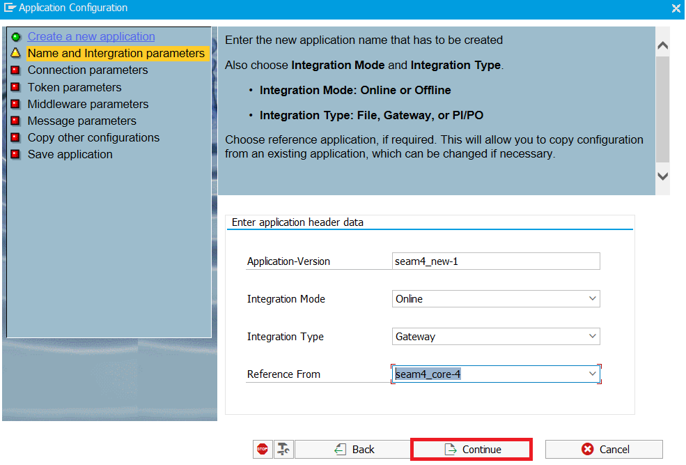

##### **Connection parameter**

- This step is to provide the Connection parameters of the application.

| **Input**       | **Purpose**          | **Possible values** |
|-----------------|----------------------|---------------------|
| Gateway/PI URL  | URL of gateway or PI |                     |
| Gateway RFC     | Gateway RFC name     |                     |
| Inbound folder  | Inbound folder path  |                     |
| Outbound folder | Outbound folder path |                     |

- Enter all the required input as shown above and click continue to proceed to the next step.

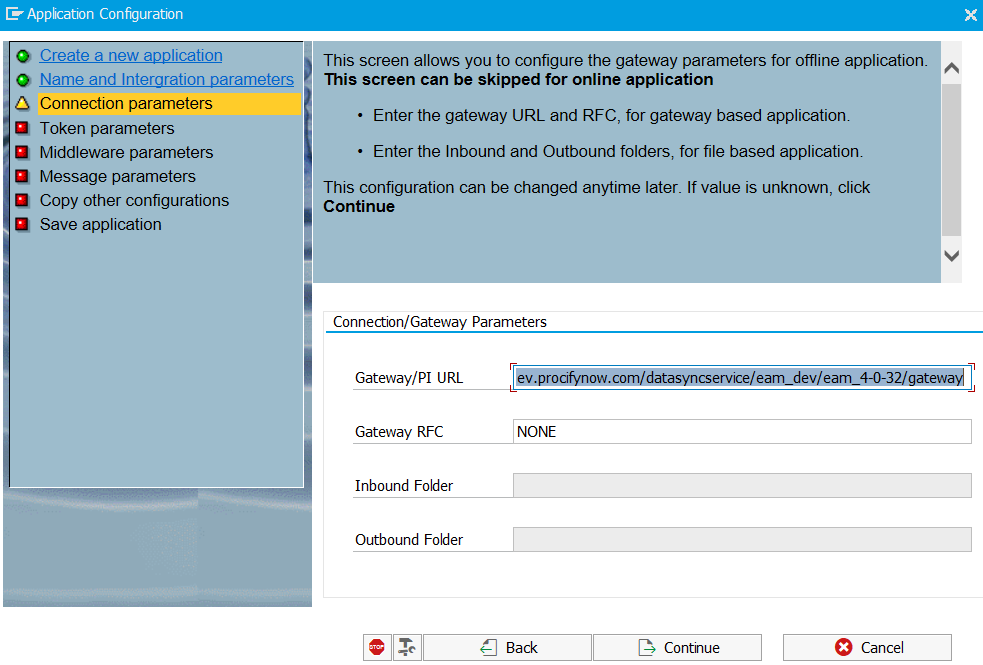

##### **Token parameter**

- This step is to configure the token parameter of the application for the provided gateway information.

| **Input**           | **Purpose**                 | **Possible values** |
|---------------------|-----------------------------|---------------------|
| Token URL           | Token url                   |                     |
| Username            | User name of the URL access |                     |
| Password            | Password of the URL access  |                     |
| SSL ID              | SSL ID of the connection    |                     |
| Proxy               | Proxy                       |                     |
| RFC: Gateway to SAP | Gateway to SAP RFC          |                     |

- Once all token parameters are provided, click the ‘TEST’ icon to verify the connection.

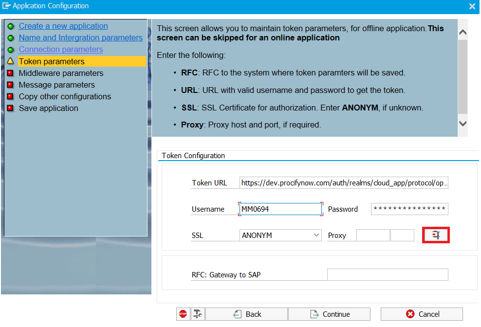

- This will display the connection status as shown below.

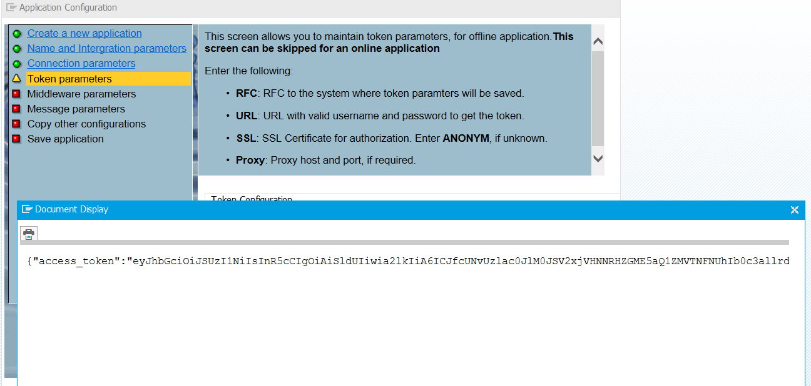

- Click on continue to move to the next step.

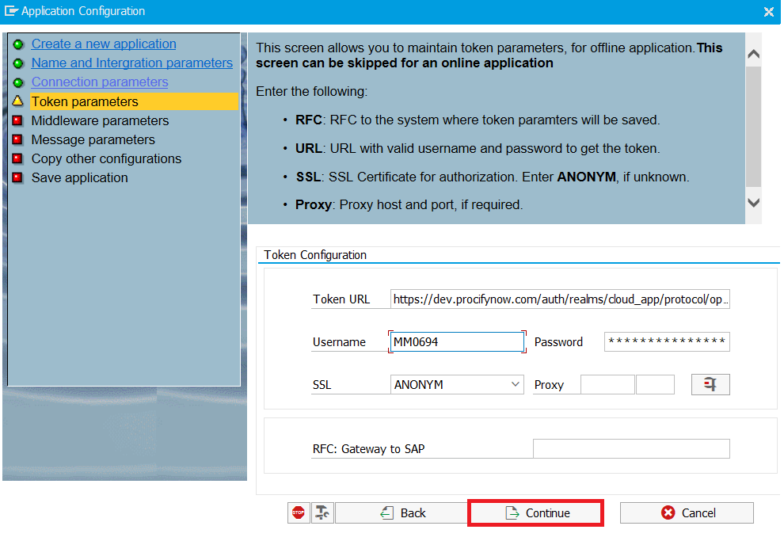

##### **Middleware parameter**

- Modify the default middleware parameter values in this step according to the requirements, then click continue to proceed to the next page.

- Click the ‘Del’ icon in the table to remove parameters.

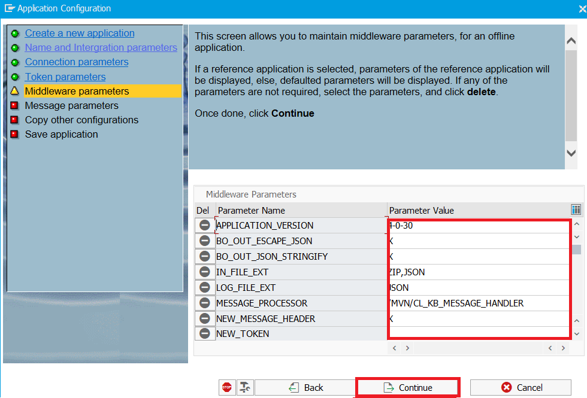

##### **Message parameter**

- Edit the default message parameters in this step based on the requirement and click on continue to move on to the next page.

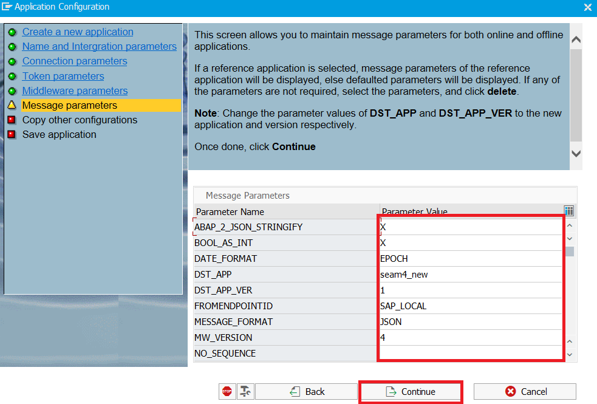

##### **Copy other configurations**

- This step involves selecting the configurations to be copied to the new app if a reference app is available.

| **Input**             | **Purpose**                                      | **Possible Values** |
|-----------------------|--------------------------------------------------|---------------------|
| Profile determination | To copy the profile determination configurations |                     |
| BO Handler            | To copy the BO Handler configurations            |                     |
| Klo Model             | To copy the Klo Model configurations             |                     |
| F4 Mappings           | To copy the F4 Mappings configurations           |                     |

- Select the checkbox if the specified configurations should be copied.

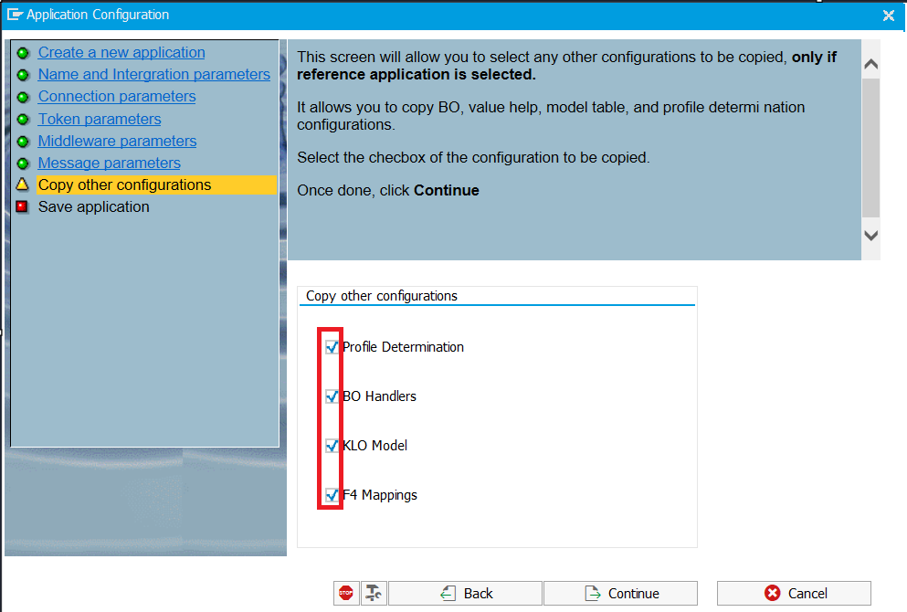

- This applies only if a reference app is provided in the Name and Integration parameters section.

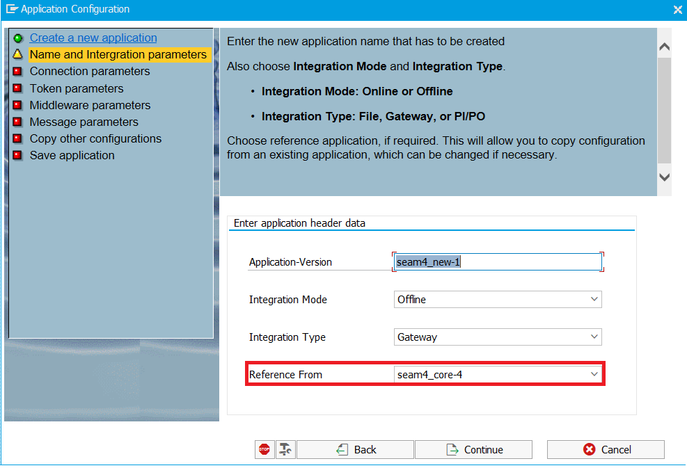

##### **Wizard Finish**

- Review the provided details in the wizard summary and click the Complete button to finalize the application creation.

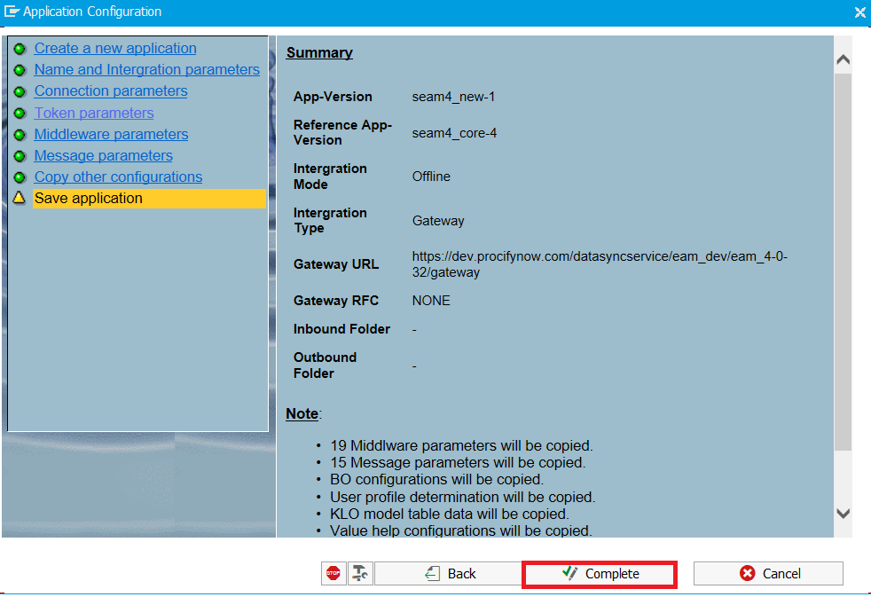

#### 1.15.1.4. Wizard Results

- An application is created with the provided details as below,

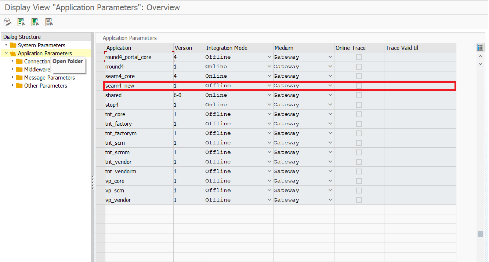

##### **Connection Parameters:**

**Path**: Klobase Configuration cockpit -\> Application configuration -\> Application Configuration

**T-code** : /MVN/KB_VC_APP_CONF

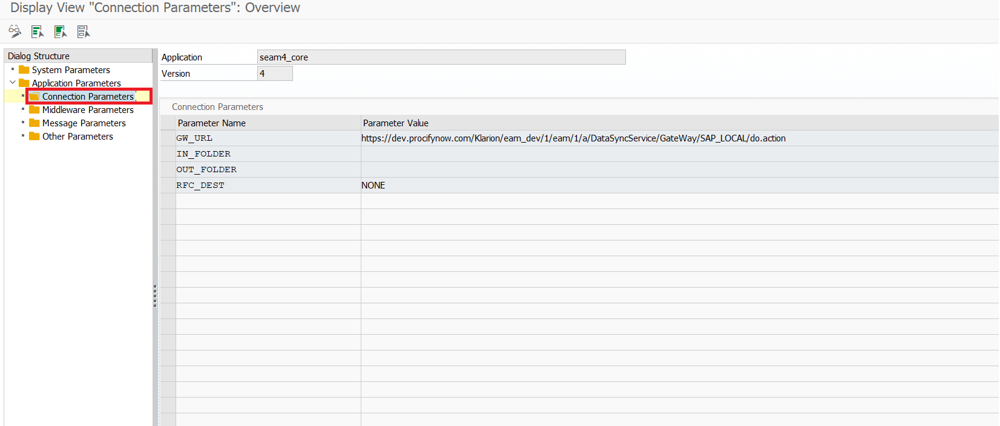

##### **Middleware Parameters:**

**Path**: Klobase Configuration cockpit -\> Application configuration -\> Application Configuration

**T-code** : /MVN/KB_VC_APP_CONF

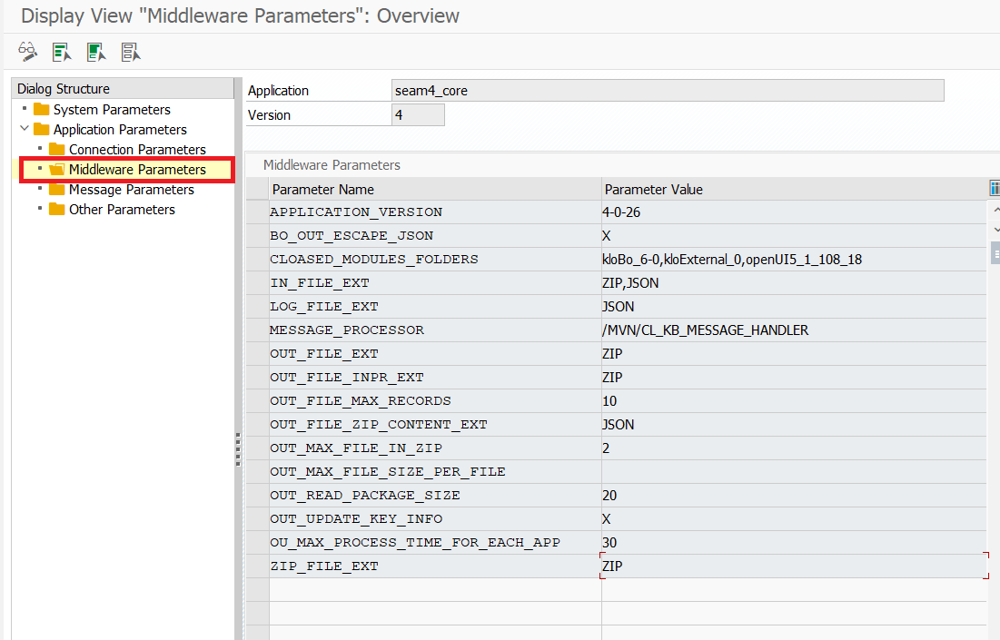

##### **Message Parameters**

**Path:** Klobase Configuration cockpit -\> Application configuration -\> Application Configuration

**T-code** : /MVN/KB_VC_APP_CONF

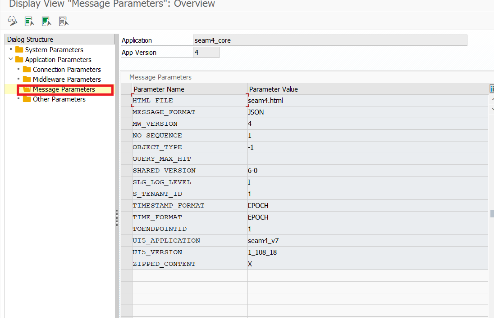

##### **Other Configurations**

If the reference app is provided, the Properties selected in the ‘’Copy Other configuration’’ sections such as Profile Determination, Bo Handler, Klo model and F4 mapping will be copied.
