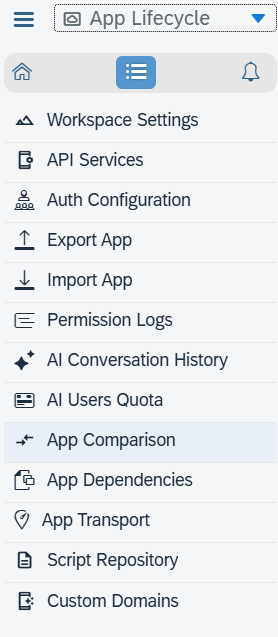
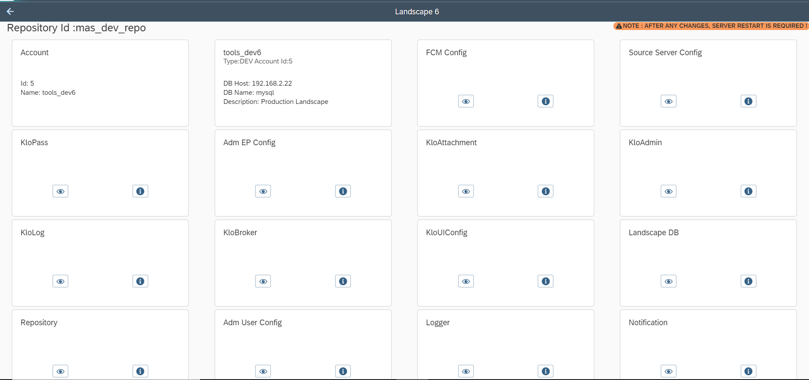

# Workspace Settings — Navigating to Workspace Settings

**Step 1- Go to App LifeCycle**

In the menu, select App Lifecycle

**Step 2 - Select Workspace Settings**

In the **App Lifecycle** there are a lot of options, select Workspace Settings.

The Workspace Settings screen will appear.

