# Procedure

1.  The same Project Android needs to be copied

2.  Application url, Landscape and App ID should be maintained on the configfile at \{Project_Name\}/scripts But in the case of generic IPA, you have to skip these steps.

> Example:
>
> 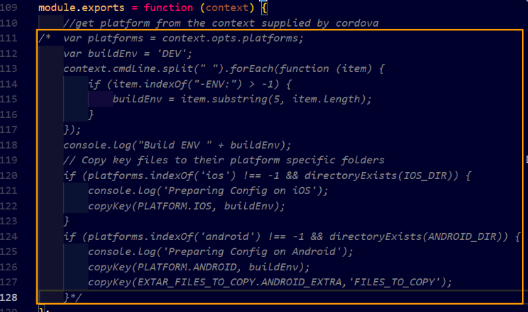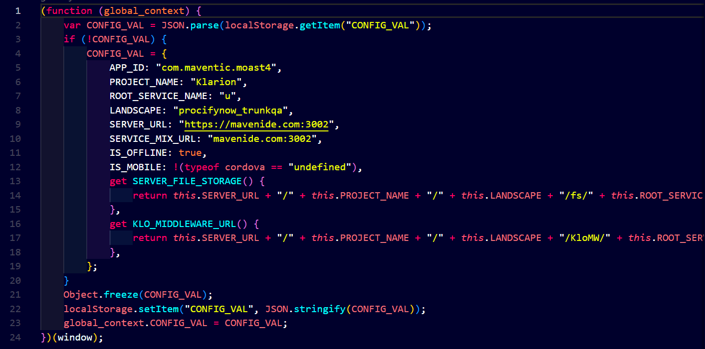

3.  On Modification of the platform. It is advised to remove and add the Platform

4.  Platform of Android or ios(if you need to change the version of the ios platform) needs to be removed using the below command

- **cordova platform rm android** -- To remove the Android platform from the cordova project

- **cordova platform rm ios** -- To remove the ios platform from the cordova project

5.  If we need some additional functionality like a camera, fcm and barcode scanner we need some additional plugins for its work which will be already there in the project. If we need additional plugins we should add plugins. To view the existing plugins execute the **cordova plugins** command to get the list of the plugins available

6.  Add the ios platform(the latest version needs to be chosen)

- **cordova platform add ios@5** (The version I am using on this build)

7.  Cordova clean needs to be done

- Run the command **cordova clean**

8.  The developer account needs to be added on Xcode on Mac (Need to login to the app with the developer account)

9.  In Apple developer account, we must create identifiers and provisioning certificates for each project [iOS App development](https://docs.google.com/document/u/0/d/18_EaEVzalBfV2NZPyyuQiK5zzez7F2vThnjefei743E/edit). This needs to be done for each project. Only then can we create an app.

10. Need to move some images from existing projects to the cordova app

> Before doing the build we need to update the app icon and launch the image

File location: Cordova Project /platforms/ios/APP_NAME/Images.xcassets need to have a proper file 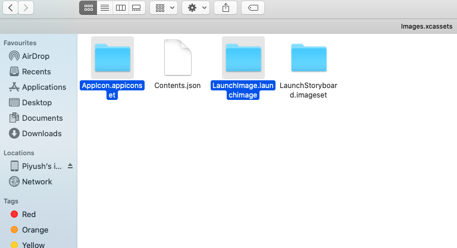

[https://appicon.co/](https://appicon.co/) - Using this we can create icons for ios device

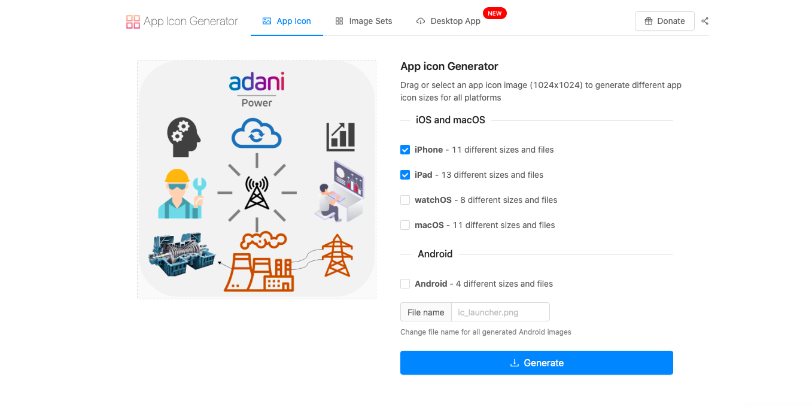

> On click of generate. One zip will get generated and we have to extract and we have to replace the cordova icons
>
> We have to manually change the launch images based on the pre-existing sizes and names also need to be changed based on the **Contents.json** on the LaunchImage.launchimage folder

11. chmod -R 777 . -- To permit to read and write of all the files

12. We need to Build the application on the Xcode application. There we need to do some configuration

> Open Xcode applicationOpening XCODE after adding the IOS Platform
>
> \{Project_Name\}/platforms/ios/\{**Project Name**\}.xcodeproj .Double click to open on xcode application

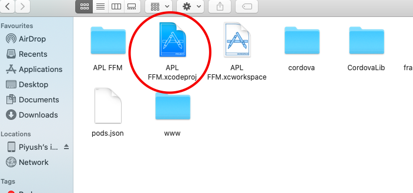

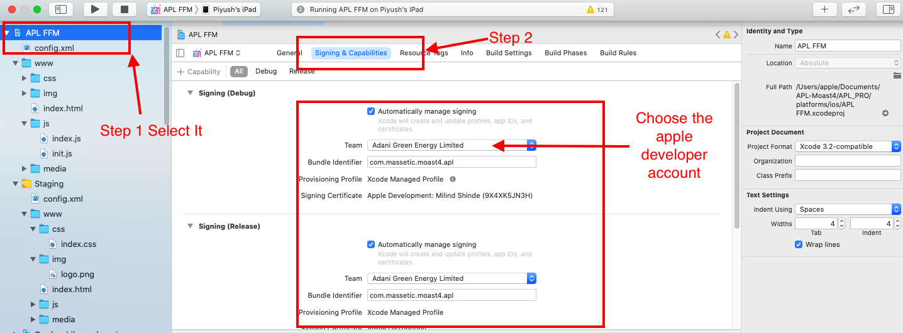

> **Step 1:** We have to choose the project to view the information related to the project
>
> **Step 2:** The user needs to click on the Signing and Capabilities
>
> **Step 3:** We need to select the team. It is a developer account for Apple. The bundle we have to create on the developer account.
>
> If we need the signing apk we have to mention the development team and bundle identifier
>
> If the User needs to add some plugins. As we need **Push notification** functionality we have added. 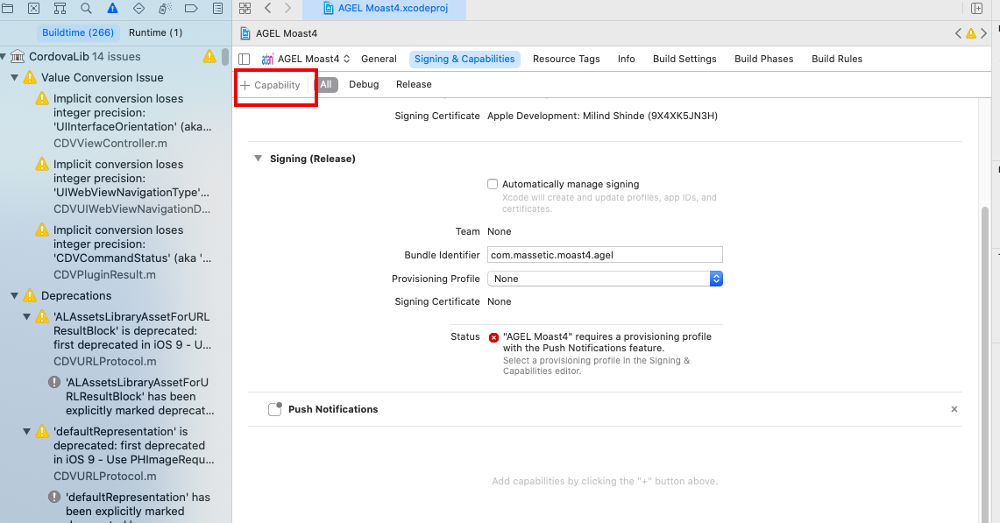
>
> The list of available capabilities will be displayed and users need to choose on the list. On double click it will be added

A plugin also needs to be added

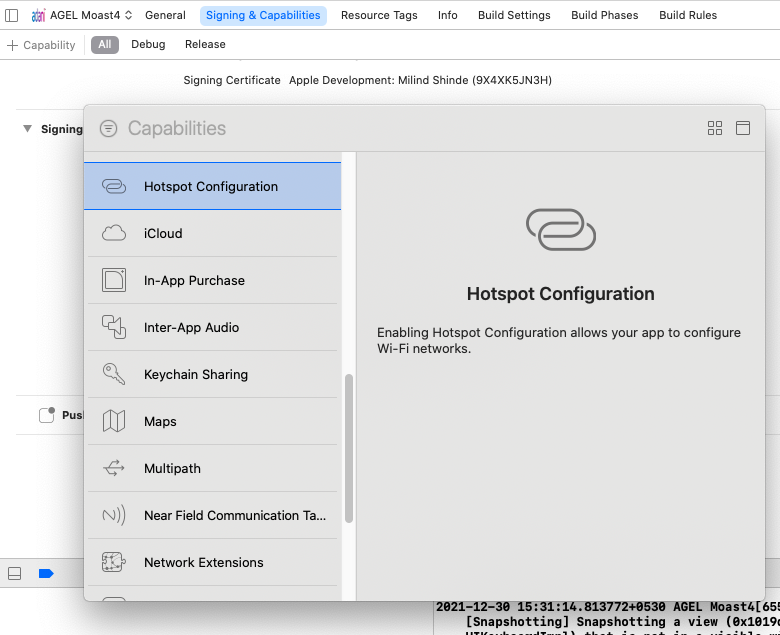

13. Clean the project on the Xcode application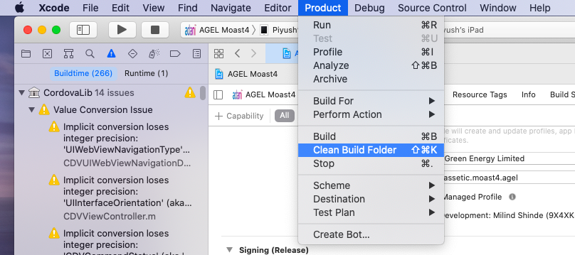

14. Build the project on the Xcode application

> Before doing the build make sure that our project is selected.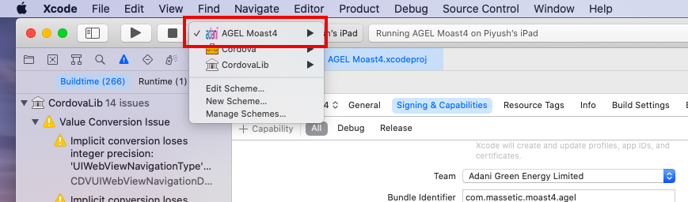
>
> Then we should build
>
> 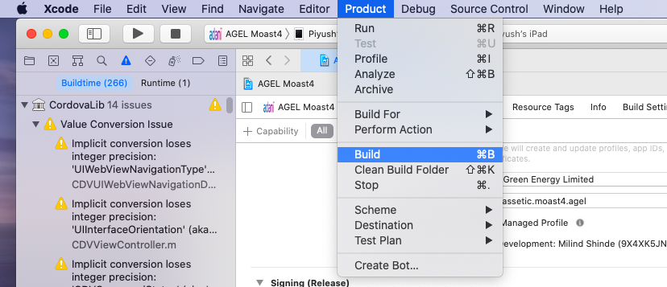

15. Open the simulator or install the application to the connected ios device(iPad or iPhone)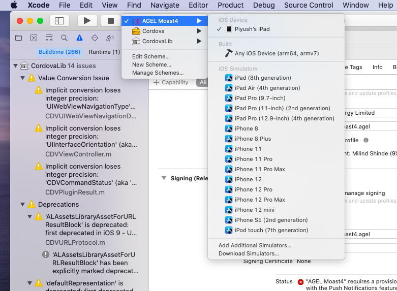

16. The console of the application can be viewed on the Safari browser. Go to Safari browser.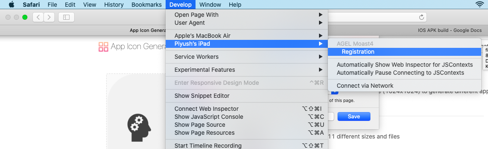

17. Archiving of the application. This process is done to share with the customer so that the customer can install it on his device. Before archiving make sure that the current project is selected and the device we have to select is Any IOS device(arm64,armv7) so that we will get the application for all devices 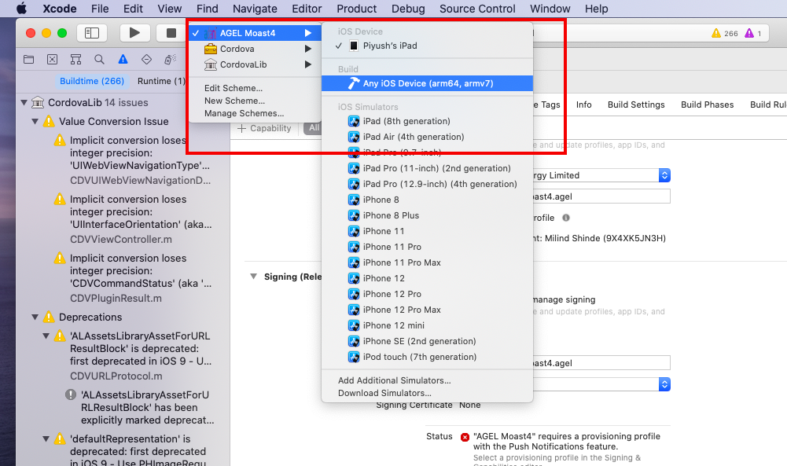

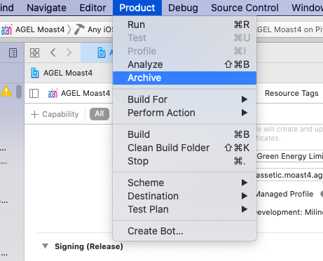

On click of Archive. It will open a dialog for exporting the application

Users need to click on the **Distribute app** button

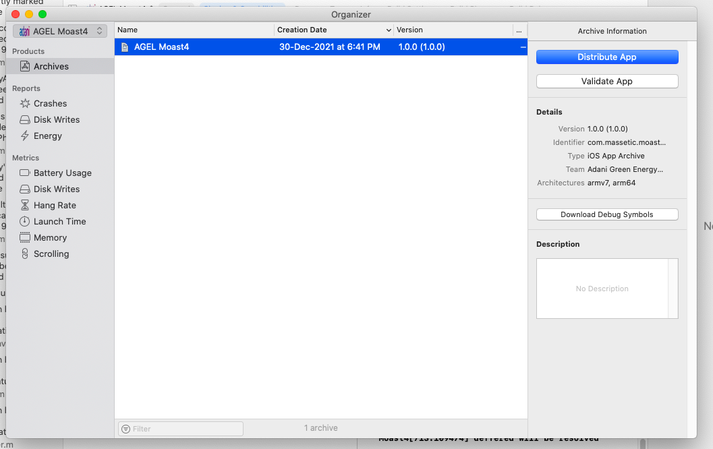

Follow the procedure below to get the ios application 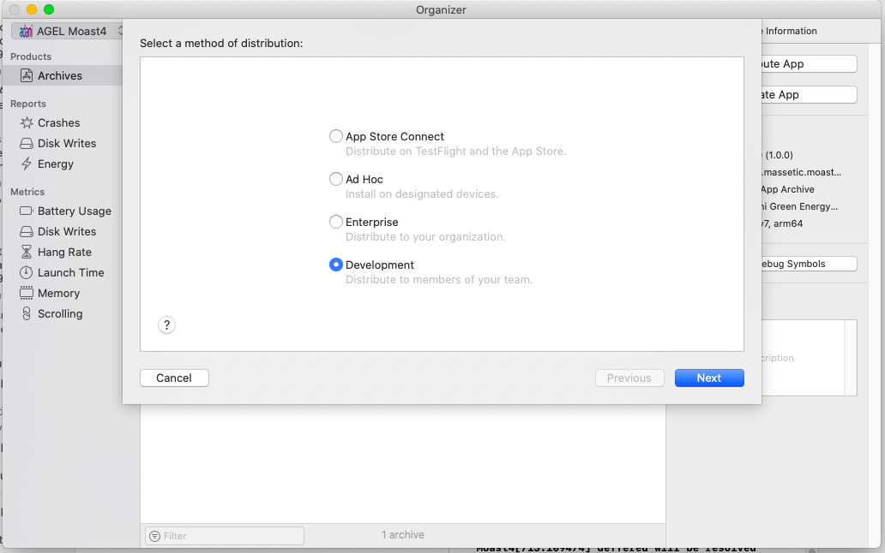

Click on the next button.

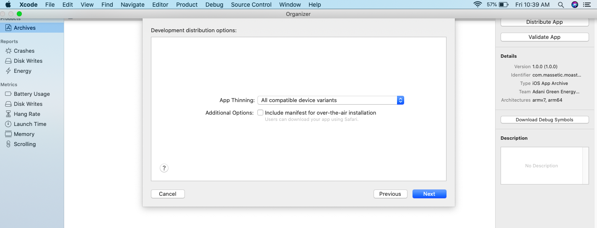

Click on the next button

I will process it for some time. Post that we have to we will get the application information.

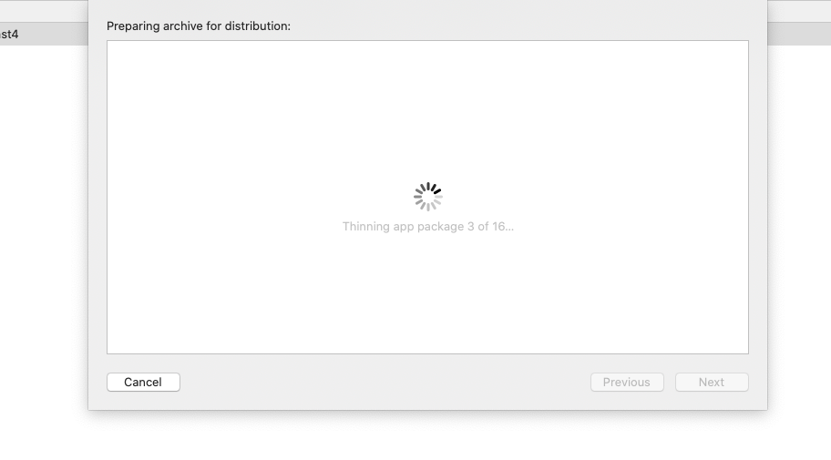

On clicking the export button I will ask the user to choose the path to export. After exporting we will get the application on the exported location as ipa file

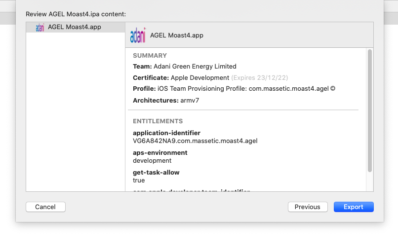
