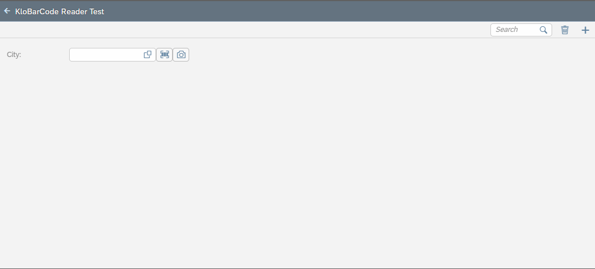
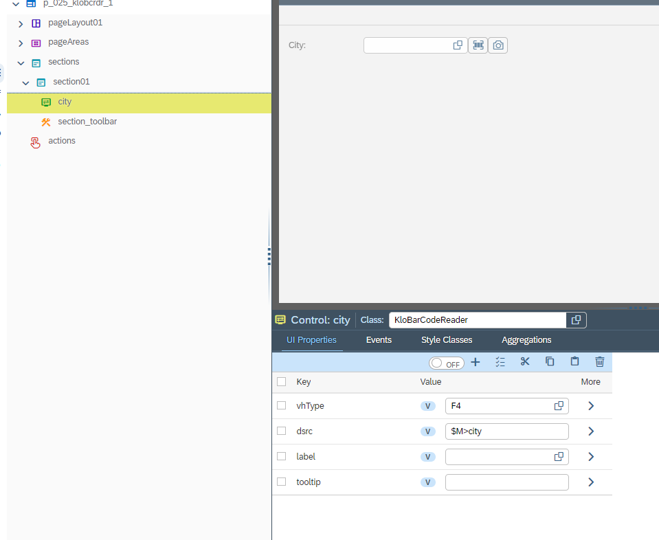

# KloBarCodeReader

**Class**: KloBarCodeReader

## Overview

Extended from **KloInput**

KloBarCodeReader can be used to scan the barcodes or QR codes.

It is used the same way KloInput is used. But additional functionality like the visibility of the buttons and input field itself is provided using properties.

## Framework Version Information

6.0 and above

## Properties

| **NAME**              | **TYPE**                  | **DEFAULT VALUE**   | **DESCRIPTION**                                                                     |
|-----------------------|---------------------------|---------------------|-------------------------------------------------------------------------------------|
| scanMode              | "landscape" \| "portrait" | portrait            | Landscape or portrait mode                                |
| vhType                | string                    | “”                  | Vhtype of the input field(refer KloInput vhtype)          |
| selectedKey           | string                    | “”                  | Sets the selectedKey for the control.                     |
| value                 | string                    | “”                  | Sets the value for the control.                           |
| showInputField        | boolean                   | true                | Set the visibility of input field                         |
| showBarCodeBtn        | boolean                   | true                | Set the visibility of barcode button                      |
| showCameraBtn         | boolean                   | true                | Set the visibility of camera button                       |
| showFlipCameraButton  | boolean                   | false               | Set the visibility of flip camera button                  |
| showTorchButton       | boolean                   | false               | Set the visibility of torch button                        |
| torchOn               | boolean                   | false               | Set whether the torch should be turned on during the scan |
| preferFrontCamera     | boolean                   | false               | Set whether the front camera should be used during scan   |
| saveHistory           | boolean                   | false               | Enable the history for the scanned codes.                 |
| resultDisplayDuration | boolean                   | false               | Duration after which results will be displayed            |
| disableAnimations     | boolean                   | true                | Enable/Disable the animations                             |
| disableSuccessBeep    | boolean                   | false               | Enable/Disable the scan sound                             |
| barcodeIcon           | sap.ui.core.URI           | sap-icon://bar-code | Sets the specified icon to the barcode button             |
| cameraIcon            | sap.ui.core.URI           | sap-icon://camera   | Sets the specified icon to the camera button              |

## Usage

Usage is the same as KloInput. But KloBarCodeReader provides much more functionality like scanMode, vhType, torchOn, preferFrontCamera etc.

Pressing the camera button opens up the barcode scanner on the mobile.

Pressing the barcode button just focuses on the input field. On scanning the barcode using the gun the scanned value is placed in the input field which is focused.

## Events

| **NAME** | **DESCRIPTION**                                                                                 |
|----------|-------------------------------------------------------------------------------------------------|
| **scan** | Fired when the scan is successful and gives the scanned string value. |

## Sample Code or Usage

Vhtype can be selected in a similar process like kloInput.

KloControls- KloInput

