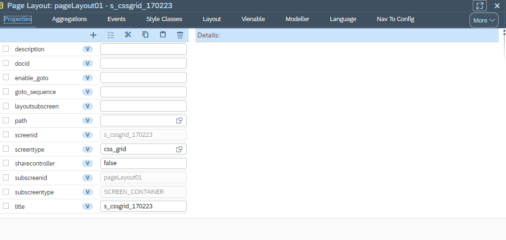
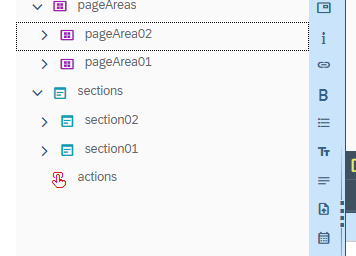
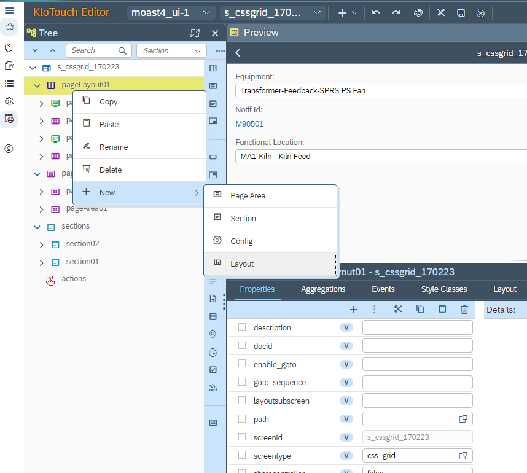
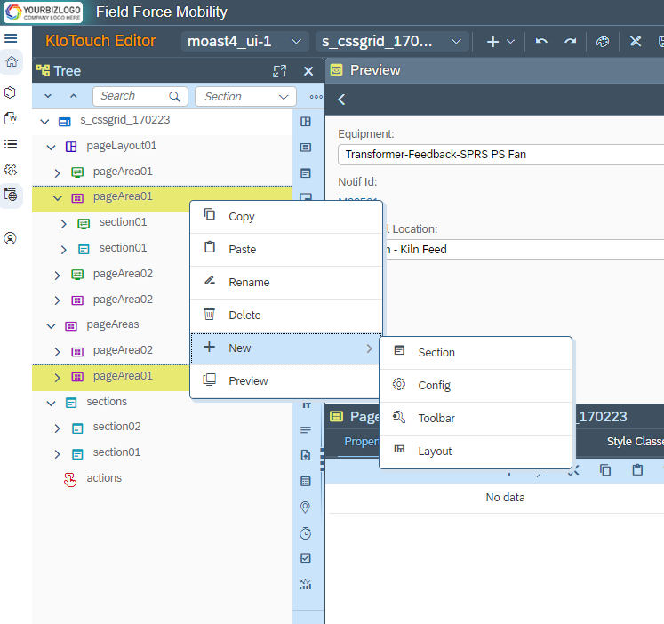
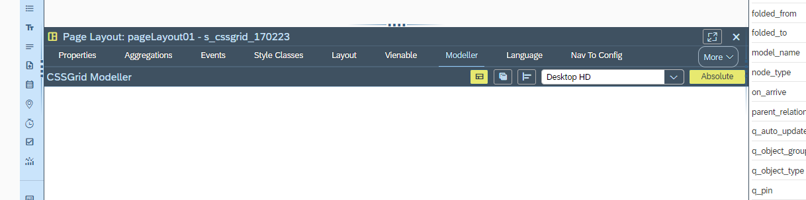
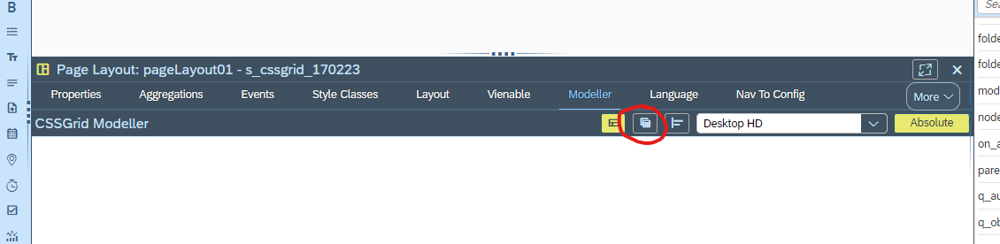
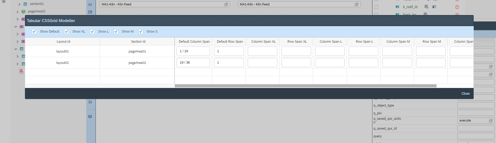
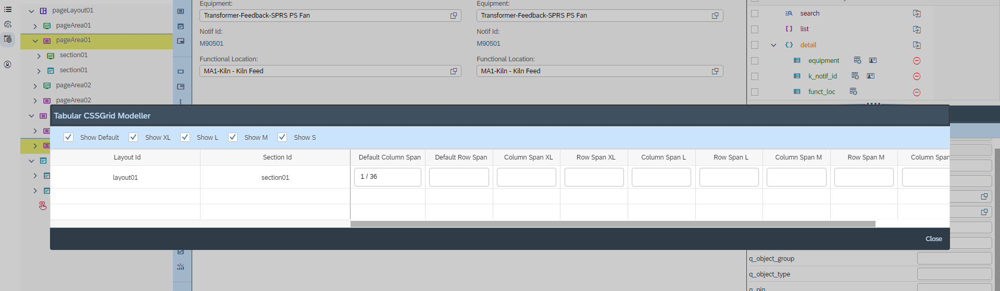

# CSS GRID

**Class**: CSS GRID

## Overview

CSS grid is the screen container that can hold page areas or sections and it behaves the same as the klocard subscreen where you can arrange your subscreen controls in any way you want in any layout.

Once you make your page layout screentype as css_grid then do a right click. You will be able to add the layoutdata to the screencontainer. Each layout data has properties of subscreen layout data.

List of properties on KloLayoutData:

- Show_title

- Show_icon

- Use_icon_tab

- Layoutsubscreen

- Expandable

- Expanded

Adding these properties will behave the same as it used to behave when we used it in the layout tab of the properties section in the klotouch editor.

Using the modeller we can adjust the layout of the content on the screencontainer as shown in the [sample code or usage](#sample-code-or-usage).

## Framework Version Information

5.7 and 6.0

## Sample Code or Usage

