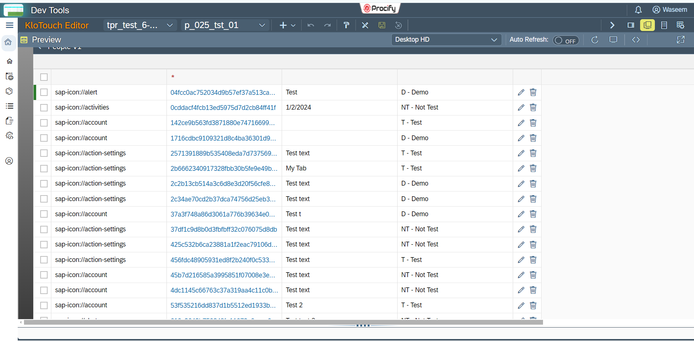
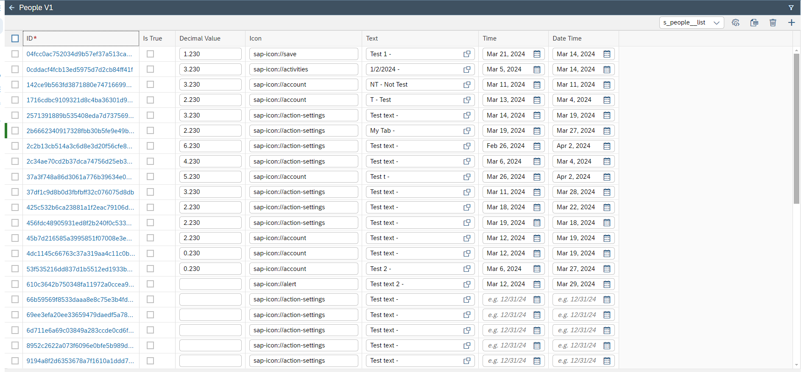
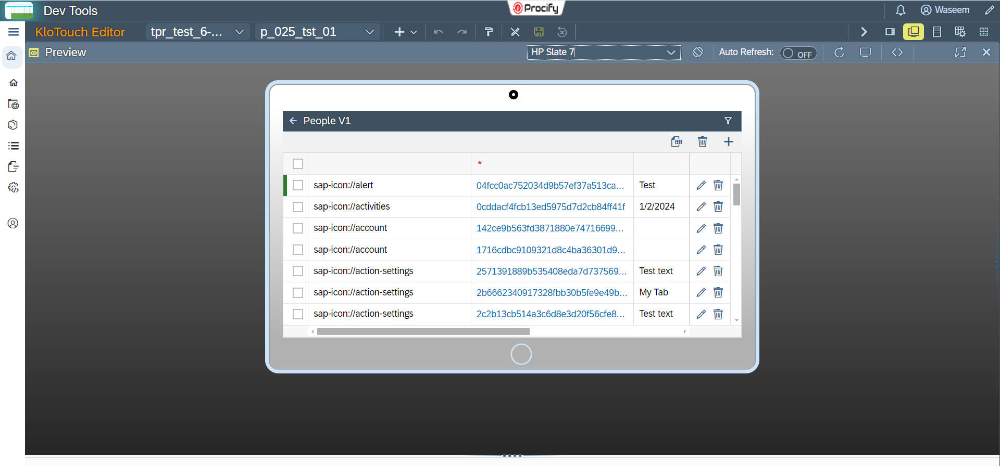
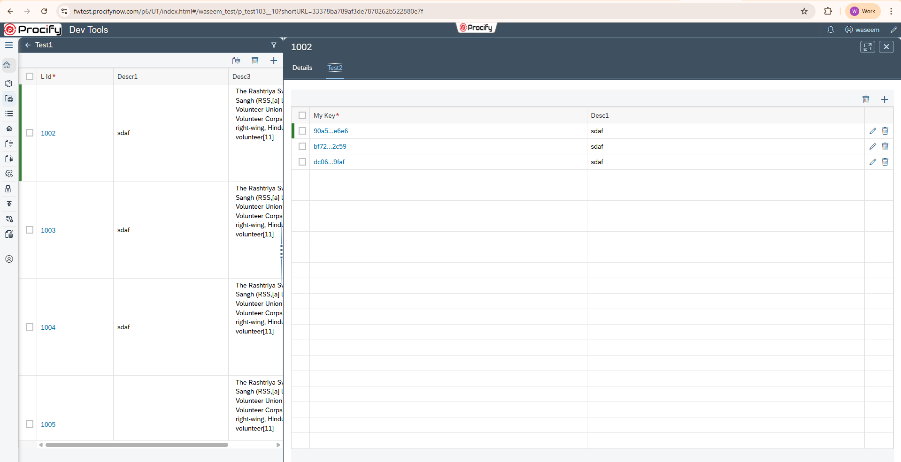
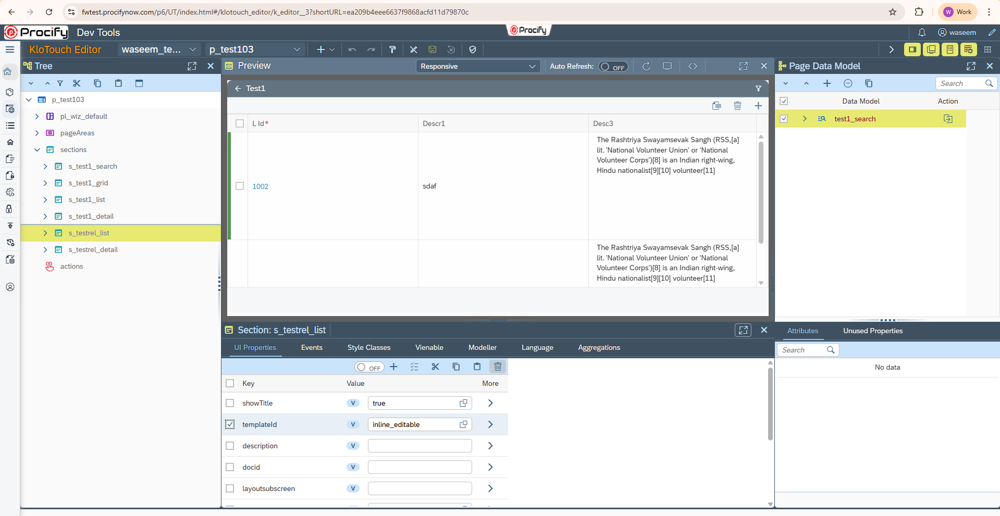
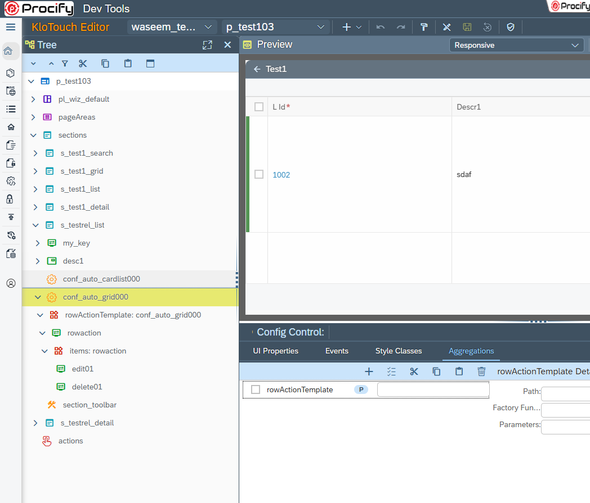
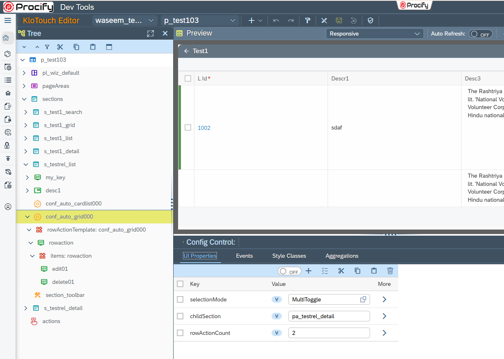
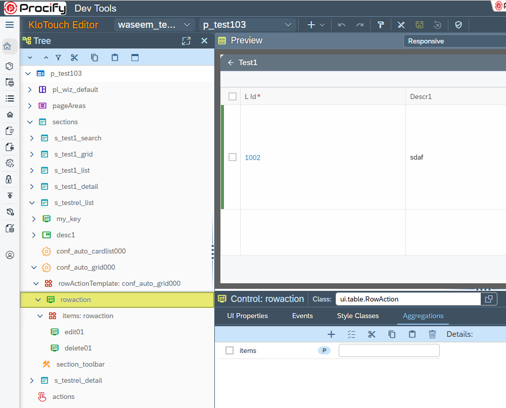
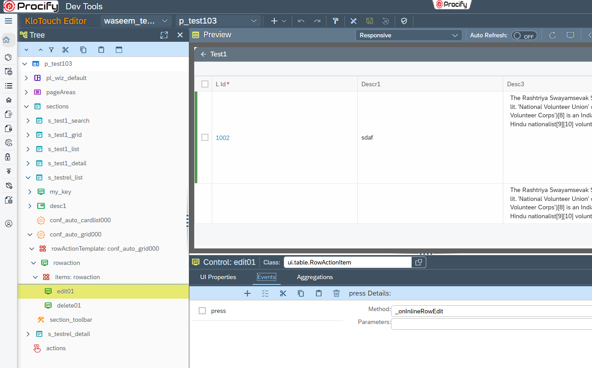

# KloGridConfig Column width specification

- If width is given to the column, then that width is set.

- If width is not given by the developer then consider width from the property type.

- If width is not given in the property type then if the r_domain is specified as Boolean then width of 78px is given because if the template control is switched for the column then the maximum width it takes is 78px.

- If the domain is given as CHR then we check the length from the property type. If the length is given and on multiplying by 14 i.e., max-width of the letter W, then if we get greater than 250, then we set 250px to the columns. In other cases, we set 150px.

## Desktop HD

Note : The **enableGrouping** property, which was previously used to support grouping functionalities, has been deprecated by OpenUI5. As a result, the framework no longer supports this feature. Screens or applications that currently utilize the **enableGrouping** property and continue to function without issues may still be used. However, any issues or unexpected behaviors arising from the use of the **enableGrouping** property will not be addressed or supported by the framework going forward. It is recommended to avoid relying on deprecated features and to refactor implementations accordingly to ensure long-term compatibility and support.

## Configuring RowActions in the KloGridConfig

Once you have created a screen using wizard and giving the templateid for the relation list as Popup Edit, you will see the relation list in the following way:

To add the custom rowactions follow the steps below:

Delete the template id from the section.

Select the grid/auto_grid config and add aggregation rowActionTempalate

Make sure to add rowActionCount based on the number of rowActions you will be adding.

Add a control ui.table.RowAction to rowActionTemplate

Add items aggregation to the rowAction control and add two controls of type ui.table.RowActionItem. Now you can configure all the available properties as per the normal control configurations.

