# KloAttach

KloAttach control is used to capture, record, upload and display the media.

## Properties

[Properties](https://apihelp.procifynow.com/ui/classes/KloControl_KloAttach.default.html) Type Doc

## Usage

For using the KloAttach control using Page Builder, developers need to have a qualifier of type attachment.

Then developers need to select the section in which KloAttach is needed. After selecting the section click and then new -\> **Controls**.

Provide the ID to the control and type KloAttach in the control field. Bind the value property of the control with the **attachment qualifier** type property of your entity.

Developers also can drag the qualifier property from the trans node and drop over the section in which they want to use KloAttach control; the control generator will automatically predict the KloAttach control.

**NOTE:** Please note that video recording in IQOO doesn’t work for unsupported codec with the Blob generated from MediaRecorder API.

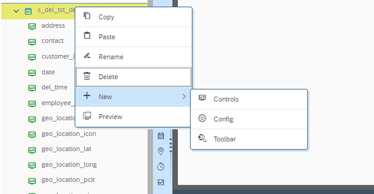

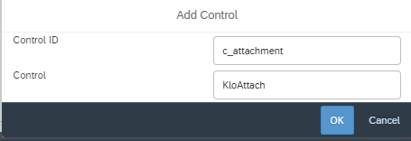

There are 4 modes in KloAttach control:

1.  **Preview:** In this mode Image control will be there with camera control. Users can capture and upload attachments. This mode will also display the captured and uploaded attachment. This is also the default mode of the KloAttach control.

2.  **w/o preview:** In this mode, users can capture and upload all the valid types of media but a preview will not be available.

3.  **Compact fileUpload:** In this mode file upload icon will be there. Users can upload all valid media.

4.  **fileUpload:** In this mode upload icon with the input field will be there. Users can upload all valid media.

If developers want to change the mode of the control then add the mode property in control and choose the mode from the f4 of the mode property.Two new properties, \`**maxFileSizeAttachment**\` and \`**showFileSizeRestriction**\`, along with their validations, have been added for all four modes in the KloAttach control. A text display shows users the file size limit and supported file types (if enabled).

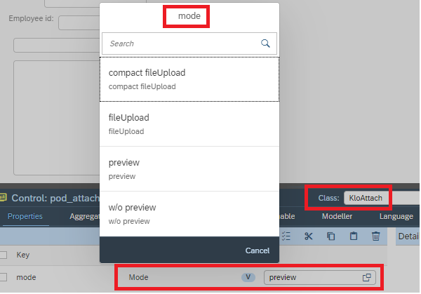

**Preview mode:**

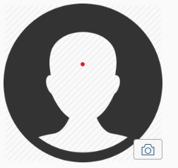

If the enabled property of control is false then the camera button will be hidden.

The image of the attachment is clickable. On click, it will open in full size in a dialog.

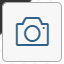With the click of the camera button, a dialog will appear with a live stream. By default, captured image/video will be of quality SD. But this can be configured using control’s property [quality](https://apihelp.procifynow.com/ui/classes/KloControl_KloAttach.default.html)

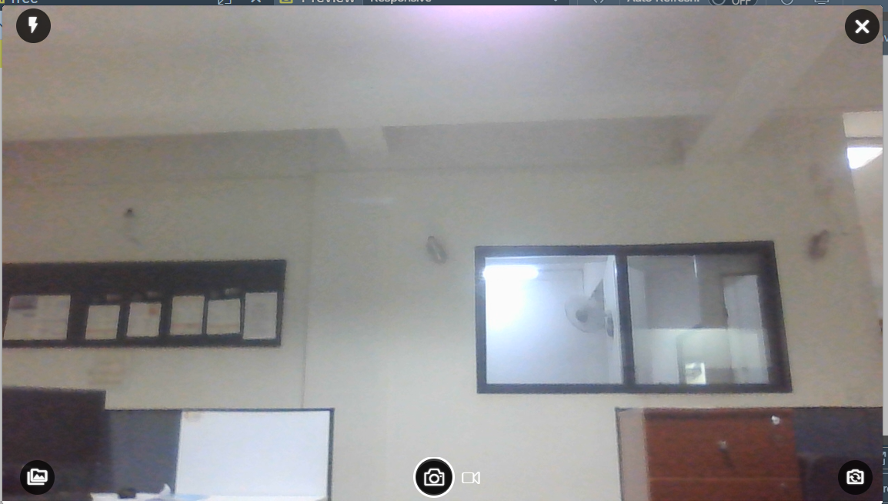

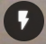 This button is used to open the flashlight of the camera.

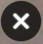 This button will close the camera.

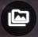 This button will open the file uploader.

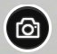 With the click of this button, the image will get captured.

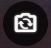 This button will switch the mode of the camera.

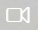 On clicking the icon the camera & video buttons will get switched. Like 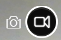

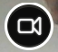 On a click of this button video recording will start.

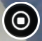 With the click of this button video recording will stop.

After capturing the image the dialog will look like below:

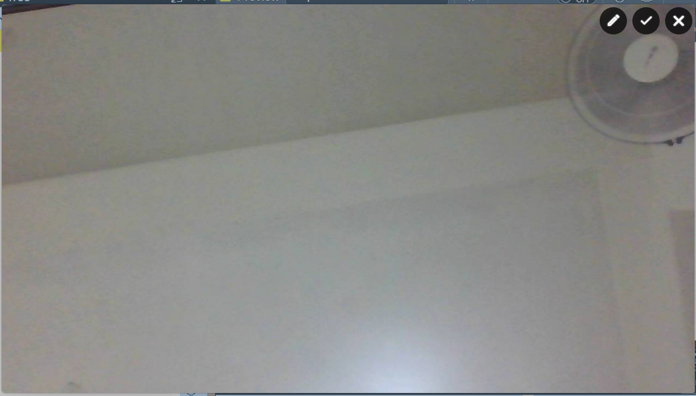

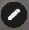 On click, the image editing dialog will open with editing options. For knowing more about editing options see the KloFeedBack control.

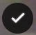On click, the captured photo will be saved.

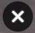On click, the dialog will get closed without saving the image.

**W/O Preview mode:**

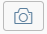 In this mode, only the camera button will be visible. The only difference between review and w/o preview mode is that in w/o preview mode attachments will not be displayed.

**File upload mode:**

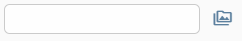

In this mode file upload button with a text field will be displayed. On click of the file upload button, the system's file explorer will open and the user can select the attachment and upload. The name of the selected attachment will be shown in the text field. Preview of the attachment is not available in this mode.

**Compact file upload mode:**

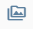 In this mode, only the file upload button will be visible. On click of the file upload button, the system's file explorer will open and the user can select the attachment and upload. Preview of the attachment is not available in this mode.

### Preview Preference:-

Developers are also able to change the preview preference of the KloAttach control.

For using thumbnails the developer needs to enable the **isThumbnailEnabled** property in the IAttachment qualifier from the Data Studio.

By default, KloAttach will display the original images and videos. Developers can change the preview preference by using the previewPreference property of the KloAttach control. There are 3 types of preview preference are available:

1.  Only Thumbnail

2\. Only Real

3\. On clicking Real

This property is applicable only in preview mode. If "Only Thumbnail" then always the thumbnail will be displayed. If 'Only Real' then always a real image will be displayed. If 'On click Real' then a thumbnail will be displayed and on click of an image real image will come into frame.

The difference between thumbnails and real images is their size & quality.

Thumbnails will have low-quality images & smaller in size as compared to the original images.

Developers are also able to change the WaterMark of the KloAttach control.

By default, waterMark will not be displayed in the original images and videos.

The developer has to mark the watermark property as true to enable that.

There are a total of 5 watermark properties: -

- waterMark

- Watermark Position

- Watermark Size

- Watermark Type

- Watermark Config

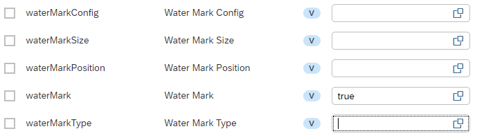

The developer can use these properties to change the size, position and type of watermark.

If the developer wants to customize the watermark according to his preference, they should use the Watermark config:-

In waterMarkConfig, add json Like:-

\{ waterMarkPosition: "top_left",

waterMarkColor: 'white',

waterMarkSize: 'M',

waterMarkType: \['geolocation', 'user', 'Text','Logo'\],

waterMarkText: 'Solution',

waterMarkLogo: 'closedmodules/kloTouch_5/media/logo.png' \}

if you want to test the logo, the logo should be present in the location specified or you should change it to the current location

Default watermark w/o any configuration.

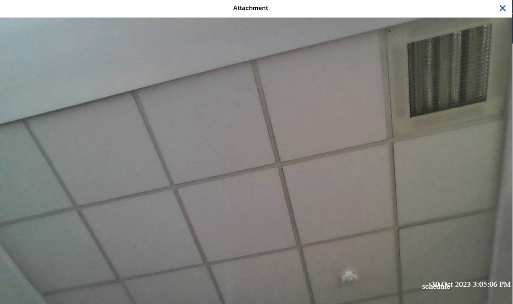

**Note:-** The watermark will only appear on the captured images/videos, it will not appear on uploaded images/videos.

### MIME Type

A media type (also known as a **Multipurpose Internet Mail Extensions** or MIME type) indicates the nature and format of a document, file, or assortment of bytes.

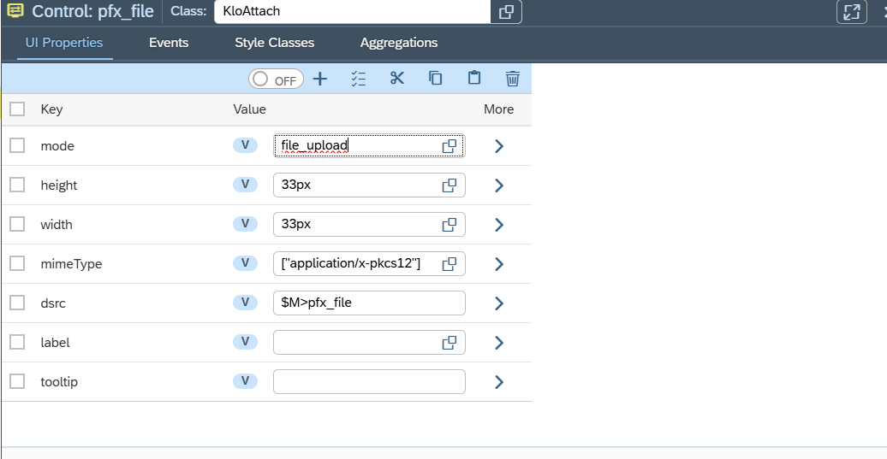

Mode should be file_upload.

mimeType can be an array of strings containing the required mime types .

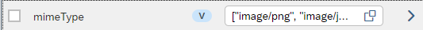

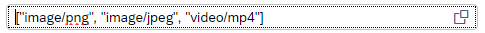

For specific file types(“file_upload”, “compact_file_upload” mode) pass the MIME type array.

MIME types are listed in [Mime Type Data](https://docs.google.com/spreadsheets/d/1ohAItHsTUXtH2oDSC7X-UStvz5thQYl6BeMTRmwVB-4/edit?usp=sharing).

**Note: There is another property fileType that will accept the file extensions in the format \[“pdf”, “xlsx”, “txt”\]. This property handles the mimetype of the control automatically. If fileType is provided, then the mimeType property will be ignored.**

**For filetypes “vsd” and “vsdx”, some browser do not have the internal mimetypes maintained. You can use \[“vsd”, “\*”\] in the fileType property for these files.**

## createNewEntityP ()

For creating attach using createNewEntityP() follow the code;

c = await txn.createEntityP('d_entity1',\{des:"hello"\},true);

c.attach.id = "9dd99fcc2c2530a7982d1131348f7155";

c.attach.name = “test.txt“;

c.attach.size = 1323;

await txn.commitP();

## Events

| **NAME**        | **DESCRIPTION**                                                                               |
|-----------------|-----------------------------------------------------------------------------------------------|
| **onCancel**    | Fired when the close button is clicked in the KloAttach dialog box. |
| **onAfterSave** | Fired after the Attachment upload is completed                      |

## Delinking KloAttach

For removing an attachment from an entity the following steps need to be done:

Step 1: Get the control by using **getActiveControlById** api by passing property name and section name.

Step 2: Now use getValue() on the control returned by **getActiveControlById**

Step 3: Set name, size and id as null on the value returned by getValue() on the control

Step 4: Call commitP or refresh the transnode based on the requirement which will result in attachment getting removed for that particular entity

## Attachment Upload progress

When an attachment is uploaded, a progress indicator will appear that shows the progress of the uploaded attachment. If the attachment upload is completed, then the attachment upload is completed then the progress indicator turns green automatically hides and fires **onAfterSave** event. If the attachment upload fails then the progress indicator turns red and automatically hides.

1.  With Preview

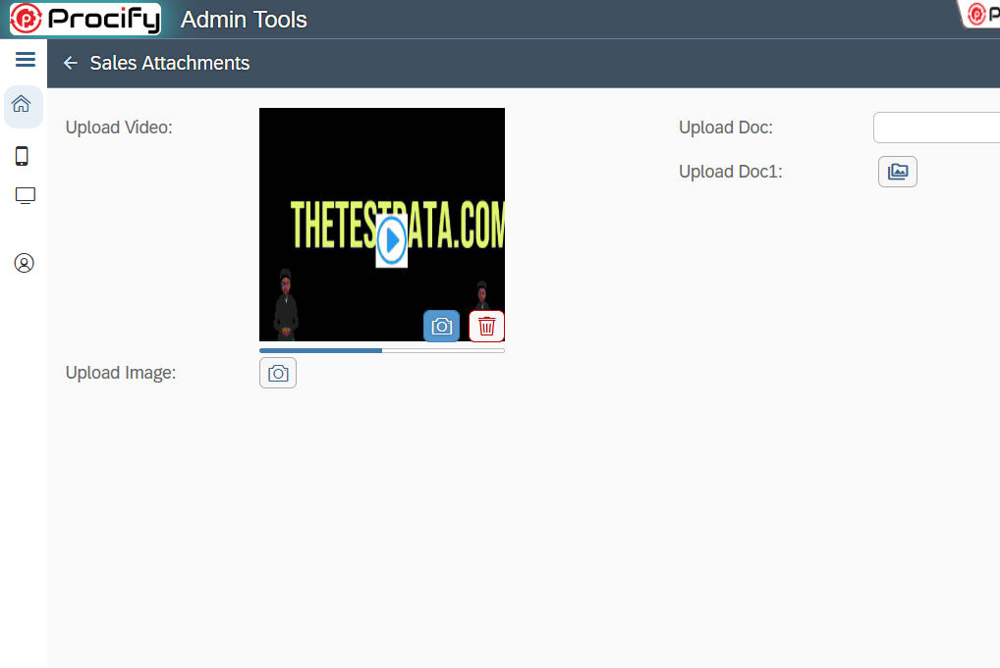

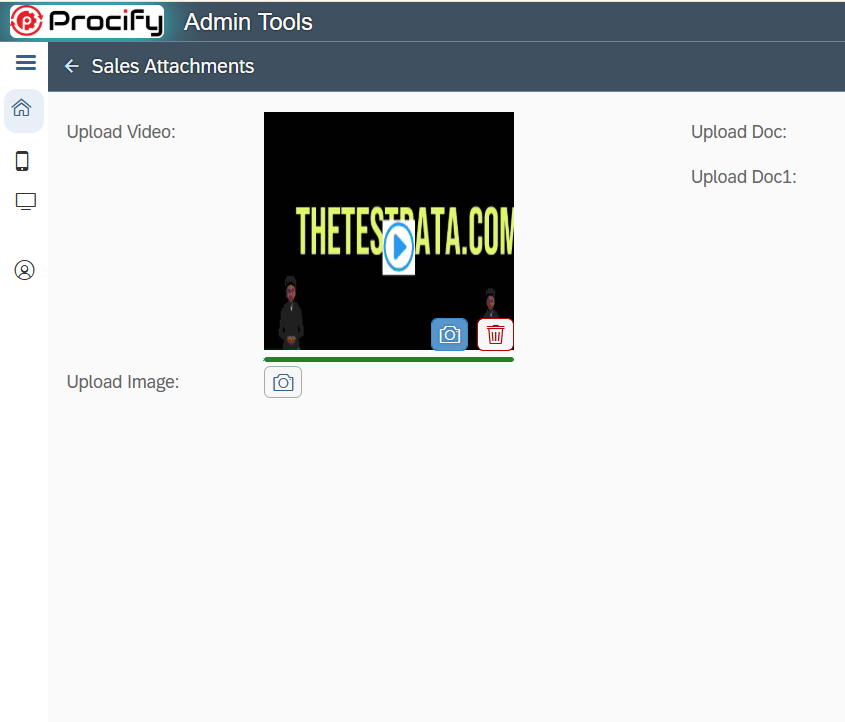

2.  Without Preview Mode

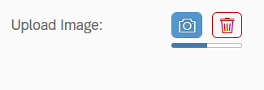

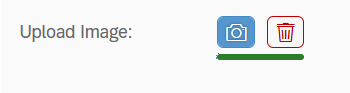

3.  File Upload Mode

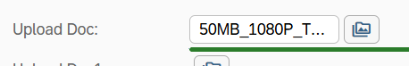

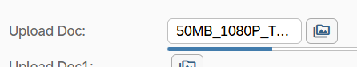

4.  Compact File Upload Mode

> 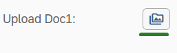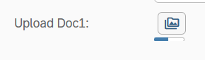

## Saving KloAttach

When committing any attachment, save will fail until the attachment is uploaded.

The failed message will be the one which is sent when calling the commitP function.
