# Calendar

A calendar is a set of working and non-working days specified for a particular time interval. This includes holidays and special periods underlying the organisation’s calendar.

We have two types of calendars:

1\. Calendar

2\. Team Calendar

## Calendar (single)

Displays a calendar of a single entity (such as a person, or resource) for the selected time interval.

## Properties

| **NAME** | **TYPE** | **DEFAULT VALUE** | **DESCRIPTION** |
|---|---|---|---|
| **appointmentCreate** | boolean | false | Determines either user can create appointments on hold and drag. |
| **calendarView** | string | week | Defines the type of calendar view based on time. Ex. “week”, “month”, “WorkWeek” etc.  [CalendarView](https://openui5.hana.ondemand.com/api/sap.m.SinglePlanningCalendarView) |
| **appointmentStartDate** | UI5Date or JavaScript Date object | null | Takes the binding for appointment aggregation’s start date. |
| **appointmentEndDate** | UI5Date or JavaScript Date object | null | Takes the binding for appointment aggregation’s end date. |
| **appointmentTitle** | string | “” | Title of the appointment. [detail](https://openui5.hana.ondemand.com/api/sap.ui.unified.CalendarAppointment#controlProperties) |
| **appointmentText** | string | “” | Text of the appointment. [detail](https://openui5.hana.ondemand.com/api/sap.ui.unified.CalendarAppointment#controlProperties) |
| **appointmentType** | sap.ui.unified.CalendarDayType | Type01 | Colour of the appointments. [detail](https://openui5.hana.ondemand.com/api/sap.ui.unified.CalendarDayType) |
| **specialDates** | string |   | Entityset transnode path. |
| **specialStartDate** | UI5 Date/ JS Date |   | Path of start date from Special dates entityset. |
| **specialEndDate** | UI5 Date/ JS Date |   | Path of end date from Special dates entityset. |
| **specialDateType** | sap.ui.unified.CalendarDayType |   | Background colour of special date. [details](https://openui5.hana.ondemand.com/api/sap.m.SinglePlanningCalendar#aggregations) |
| **specialDateSecondaryType** | sap.ui.unified.CalendarDayType |   | Secondary Background colour of special date. [details](https://openui5.hana.ondemand.com/api/sap.m.SinglePlanningCalendar#aggregations) |
| **appointmentIcon** | sap.ui.core.Icon | null | Icon for appointments. [detail](https://openui5.hana.ondemand.com/api/sap.ui.core.URI) |
| **enabled** | boolean | true | Determines if the calendar should be enabled or disabled. |
| **showAppointmentDetail** | boolean | true | controls visibility of appointment detail on click of an appointment in calendar |

## Usage

For using a calendar using Page Builder, users need to select the screen type as a calendar. After selecting the calendar as a screen type users need a config. In config, users need to bind the appointmentStartDate : js date object, appointmentEndDate: js date object, appointmentTitle: string, appointmentIcon: sap icon URL or image path and appointmentText: string properties of calendar control to the properties of the entity set.

Demonstration of the above-mentioned steps:

1.  Select the Screen Type as a calendar.

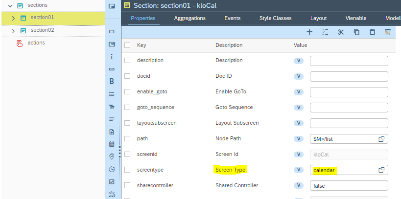

2.  Go to Config.

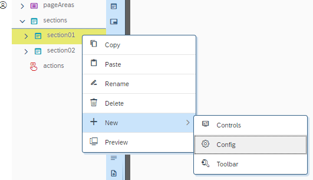

3.  Add Path in the properties.

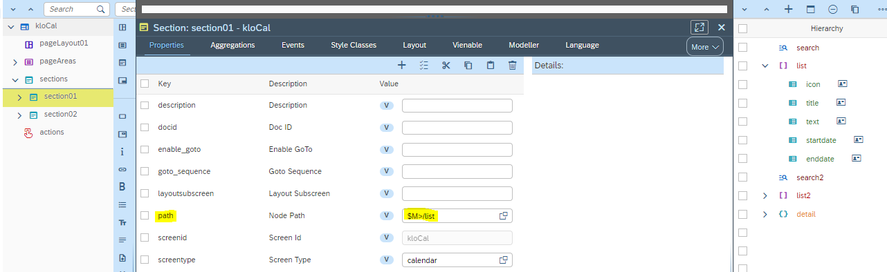

4.  Bind the properties of calendar control to the properties of the entity set.

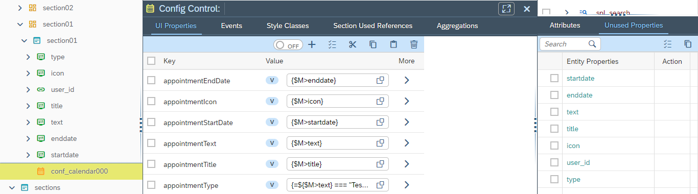

After following the above-mentioned steps, a preview of the calendar screen will look like below:

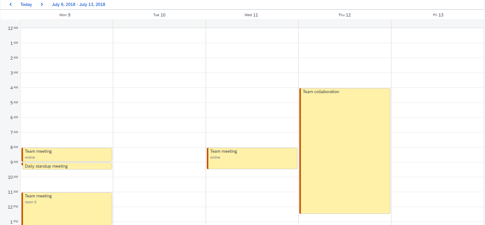

There are 4 types of views in the calendar:

1.  Day

2.  Week

3.  Work Week

4.  Month

By default, the calendar will be displayed in the weekly view.

If the developer wants to use a different view then add the calendarView property in the config and select the desired view type.

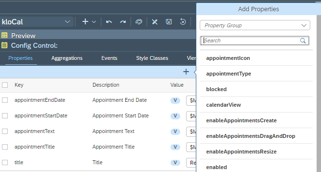

Select the desired view type.

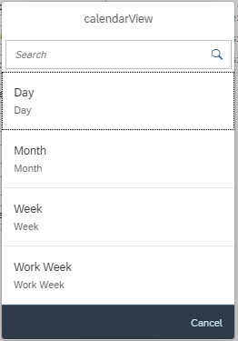

Calendar will also provide drag and drop, create and resize of appointments. To use these features developers need to add enableAppointmentsCreate and enableAppointmentsResize, properties in the config of the calendar control.

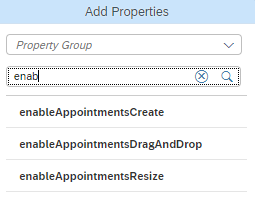

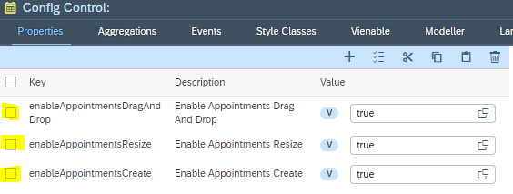

After enabling drag and drop, create and resize properties users can perform enabled actions on the appointments.

Here appointments are clickable, on clicking the appointments popover will open in the card will be displayed. That card will display the content which is added in the same section whose screen type is the calendar.

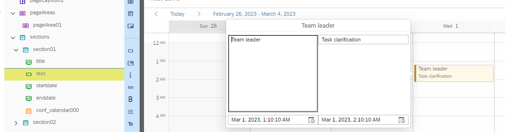

You can model the card content by following these steps:

1.  Switch the calendar screen type to "Card."

2.  Navigate to the modeller section and configure the desired controls.

3.  Change the screen type back to "Calendar."

4.  Preview the screen to confirm the updates.

**Note:** For screen types like Calendar, Team Calendar, Timeline, and kloMap, their respective aggregations—such as appointments or map markers—can be modeled in the same way as card content.

There are a few events developers can use from the events section of the Page Builder.

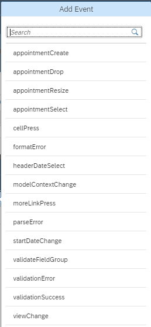

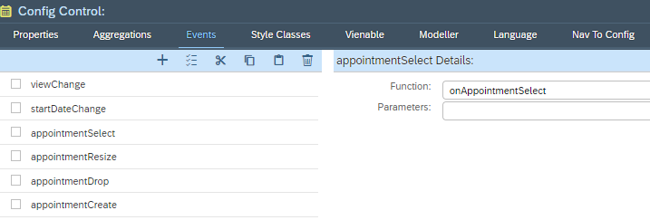

## Team Calendar

Displays rows with appointments for different entities (such as persons or teams) for the selected time interval.

## Usage

For using a team calendar using Page Builder users need to select the screen type as teamCalendar. After selecting the calendar as a screen type users need a config.

In config, users need to bind the rowIcon: sap icon URL or image path, rowText: string, rowTitle: string, appointmentStartDate: js date object, appointmentEndDate: js date object, appointmentTitle: string, appointmentIcon: sap icon URL or image path and appointmentText: string properties of calendar control to the properties of the entity set.

rowIcon, rowTitle & rowText properties should be in one entity and appointmentStartDate, appointmentEndDate, appointmentIcon, appointmentTitle, and appointmentText should be in another entity. The **appointment** property of the control should bind with the path of the entityset containing appointment data.

For example :

1st entity is d_people \{

icon

title

text

relation: r_appointments\{

d_calendar

\}

\}

2nd entity is d_calendar \{

startdate

enddate

icon

title

text

\}

Demonstration of team calendar’s implementation:

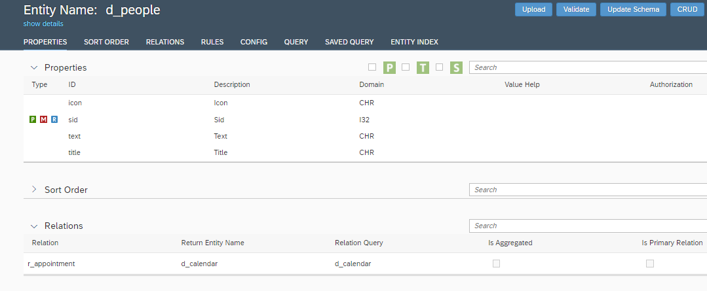

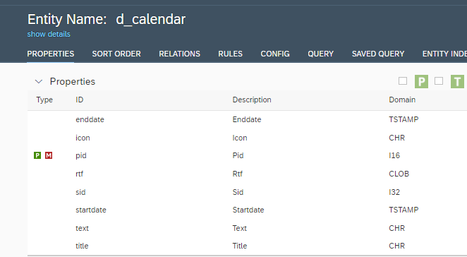

**screen type:**

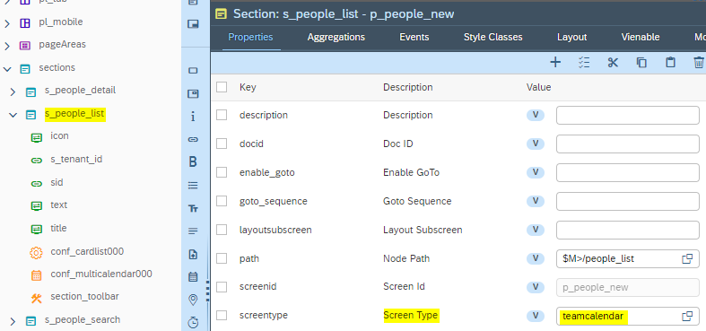

**Config:**

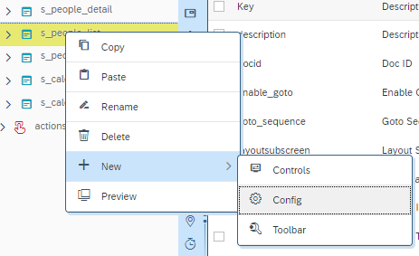

**Property binding:**

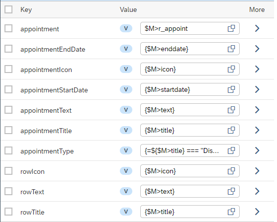

**Preview of the team calendar:**

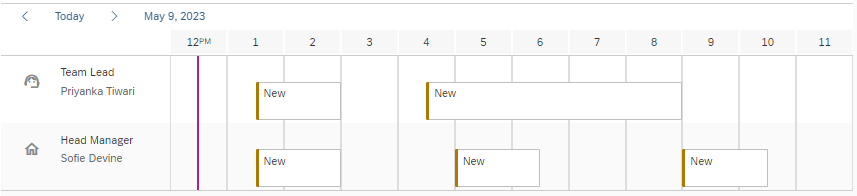

There are 3 types of views in the team calendar:

- Hour

- Day

- Month

By default, the calendar will be displayed in the hour view.

If the developer wants to use a different view then add the calendarView property in the config and select the desired view type.

Select the desired view type.

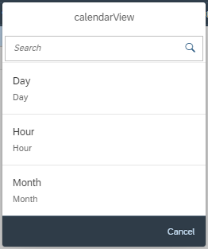

Calendar will also provide drag and drop, create and resize of appointments. To use these features developers need to add enableAppointmentsCreate and enableAppointmentsResize, properties in the config of the calendar control.

After enabling drag and drop, create and resize properties users can perform enabled actions on the appointments.

Here appointments are clickable, on clicking the appointments popover will open in the card will be displayed. That card will display the content which is added in the same section whose screen type is calendars.

There are a few events developers can use from the events section of the Page Builder.

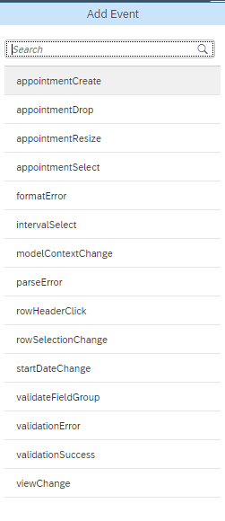

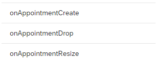

