# Map Integration

Map control (KloConfigMap) is used to display the locations on the map.

Configuration :
To use the map, google_maps_api_key should be maintained in the config.json(mm_klobroker)
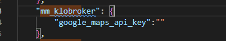

## Properties

| **NAME**           | **TYPE**             | **DEFAULT VALUE** | **DESCRIPTION**                                                                                                                        |
|--------------------|----------------------|-------------------|----------------------------------------------------------------------------------------------------------------------------------------|
| **lat**            | float                | 1                 | It will set the position of the map latitude-wise.                                                           |
| **lng**            | float                | 1                 | It will set the position of the map longitude-wise.                                                          |
| **width**          | sap.ui.core.CSSSize  | auto              | It will set the width of the map.                                                                            |
| **height**         | sap.ui.core.CSSSize  | 25em              | It will set the height of the map.                                                                           |
| **mapTypeId**      | string               | terrain           | mapTypeId will be used to show a map in \[terrain, satellite\] view.                                                                   |
| **zoom**           | int                  | 16                | It will set the zoom level of the map.                                                                                                 |
| **centre**         | boolean              | true              | If the true recenter button comes at the right-hand side of the map.                                                                   |
| **navigation**     | boolean              | true              | If the true recenter button comes at the right top of the map.                                                                         |
| **mapType**        | boolean              | false             | If the true recenter button will come at the left top on the map.                                                                      |
| **fitToMarkers**   | boolean              | true              | If true, the map will be focused on the markers.                                                                                       |
| **language**       | string               | English           | To select the language for the map. Ex. for Hindi it’s ‘hi’, for arabic it’s ‘ar’, for english ‘en’.(First two letter of the language) |
| **showMyLoc**      | boolean              | FALSE             | It will show the pin for the current location.                                                               |
| **myLocIcon**      | G-Icons              |                   | It will set the icon inside the pin.                                                                         |
| **myLocPin**       | boolean              | FALSE             | It will hide the pin and show only the icon for the current location                                         |
| **myLocIconColor** | sap.ui.core.CSSColor |                   | It will set the colour of the icon.                                                                          |
| **myLocPinColor**  | sap.ui.core.CSSColor |                   | It will set the colour of the pin.                                                                           |

## Usage

This control will be used as a screen type. A preview of the section where this control is added will display the map with the added pins. For using this control first select the screen type of the section as **map.** Then for using the map's properties, add config to the respective section. In config, you can use the properties of kloConfigMap.

KloConfigMap has markers as a hidden aggregation. For adding markers drag a property ( which has a geoLocation qualifier) from the trans node and drop over configMap.

The map has only 2 views \[terrain, satellite\].

Demonstration of the kloConfigMap control’s implementation using Page Builder,.

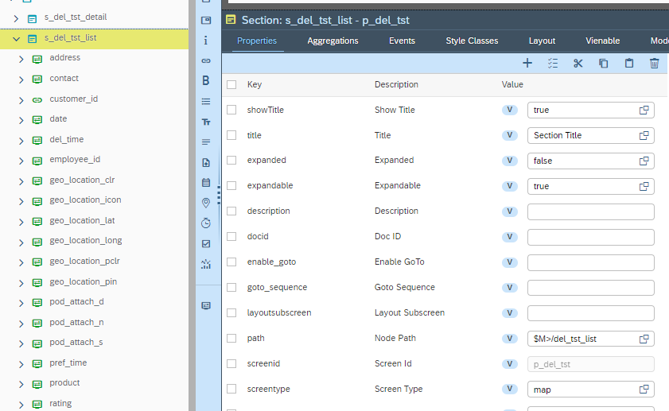

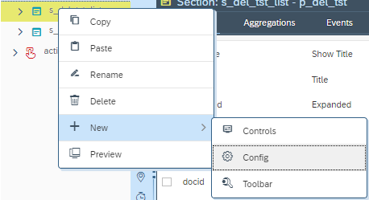

**Preview of map:** By default map will be shown in terrain view.

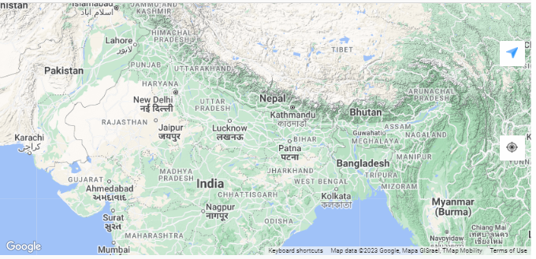

For changing the default view of the map developers need to add the mapTypeId property in the config of the map, then select the desired mapTypeId from the property’s f4.

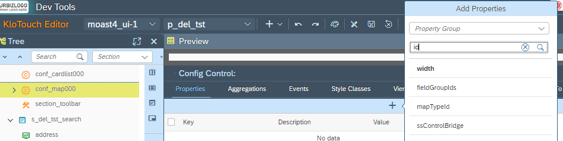

Preview of map control in satellite view.

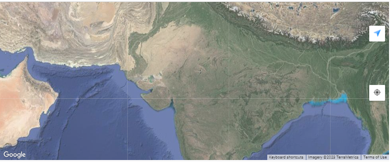

If the developer wants to provide the control to the user for changing the view of the map then enable the mapType property in the config.

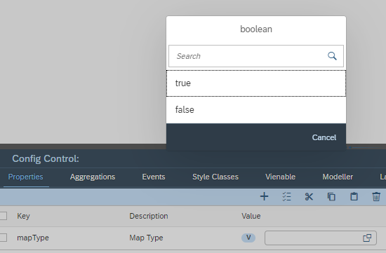

Preview after enabling the mapType.

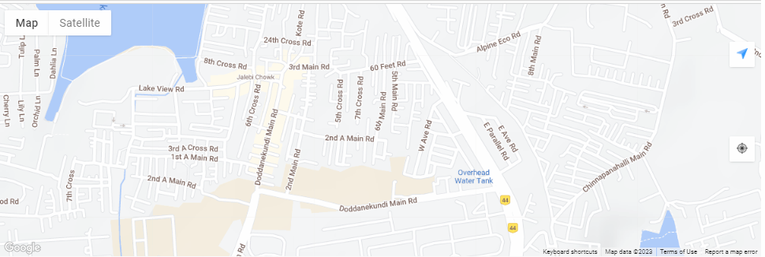

For displaying the pin on the map, drag the property of type geolocation from the trans node (entity or entityset) and drop it on the config of the map.

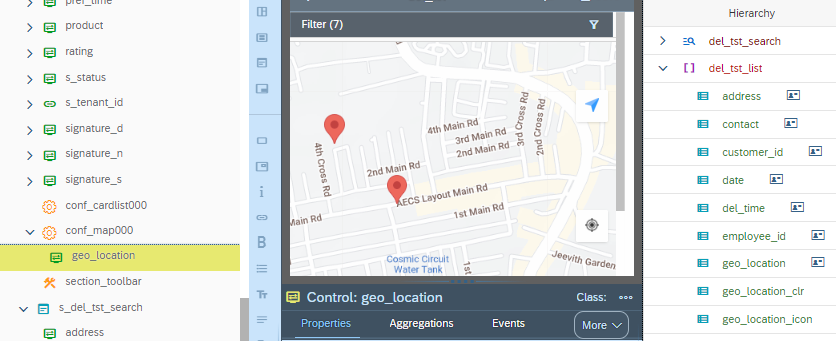

Preview after adding geolocation qualifier.

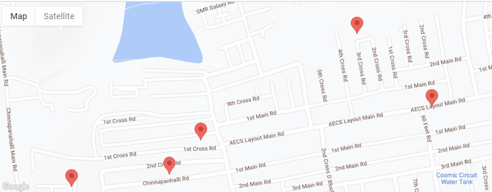

In the above preview, default markers are displayed. Developers can customise the markers by selecting the class name as KloMapMarker and changing the pin, pinColor, size, icon and iconColor properties.

If developers want to change the size of the pin then assign the size in px in the size property of KloMapMarker.

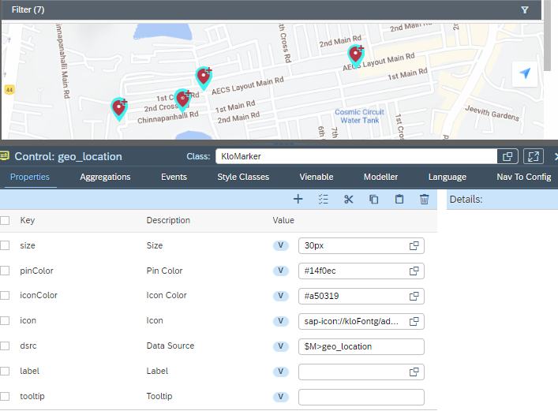

If developers want to display only icons then they can mark the pin property as false and select the icon from f4 of icon properties, change the colour using the iconColor property. If developers want to change the size of the icon then assign the size in px in the size property of KloMapMarker.

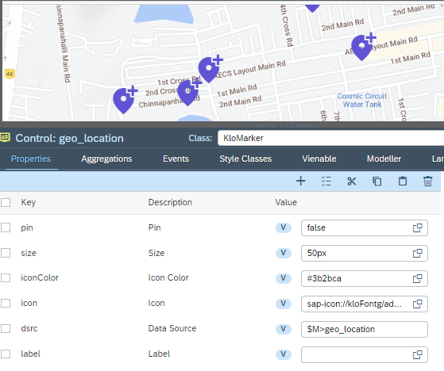

Over the map pins/ icons are clickable, on click of the pins/ icons popover will open in which the card will be displayed. That card will display the content which is added in the same section whose screen type is a map.

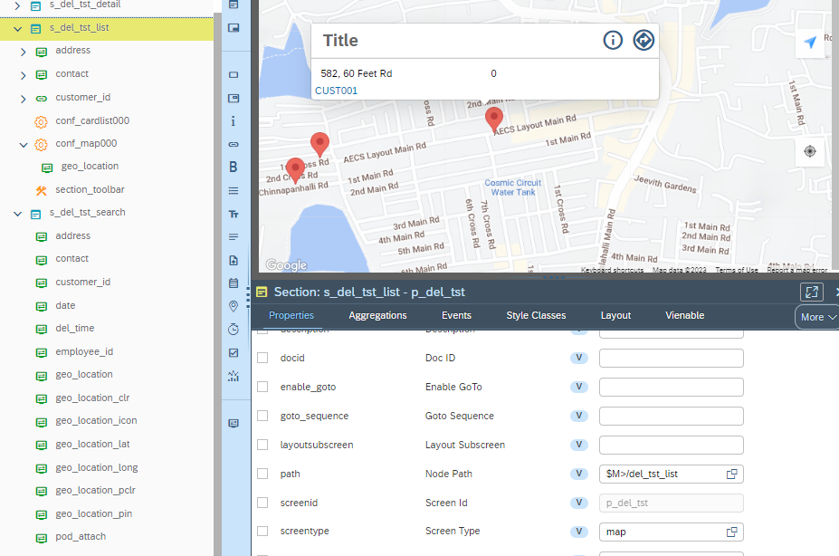

**Action button on the map:**

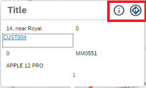

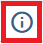On click of this button, the info event of KloMapMarker will be fired. Developers need to define the info event.

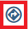With a click of this button, Google Maps will open and display the path between the clicked pin and the current location.

With the click of this button, Google Maps will open and display the path between the first pin rendered on a map and the current location.

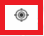With a click of the button, it will recenter the map to the current location of the device/system.

## Aggregations

| **NAME**    | **TYPE**                               | **DESCRIPTION**                                       |
|-------------|----------------------------------------|-------------------------------------------------------|
| **markers** | KloMapMarker | This aggregation is hidden. |
