# KloSignature

**Class**: KloSignature

## Overview

Extended from **sap.m.Input**.

It renders a KloSignature control based on its mode. There are 3 modes of kloSignature control ( inline, popup, w/o preview ).

Value property is mandatory for KloSignature.

The signature will be saved as an attachment.

## Framework Version Information

Version 5.7 and 6.0

## Properties

| **NAME**     | **TYPE**             | **DEFAULT VALUE**        | **DESCRIPTION**                                                                                                                                                                                                                                                                                                                                                                                                                                                                        |
|--------------|----------------------|--------------------------|----------------------------------------------------------------------------------------------------------------------------------------------------------------------------------------------------------------------------------------------------------------------------------------------------------------------------------------------------------------------------------------------------------------------------------------------------------------------------------------|
| **value**    | object               | \{\}                       | Value property must be an attachment property.                                                                                                                                                                                                                                                                                                                                                                                                               |
| **height**   | sap.ui.core.CSSSize  | 150px                    | Height property is only applied to the signature image. In inline mode, height must be in **px.**                                                                                                                                                                                                                                                                                                                                                            |
| **width**    | sap.ui.core.CSSSize  | 250px                    | The width property is only applied to the signature image. In inline mode, the width must be in **px.**                                                                                                                                                                                                                                                                                                                                                      |
| **title**    | string               | Signature Pad            | This property will be used as a title for the header of the dialog                                                                                                                                                                                                                                                                                                                                                                                           |
| **icon**     | sap.ui.core.URI      | sap-icon://kloFontg/edit | Icon to be displayed for the signature control button.                                                                                                                                                                                                                                                                                                                                                                                                       |
| **mode**     | string               | popup                    | There are 3 modes for kloSignature. Inline:- In this mode, the signature can be done at the same place where it's displayed.Popup:- In this mode on click of the signature button, the signature pad will open where the user can sign.w/o preview:- In this mode, signature image will not be displayed. With the click of the sign button, the signature pad will open. |
| **pen**      | boolean              | true                     | whether you want to use a pen or not.                                                                                                                                                                                                                                                                                                                                                                                                                        |
| **penSize**  | int                  | 4                        | Thickness of the pen.                                                                                                                                                                                                                                                                                                                                                                                                                                        |
| **penColor** | sap.ui.core.CSSColor | blue                     | The colour of the pen in which the user will do the signature.                                                                                                                                                                                                                                                                                                                                                                                               |
| **palette**  | boolean              | true                     | Whether to display a palette or not. Not applicable for inline mode.                                                                                                                                                                                                                                                                                                                                                                                         |
| **crop**     | boolean              | true                     | Whether to display a crop button or not. Not applicable for inline mode.                                                                                                                                                                                                                                                                                                                                                                                     |

| **enabled** | boolean | true | *Indicates whether the user can interact with the control or not.* |
|-------------|---------|------|----------------------------------------------------------------------------------------------|
| **visible** | boolean | true | Indicates whether this control is visible to the user or not.      |

## Usage

For using the KloSignature control using Page Builder, developers need to have a qualifier of type signature.

Then developers need to select the section in which KloSignature is needed. After selecting the section, right-click and then new -\> **control**.

Provide the ID to the control and type KloSignature in the control field. Bind the value property of the control with the signature qualifier type property of your entity.

Developers also can drag the qualifier property from the trans node and drop over the section in which they want to use kloSignature control; the control generator will automatically predict the KloSignature control.

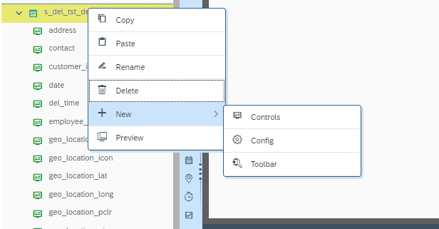

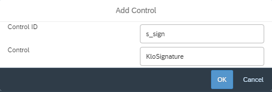

There are 3 modes in KloSignature control:

1.  **Inline: In this** mode, the signature can be done at the same place where it's displayed.

2.  **Popup:-** In this mode on click of the signature button, the signature pad will open where the user can sign. This is also the default mode of KloSignature control.

3.  **w/o preview:-** In this mode, signature image will not be displayed. With a click on the sign button, the signature pad will open.

If developers want to change the mode of the control then add the mode property in control and choose the mode from the f4 of the mode property.

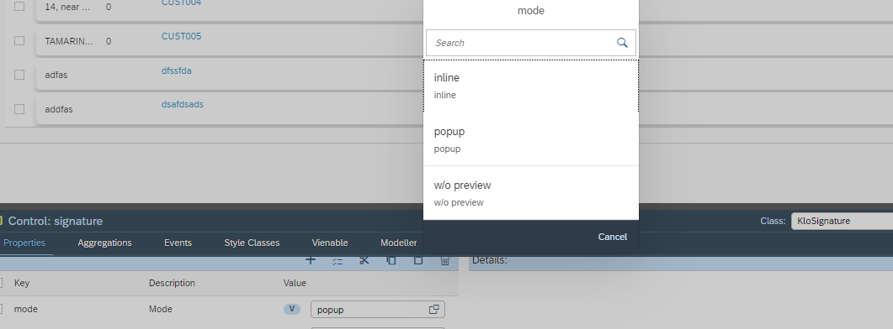

**Inline mode:**

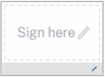

With a click of this button, this button will get replaced with the save, reset and cancel button. Now the users can do signatures with a mouse or touch.

With a click of this button, the signature will get saved.

On click, the signature pad will get cleaned.

On click, the save, reset and cancel will get replaced with the edit button and now the pad becomes non-editable.

If the enabled property of the control is false then the footer of the control will be blank (no action button).

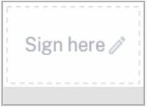

**Popup mode:**

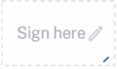

If the enabled property of control is false then the edit button will be hidden.

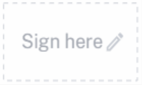

With a click of this button, the signature pad will open in a dialog and the user can do a signature with a mouse or touch on the pad.

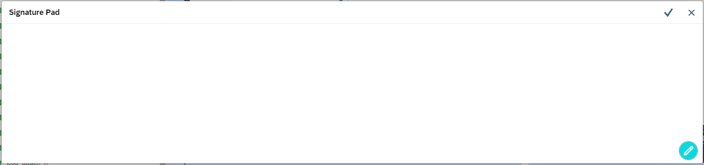

With a click of this button, a signature will be saved.

On click, the dialog will get closed.

With the click of this button, more editing options will open. After selecting the options, this button’s icon will change based on the selected option.

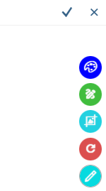

This button is to select the pen.

 This button's task is to clean the signature pad.

This button is for cropping the signature.

 This button is a colour palette. The selected colour will be used for signature.

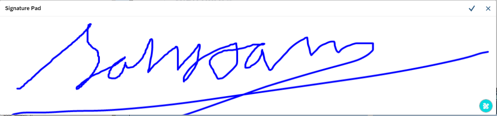

**W/o Preview mode:**

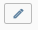 In w/o preview mode, only the pen button will be displayed. The Only difference between popup & and w/o preview mode is that in w/o preview mode signature will not be displayed.

With a click of this button, the signature pad will open in a dialog and the user can do a signature with a mouse or touch on the pad.

With a click of this button, the signature will get saved.

On click, the dialog will get closed.

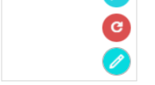With the click of this button, more editing options will open. After selecting the options, this button’s icon will change based on the selected option.

This button is to select the pen.

 This button's task is to clean the signature pad.

This button is for cropping the signature.

 This button is a colour palette. The selected colour will be used for signature.

## Events

| **NAME**     | **DESCRIPTION**                                                                                  |
|--------------|--------------------------------------------------------------------------------------------------|
| **onCancel** | Fired when the close button is clicked in the KloSignature dialog box. |
