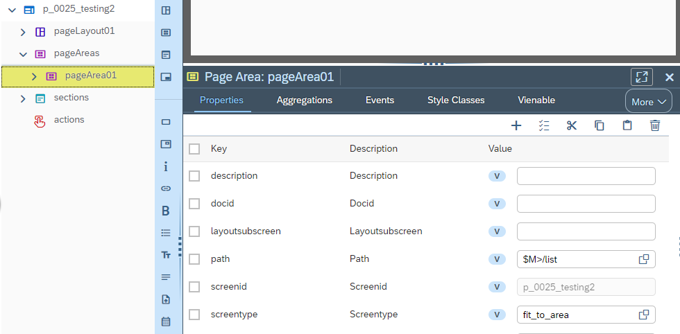
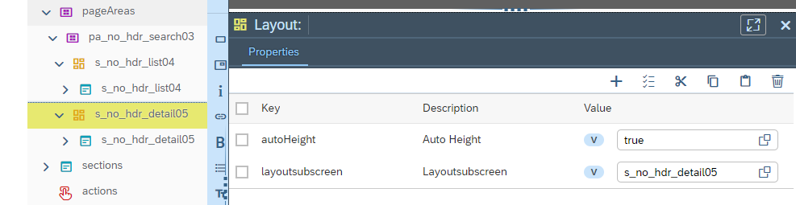
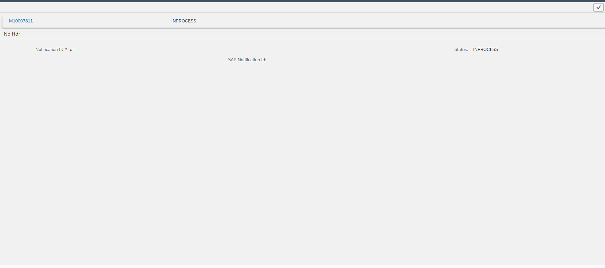

# KloGrowingContainer (fit_to_area)

## Overview

KloGrowingContainer is a Page area (flex) control which will allow the growth of the height of the particular section under its parent page area.

## Framework Version Information

6.0

## Usage

In general, this control is useful if developers want to allow a control to occupy the available space. For example, if there are two sections (A & B) under a single page area & the requirement is one section(A) must have a fixed height & and the other section (B) will adjust in the remaining complete space.

In this case, the developer can use the KloGrowing container as a Page Area & and for section (B) will mark autoHeight as **true** in its layoutdata.

## Steps

1.  Select the screen type as a fit_to_area in the page areas properties section.

2.  For making sections height growable add auto height property in properties of layout and mark as true.

3.  See the preview and check your expectations are matched. Section ‘A’ has a fixed height while section ‘B’ has a responsive height.

> 
