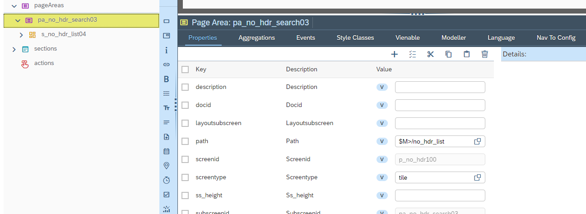
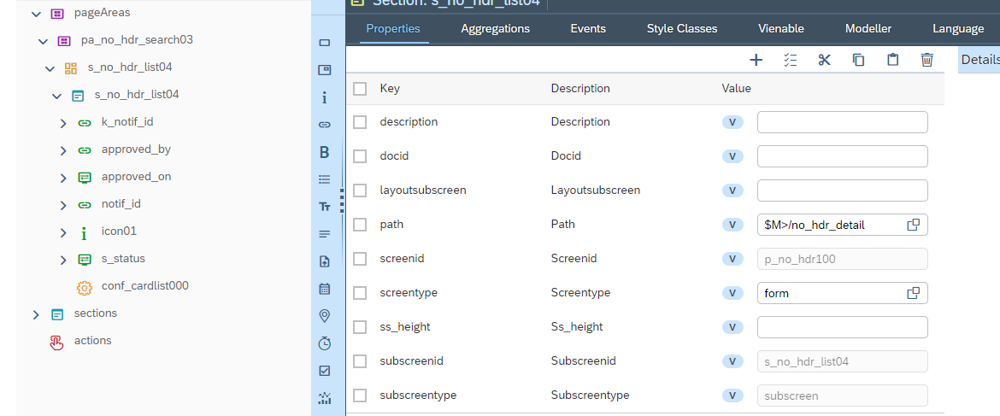
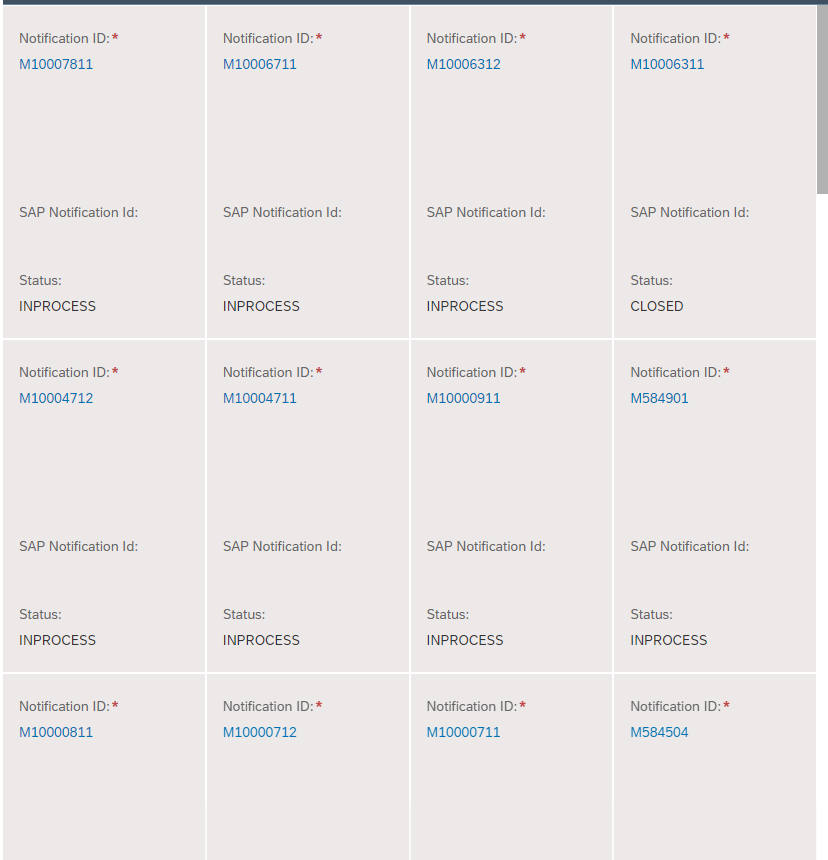

# KloTile (tiles)

## Overview

KloTile is a Page area (grid) control which will clone the child section based on the number of the entities in entityset and display it as tiles. KloTile is a new section type similar to cardlist, but it renders card content only when the card enters the visible viewport.

## Framework Version Information

6.0

## Properties

| **NAME**        | **TYPE**             | **DEFAULT VALUE** | **DESCRIPTION**                                                                 |
|-----------------|----------------------|-------------------|---------------------------------------------------------------------------------|
| **height**      | sap.ui.core.CSSSize  | 100%              | Height of the control                                 |
| **width**       | sap.ui.core.CSSSize  | 100%              | Width of the control                                  |
| **columnWidth** | sap.ui.core.CSSSize  | 1fr               | Width of each column.                                 |
| **bgColor**     | sap.ui.core.CSSColor | “#fffdfd”         | Background colour of the control.                     |
| **columnM**     | int                  | 1                 | Number of columns to be shown in medium sized screen. |
| **columnL**     | int                  | 1                 | Number of columns to be shown in medium sized screen. |
| **columnXL**    | int                  | 1                 | Number of columns to be shown in medium sized screen. |

## Usage

In general this control is useful if developers want to cover a range of values where each tile has the same total of the sum field based on the sort order of the incoming records. Like displaying products in shopping apps.

In this case, the developer can use KloTile control as a Page Area and bind it with entityset.

Page area of type KloTile must have at most one section as its child and that section type must be either card/form or any other control which will only support the entity.

## Steps

1.  Select the screen type as a tile in the page areas properties section and bind it with entityset.

> 

2.  Add only a single section under this page area. Maintain the section properly as per the requirements.

> 

3.  Now preview and see multiple tiles with a bound section will be displayed & also it will adjust the size based on available space.

> 
