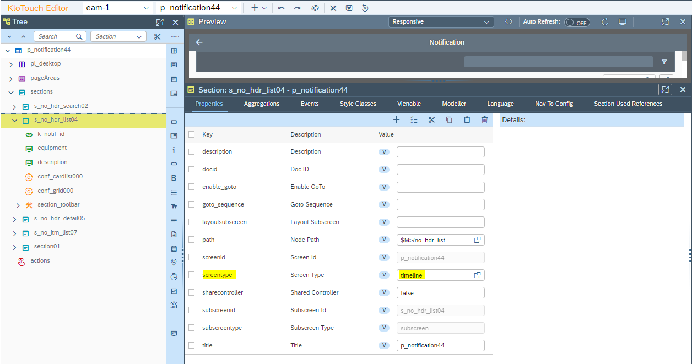
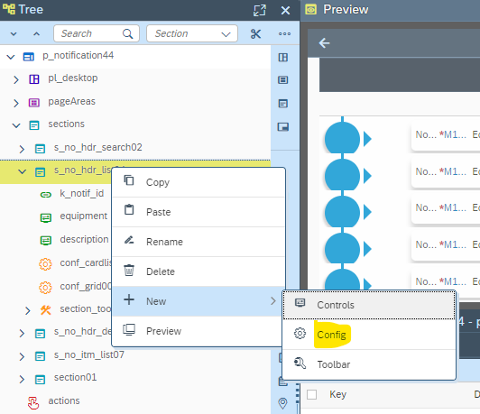
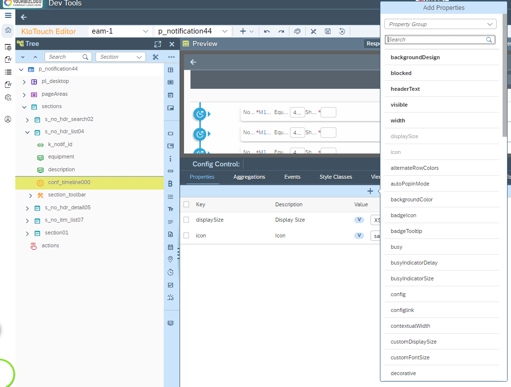
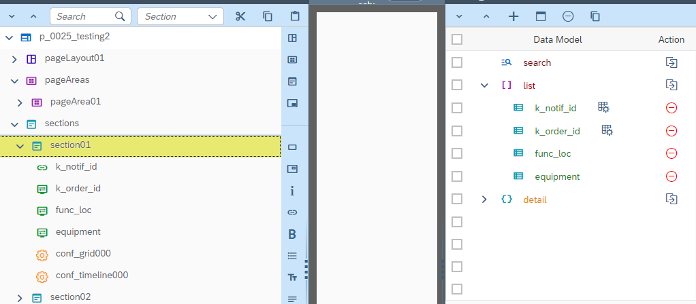
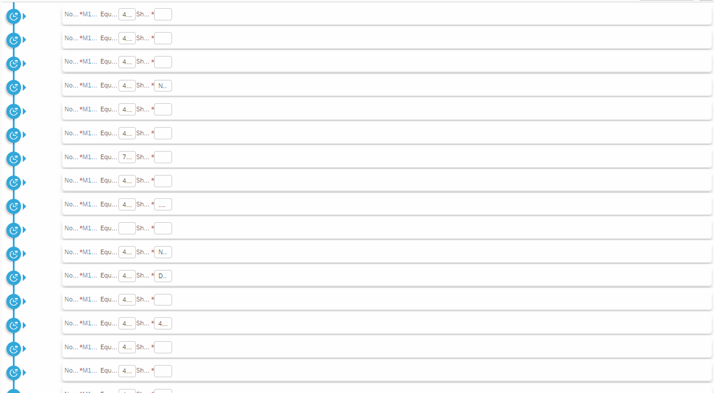
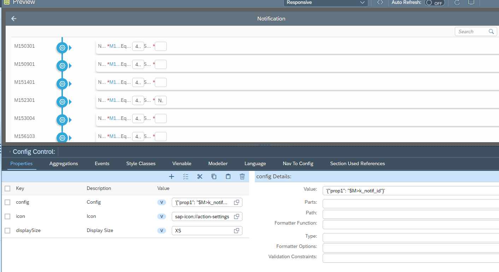
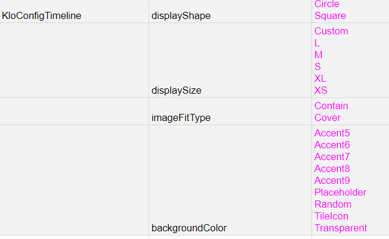

# KloTimelineConfig

## Overview

KloTimelineConfig control is useful when developers want to display the date with respect to time/date or any specific attributes.

## Framework Version Information

6.0

## Properties

| **NAME** | **TYPE** | **DEFAULT VALUE** | **DESCRIPTION** |
|---|---|---|---|
| **icon** | sap.ui.core.Icon | 'sap-icon://person-placeholder' | Icon for timeline items.  [detail](https://openui5.hana.ondemand.com/api/sap.m.Avatar#controlProperties) |
| **displayShape** | sap.m.AvatarShape | “Circle” | For timeline item avatar shape.  [detail](https://openui5.hana.ondemand.com/api/sap.m.AvatarShape) |
| **displaySize** | sap.m.AvatarSize |   | For timeline item avatar size.  [detail](https://openui5.hana.ondemand.com/api/sap.m.AvatarSize) |
| **customDisplaySize** | sap.ui.core.CSSSize |   | Specifies custom display size of the timeline item Avatar.  **Note**: It takes effect if the displaySize property is set to Custom.  [detail](https://openui5.hana.ondemand.com/api/sap.m.Avatar#controlProperties) |
| **customFontSize** | sap.ui.core.CSSSize |   | Specifies custom font size of the timeline item Avatar.  **Note**: It takes effect if the displaySize property is set to Custom. |
| **imageFitType** | sap.m.AvatarImageFitType | Cover | Specifies how an image would fit in the timeline item Avatar. |
| **fallbackIcon** | string |   | Defines the fallback icon displayed in case of wrong icon src of timeline item avatar. **Notes:** If not set, a default fallback icon is displayed depending on the set displayShape property.Accepted values are only icons from the SAP icon font. |
| **backgroundColor** | sap.m.AvatarColor | Accent6 | Determines the background colour of the timeline item avatar. |
| **showBorder** | boolean | false | Determines whether the control is displayed with a border. |
| **badgeIcon** | sap.ui.core.URI | “” | Defines what type of icon is displayed as visual affordance. It can be predefined or custom. |
| **badgeTooltip** | string | “” | Defines a custom tooltip for the badgeIcon. If set, it overrides the available default values. |
| **decorative** | boolean | false | Defines whether the timeline item avatar is used for decorative purposes and is ignored by accessibility tools. |
| **config** | object | \\{\\} | Takes a config object which is shown on the left side of the timeline. Config Eg. \\{"prop1": "$M&gt;id", "prop2": "$M&gt;name", ….\\} Config can contain “n” no of key value pairs where key can be anything. |

## Usage

For using a section of type timeline follow the below-mentioned steps:

1.  Create a section and select screen type as timeline.

> 

2.  Right-click on the selected section and add the config.

> 

3.  In config add the required properties.

> 

4.  Drag the required properties from the trans node and drop on the section.

> 

5.  A preview of the timeline will be mentioned below.

> 

6.  For adding a field before the timeline icon user needs to provide the JSON as a string in the config property of the timeline’s config & config should have the utmost two fields (Means max 2 fields can be shown on the left side of the icon).

> 

Currently, users can use the below-mentioned properties with respective values.

> 
