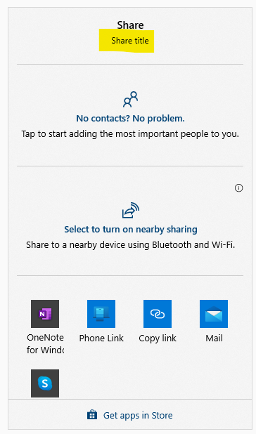
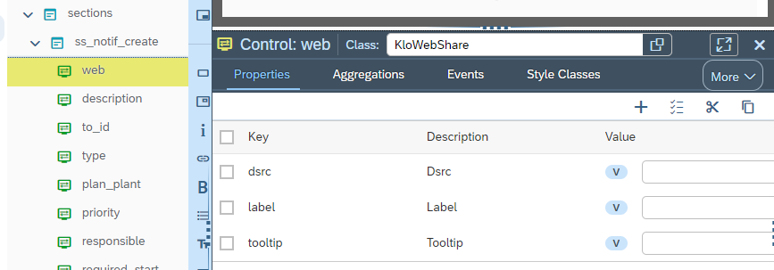
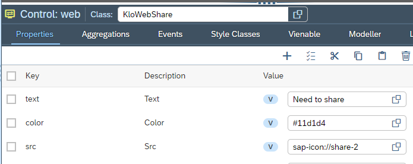
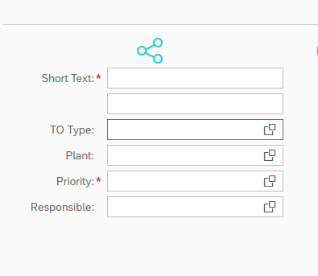
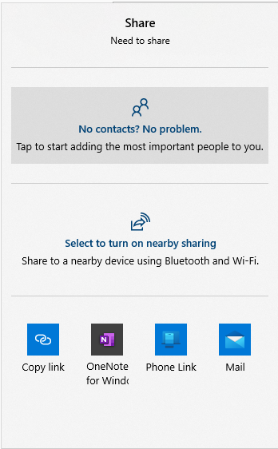

# KloWebShare

## Overview

The KloWebShare allows a site to share links to user-selected share targets, utilizing the sharing mechanisms of the underlying operating system. These share targets typically include the system clipboard, email, contacts or messaging applications, and Bluetooth or Wi-Fi channels.

## Framework Version Information

6.0

## Properties

| **NAME** | **TYPE**            | **DEFAULT VALUE**               | **DESCRIPTION**                                                    |
|----------|---------------------|---------------------------------|--------------------------------------------------------------------|
| **src**  | sap.ui.core.Icon    | 'sap-icon://person-placeholder' | Icon of the control                      |
| **size** | sap.ui.core.CSSSize |                                 | Size of the control’s icon.              |
| **text** | string              | “”                              | To set the \*\***“share dialog”** title. |

## Share dialog

> 

## Usage

For using KloWebShare control in APK or IPA developers need to make sure that **cordova-plugin-x-socialsharing** is added to the application. For browsers, plugin is not required.

## Steps

1.  Add the KloWebShare as a control in the needed section.

> 

2.  Developers can also use the following properties

> **Src**:- for changing the icon which will render as a control
>
> **Text**: - Text will be displayed as a title of the API’s dialog.
>
> **Color**: - For changing the color of the icon.
>
> 

3.  A preview of the web share control is mentioned below:

> 

4.  On click of the icon, the API's dialog will be displayed with text properties value. It will share the current page’s URL.

> 
