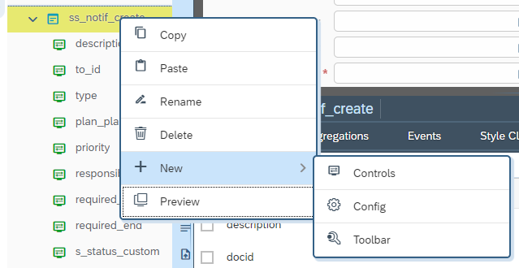
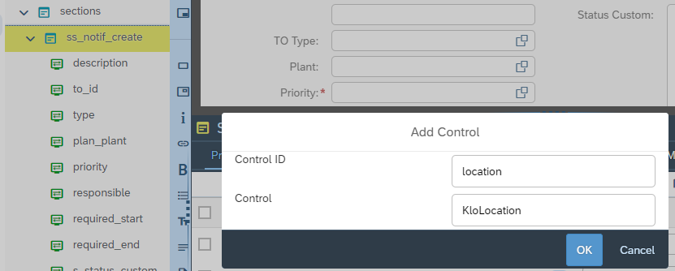
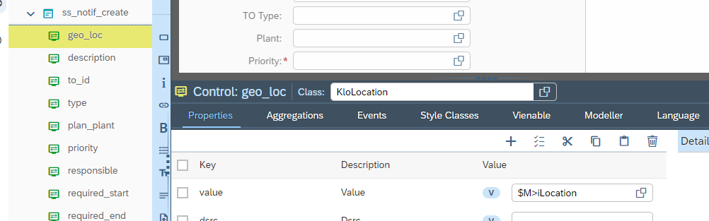
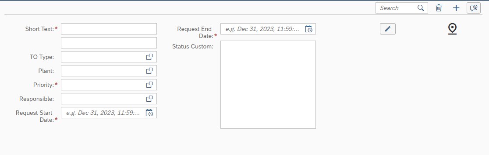

# KloLocation

## Overview

The KloLocation control is used for representing the ILocation qualifier in sections of type other than map.

## Framework Version Information

6.0

## Properties

| **NAME**        | **TYPE**            | **DEFAULT VALUE**            | **DESCRIPTION**                                                                                                                                |
|-----------------|---------------------|------------------------------|------------------------------------------------------------------------------------------------------------------------------------------------|
| **geoLocation** | object              | \{\}                           | To bind location qualifiers and based on the latitude and longitude the map is opened and navigated.                 |
| **size**        | sap.ui.core.CSSSize |                              | Since Icon uses font, this property will be applied to the css font-size property on the rendered icon for location. |
| **src**         | sap.ui.core.URI     | sap-icon://kloFontg/pin_drop | To set the icon for control’s icon.                                                                                  |

## Usage

For using ILocation qualifiers in sections of type other than map developers need to use KloLocation control. This control will be rendered as an icon and on click of the icon it will open the GMap with the route from the current location to the location of the qualifier( latitude and longitude stored in the ILocation qualifier).

## Steps

1.  Add the KloLocation control in the needed section. Select the **Controls** option and add the Location Control.

> 
>
> 

2.  Developers must make sure that the value property of KloLocation control is bound with the ILocation Qualifier. They can use all the icon properties on this control.

> 

3.  Preview of KloLocation control.

> 

4.  On clicking the icon it will open the GMap with the route from the current location to the location of the qualifier(latitude and longitude stored in the ILocation qualifier).
