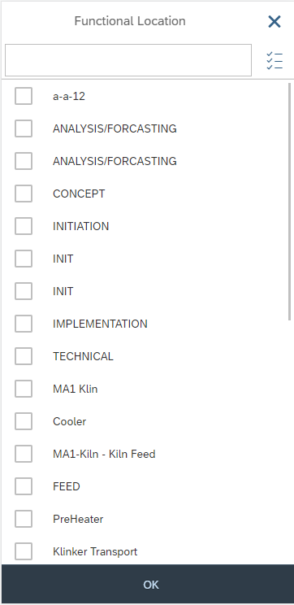
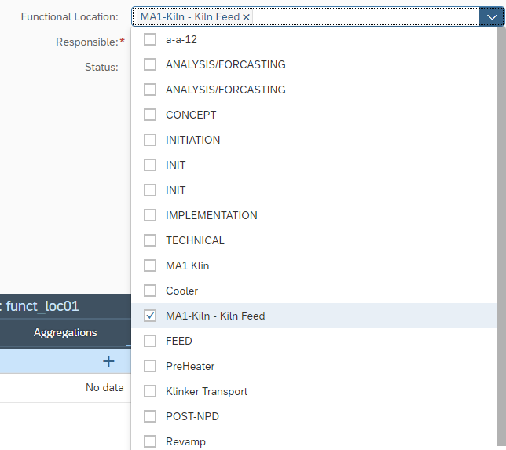
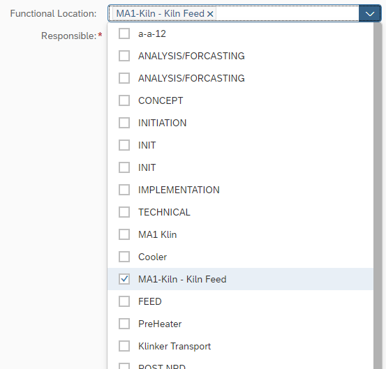
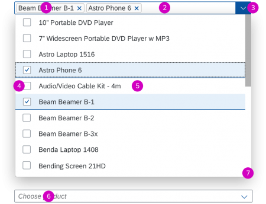
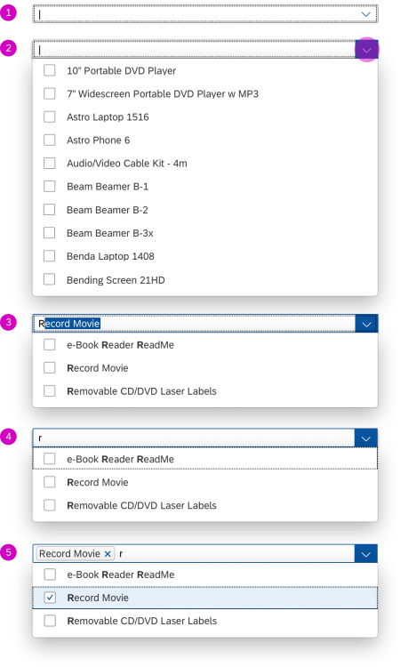
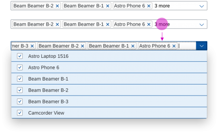
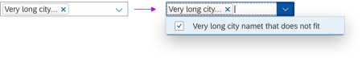
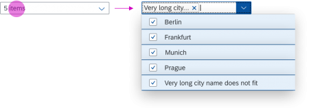
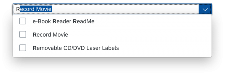
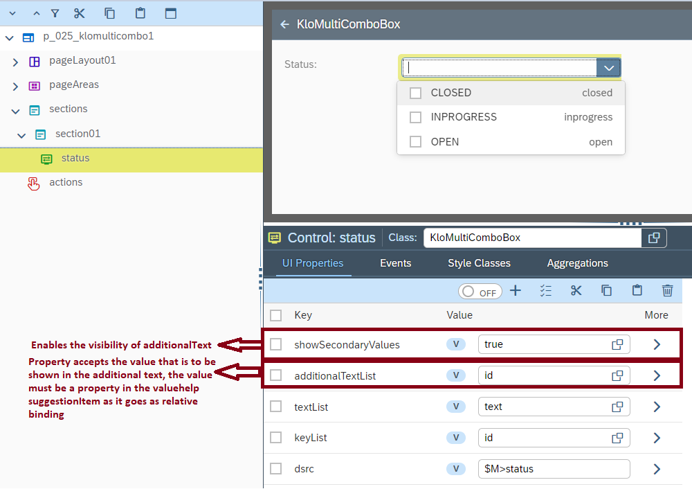

# KloMultiComboBox

## Introduction

The KloMultiCombo box control is commonly used to enable users to select one or more options from a predefined list. The control provides an editable input field to filter the list, and a dropdown arrow to open the list of available options. The select options in the list have checkboxes that permit multi-selection.

## Usage

#### Use the kloMultiCombo box if

- The user needs to select one or more options from a long list of options (maximum of approximately 200).

- The values of the option list contain secondary information that does not need to be displayed right away.

#### Do not use the kloMultiCombo box if

- The user needs to choose between two options, such as ON or OFF and YES or NO. In this case, consider using a switch control instead.

- You need to display more than one attribute. In this case, consider using the kloInput instead.

- The user needs to search on multiple attributes. In this case, consider using the kloInput instead.

- Your use case requires all available options to be displayed right away, without any user interaction. In this case, consider using [checkboxes](https://experience.sap.com/fiori-design-web/checkbox/) instead.

- You want to enable users to add custom values. In this case, consider using the [multi-input field](https://experience.sap.com/fiori-design-web/multiinput/).

- Your use case requires more options to choose from. In this case, consider using the [multi-input field](https://experience.sap.com/fiori-design-web/multiinput/), either with the [select dialog](https://experience.sap.com/fiori-design-web/select-dialog/) or [value help dialog](https://experience.sap.com/fiori-design-web/value-help-dialog/) (for more than 1000 items).

## Responsiveness

The kloMultiCombo box is optimized for keyboard and mouse interaction.

#### Size S

#### Size M

#### Size L

## Components

#### Input Field

The [input field](https://experience.sap.com/fiori-design-web/input-field/) (2) can display a placeholder text (6) when it’s empty, or a [token](https://experience.sap.com/fiori-design-web/token/) (1) if a value is selected.

***Components of the kloMultiCombo box***

#### Dropdown Trigger

The dropdown button (3) collapses and expands the dropdown list.

#### Option List

The option list (7) contains a list of selectable options (5). Clicking the label of an entry closes the option list and creates a token for the selected option. To enable multi-selection, every entry also has a [checkbox](https://experience.sap.com/fiori-design-web/checkbox/) (4). Clicking a checkbox creates a token. The option list remains open.

## Behavior and Interaction

#### Select a Value

There are three ways to select an item from the list:

- Tick the checkbox (option list remains open).

- Click the label of a select option (option list is closed).

- Use the keyboard (spacebar or Enter).

The user clicks the input field to place the cursor in the field (1). Clicking the down arrow displays the list (2). As the user types into the input field, the list is filtered accordingly (3). The arrow up and arrow down keys move the focus within the list (4), while the typed text remains in the input field. Selected options are automatically entered into the input field as tokens (5).

If the user selects items from the filtered option list (3) by clicking the checkbox or by pressing the space bar on the keyboard, the text entered in the input field remains. The option list stays open. If the user selects items by clicking the label or by pressing Enter, the entered text is cleared and the option list is closed.

The shift key can be used to select a range of items (shift+click marks the end of the range, shift+arrow up / shift+arrow down extends or narrows the selection range in the corresponding direction. Ctrl+A selects or deselects all items. If selecting all items is a common use case, you can also show a Select All [checkbox](https://experience.sap.com/fiori-design-web/checkbox/) at the top of the list (property: showSelectAll).

#### Reviewing Tokens

If tokens have been selected, and the multi-combo box is not in focus, the input field displays as many tokens as possible in the available space. If more tokens have been selected, an \[n\] More label indicates the number of hidden tokens. The tokens in the input field appear in the order in which they were selected.

Clicking the \[n\] More label opens a popover below the input field, in which all selected items are shown. The user can deselect an item by clicking its checkbox or label.

If the length of the last selected token exceeds the width of the input field, a label \[n\] Item/s is shown when the field is not in focus.

Clicking the \[n\] Item/s label opens a popover below the input field, in which all selected items are shown. The user can deselect an item by clicking its checkbox or label.

If there is only one token in the input field and its length exceeds the width of the input field, the text is truncated. Clicking the token opens a popover below the input field, in which the full text of the token is shown.

***Multi-combo box - '1 Item' case (desktop)***

#### Filtering the Option List

When the user starts typing in the input field, the option list is filtered. Only items that match the characters entered are shown in the dropdown list. The default filtering method is “starts with per term”, which matches the beginning of each word in an item’s text.

If the filtered option list contains items that start with the characters entered by the user, the first matching, unselected item is auto-completed in the input field.

## Guidelines

#### Placeholder

Don’t use the placeholder attribute as an alternative to a label. This is important because the placeholder text will be overwritten as soon as the form is filled out. Labels are necessary because they indicate the meaning of the form fields if the placeholders are no longer visible. Show a placeholder only if the user needs a hint about what data to enter. Don’t repeat the content of the label. A hint could be a sample value or a brief description of the expected format. For more information about how to use the placeholder, see [input field](https://experience.sap.com/fiori-design-web/input-field/).

#### Option List

Keep the label of an entry in the select option list as short as possible because the list uses single lines only. Values that are too long may be truncated. If you need to indicate that none of the selection options are selected, show a blank input field. Define a default selection whenever possible. The kloMultiCombo box cannot display columns. If you want to show two values in the option list, show the leading information first, followed by the secondary information in parentheses, such as Walldorf (Germany).

Don’t [disable](https://experience.sap.com/fiori-design-web/ui-element-states/#disabled) items in the option list. If an item can’t be selected, hide it.

#### Width

You can adjust the width of the option list to some extent. The multi-combo box control is usually used in [forms](https://experience.sap.com/fiori-design-web/form/), where the width is determined by the form element or container in which it is embedded. Therefore, we don’t recommend defining a fixed width, but rather working with proper layout containers such as the form, simple form, or responsive grid layout, and with the layout data property, where the width is defined. If you need to restrict the width to a defined value, set the width accordingly. Keep in mind that there’s no horizontal scrolling in the option list. Entries that are too long are truncated and users won’t be able to read them. To avoid this, you can enable wrapping (property: wrapping).

additionalTextList, textList and keyList:

**keyList** accepts the value which is the property in the value help suggestionItems. When provided property goes as relative binding to the suggestionItems aggregation. And the value is the key for the suggestion items.

**textList** accepts the value which is the property in the value help suggestionItems. When provided property goes as relative binding to the suggestionItems aggregation. And the value is the text for the suggestion items.

**additionalTextList** accepts the value which is the property in the value help suggestionItems. When provided property goes as relative binding to the suggestionItems aggregation. And the value is the additional for the suggestion items. showSecondaryValues property needs to be set to true so that the additionalText is shown in the suggestionItems.

**Note:** For binding properties, we follow the predefined sequence:

\["geoLocation", "avatarTitle", "src", "dateValue", "selected", "selectedKey", "selectedKeys", "value", "guid", "text", "state"\].

Accordingly, for **kloMultiComboBox**, the binding should be implemented using the **selectedKey** property

**Note:** For more information please refer to this [sap.m.MultiComboBox](https://sdk.openui5.org/api/sap.m.MultiComboBox).
