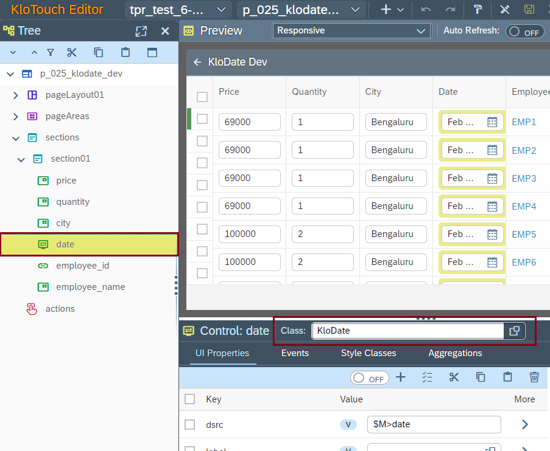
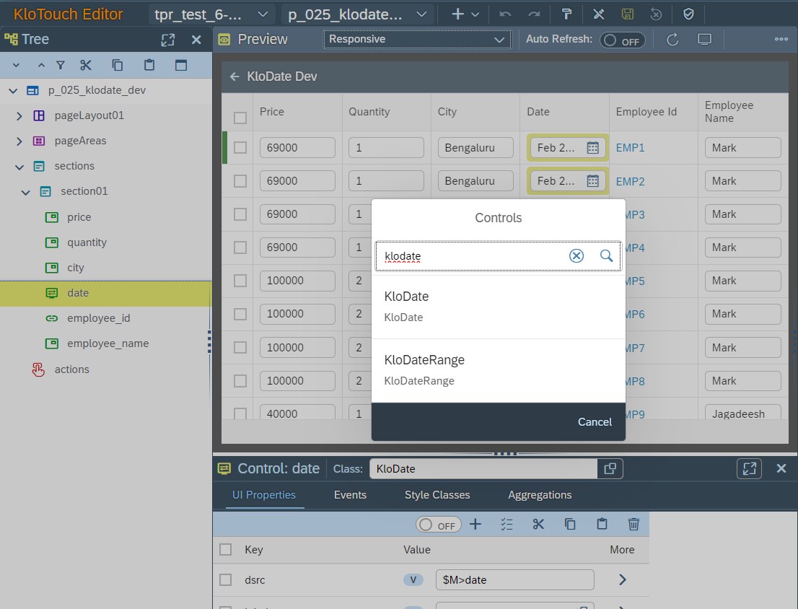
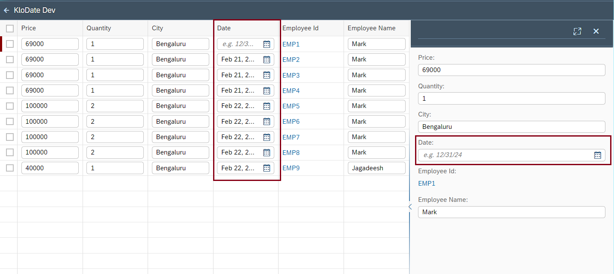

# KloDate

**Class**: KloDate

## Overview

Extended from **sap.m.DatePicker**

## Framework Version Information

6.0 and above

## Properties

Please refer to the properties of the control [sap.m.DatePicker](https://sdk.openui5.org/api/sap.m.DatePicker#controlProperties) for more information on Properties.

## Usage

Please refer to the section Sample Code or Usage below.

## Events

Please refer to the events of the control [sap.m.DatePicker](https://sdk.openui5.org/api/sap.m.DatePicker#events) for more information.

## Sample Code or Usage

