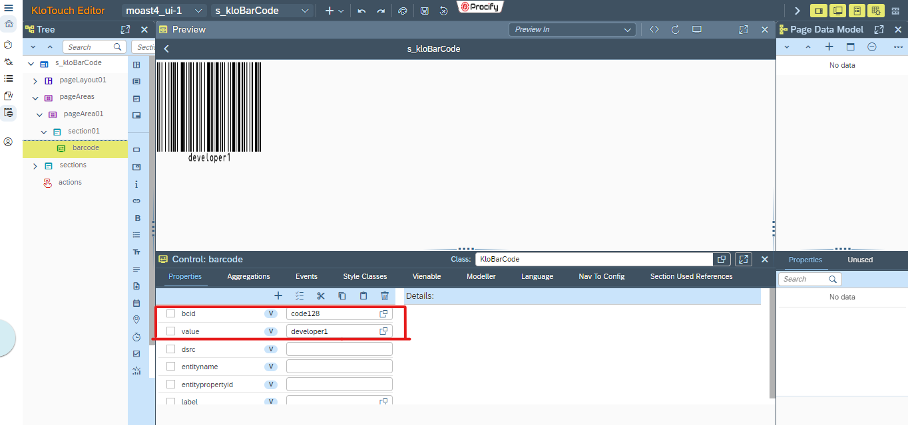

# KloBarCodeWriter

**Class**: KloBarCodeWriter

## Overview

Extended from sap.ui.core.Control.

This feature renders a barcode of specified bcid(Barcode Id) once a value is provided either by setting or binding to a path in the model.

Value is a must property if the barcode is expected on the view.

The data uri of the displayed barcode can be accessed with the help of canvasURL property which can be bound to a path in the model to be used elsewhere.

width, height, padding and backgroundColor can be provided which are cssvalues.

Rotate can take values N(Normal), R(Right), L(Left), I(Inverted)

## Framework Version Information

6.0 and above

## Properties

| **NAME**            | **TYPE**                 | **DEFAULT VALUE** | **DESCRIPTION**                                                                                                             |
|---------------------|--------------------------|-------------------|-----------------------------------------------------------------------------------------------------------------------------|
| **bcid**            | string                   | datamatrix        | Type of barcode to be displayed                                                                   |
| **value**           | string                   | “”                | Value for which the barcode to be generated                                                       |
| **width**           | sap.ui.core.CSSSize      | 200px             | Height of the barcode                                                                             |
| **height**          | sap.ui.core.CSSSize      | 200px             | Width of the barcode                                                                              |
| **backgroundColor** | string                   | fff               | BackgroundColor of the barcode generated                                                          |
| **rotate**          | 'N' \| 'R' \| 'L' \| 'I' | N                 | Rotates the barcode to right, left, normal or inverted.                                           |
| **padding**         | string                   | 2                 | Value to provide padding for the barcode from its container                                       |
| **canvasURL**       | string                   |                   | Binding path to the model if provided gives the data uri that can be accessed in the binded path. |

## Sample Code or Usage

The above image shows the barcode control and values provided for the properties **bcid** and **value.**

#### Reference Document

[**BWIPP_barcodewriter_guide.pdf**](https://drive.google.com/file/d/1-_UmqIOuaJTftV_4im6xLP6M8j6mEHQj/view?usp=drive_link)
