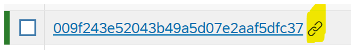
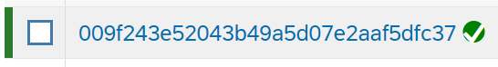
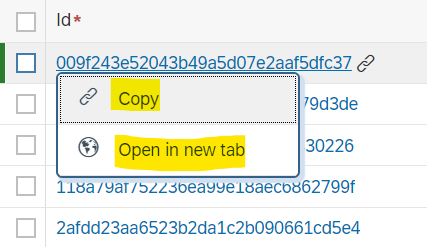

# KloLink

## Overview

Extended from **sap.m.Link**

**KloLink** is a control which allows users to open a Link, both in the same screen and in another tab, on CTRL + Click. It also offers a one-click option to copy the link.

## Framework Version Information

7.0

## Properties

Check properties of [**sap.m.Link**](https://openui5.hana.ondemand.com/api/sap.m.Link#controlProperties).

## Usage

**KloLink** control’s basic functionality is **list to detail navigation,** like **m.Link,** but this control has some additional features. This control is useful when developers want to provide functionality where they can open a link, other than the current tab, in single action(CTRL + Click) which is a standard practice in websites. This control also provides the ability to copy the link to clipboard with a single click. This link can be shared and opened later.

**On hover KloLink:**

Copy button copies the link to the clipboard.

On right click, Control opens a context menu with two options:

1\. Copy

2\. Open link in new tab.

**On right click in KloLink:**

## Events

| **NAME**  | **DESCRIPTION**                                                                                                                                                                                                                                                                                                                                                                                                                                                                                |
|-----------|------------------------------------------------------------------------------------------------------------------------------------------------------------------------------------------------------------------------------------------------------------------------------------------------------------------------------------------------------------------------------------------------------------------------------------------------------------------------------------------------|
| **press** | This event takes the “**navTo”** event from Page Builder, based on which it does standard navigation/CTRL + Click navigation and generates the copyable link for later use or sharing. \*\* Control will not work as intended, if the event method is any other method than “navTo” API in the Page Builder. Even if inside the controller function “navTo” is used, it will not work for copy link or open in new tab functionality. |
