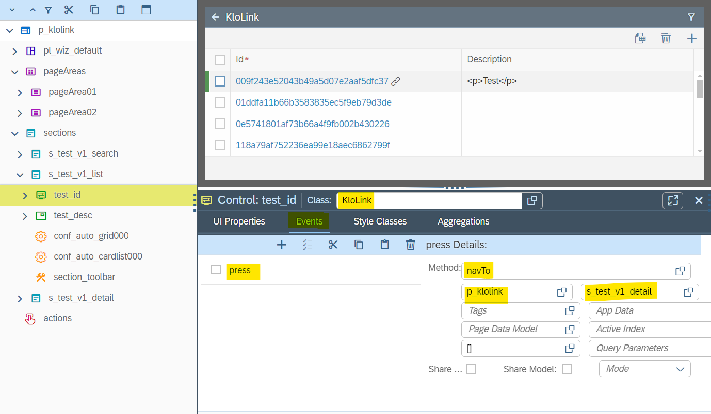
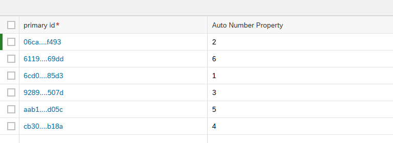
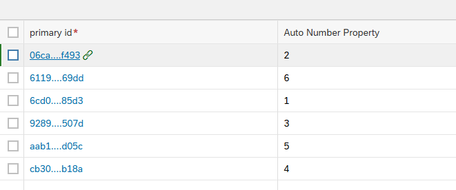

# KloGuid

**Class**: KloGuid

## Overview

Extended from KloLink which is extended **sap.m.Link**.

KloGuid allows developers to display GUID property data in a shortened format.

## Framework Version Information

7-2-74

## Usage

KloGuid allows displaying GUID property data in a shortened format,showing the first four characters, followed by four dots, and then the last four characters (e.g., abcd....lmno). When the user hovers over it, a copy icon appears, enabling them to easily copy the full GUID.

The GUID, which is 32 characters in length, is formatted by displaying the first four characters, followed by '....', and then the last four characters, making it more concise and visually suitable for display on the screen.

When you hover over the link, an icon will appear. Upon clicking the icon, the entire 32-character GUID will be copied to the clipboard, allowing it to be used as needed. Additionally, clicking the link will navigate you to the detailed page.

## Properties

Check properties of **KloLink.** ( [**sap.m.Link**](https://openui5.hana.ondemand.com/api/sap.m.Link#controlProperties).)

| **NAME** | **TYPE**                               | **DEFAULT VALUE**           | **DESCRIPTION**                                                                                                    |
|----------|----------------------------------------|-----------------------------|--------------------------------------------------------------------------------------------------------------------|
| **guid** | string(GUID) | - | Formats the 32 char length guid to \<First Four Characters\>....\<Last Four Characters\> |

## Events

Check Events of **KloLink.**
