# Tree Screen Type Implementation

## Overview

The Tree Screen Type is designed to represent hierarchical data in a structured manner. It allows users to visualize relationships between parent and child nodes, making it ideal for displaying nested information such as organizational charts, file systems, or any other hierarchical datasets.

## Data Preparation

To prepare the data for a Tree Screen Type, we will use a JSON format that represents the hierarchical structure (If your Entityset has such structured data, you can use your entityset for the tree). Here’s a sample JSON array:

\[\{

"key_01": "value_1",

"key_02": "value_2",

"key_03": "value_3",

"child": \[\{

"key_01": "value_11",

"key_02": "value_22",

"key_03": "value_33",

"child": \[\{

"key_01": "value_111",

"key_02": "value_222",

"key_03": "value_333",

"child": \[\{

"key_01": "value_1111",

"key_02": "value_2222",

"key_03": "value_3333",

\}\]

\}\]

\}\]

\}\]

### JSON Structure

- Each object represents a node in the tree.

- The child array holds nested objects, representing the child nodes.

- Key names for child nodes are consistent with parent nodes, ensuring a clear relationship.

We will store the data in other type of transnode.

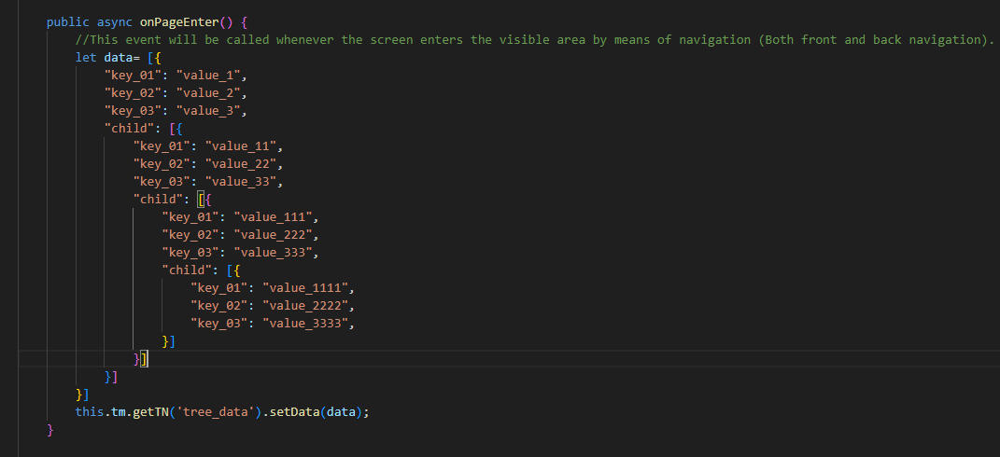

## Screen

**Step 1:**

- Create one pageArea with screentype, fit_to_area and a section with screentype, tree.

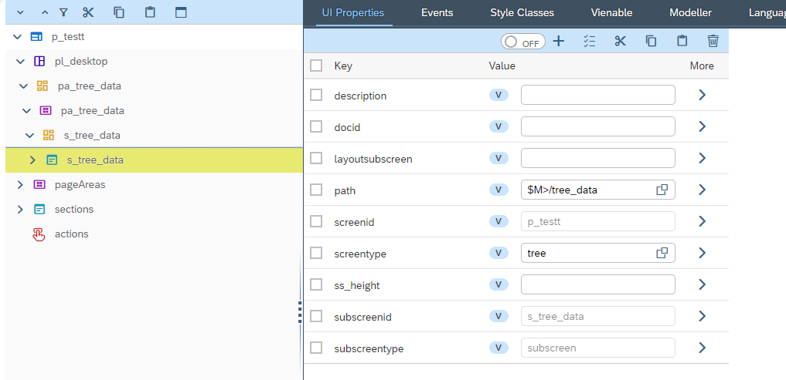

- In the section layout, add one property autoHeight as true. This ensures that the section dynamically adjusts its height based on the content displayed.

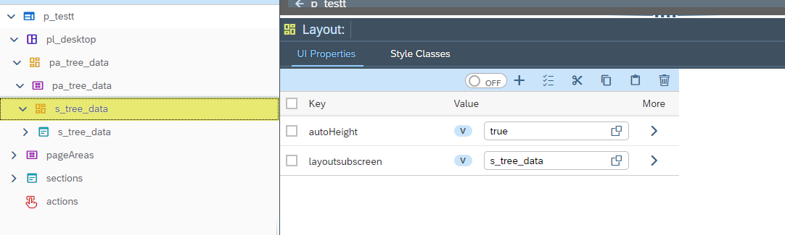

**Step 2:**

- Create other type of transnode (If you are using entityset, then you can use that transnode).

> 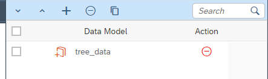

**Step 3:**

- Add Controls for Data Binding

- Create controls within the section for each key in your JSON data (key_01, key_02, key_03).

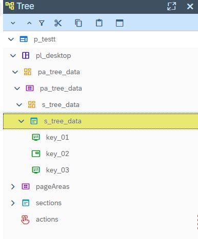

- Bind the section to the other type of transnode that contains the hierarchical JSON data.

> 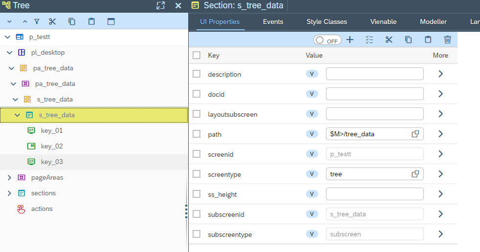

- Ensure that each control is correctly bound to the corresponding key in the JSON structure.

> 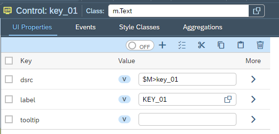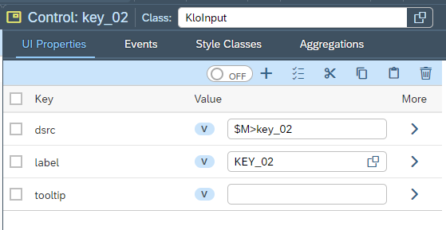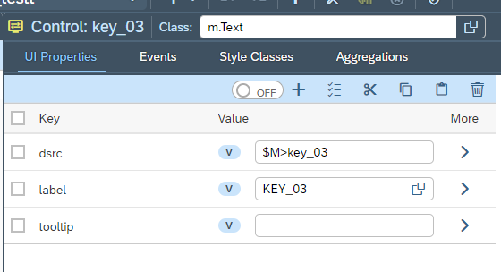

**Step 4:**

- Add Config to the section of type tree

- Add array names to the config for maintaining the child

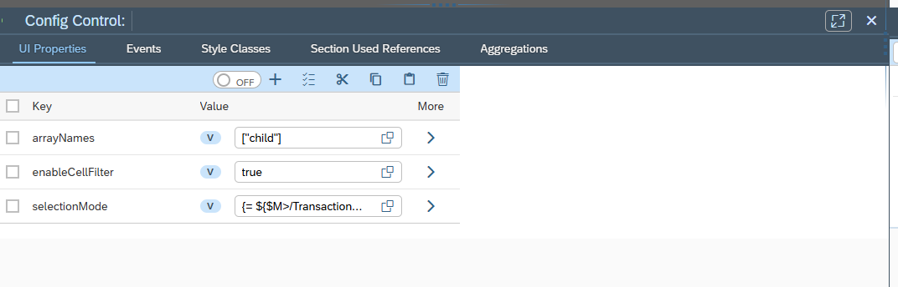

- Now after previewing the screen,it will look like as shown below :

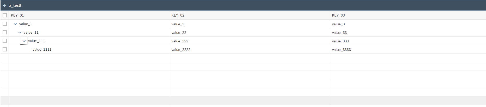
