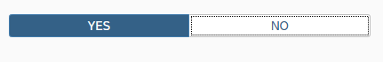
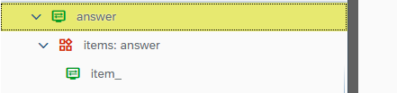
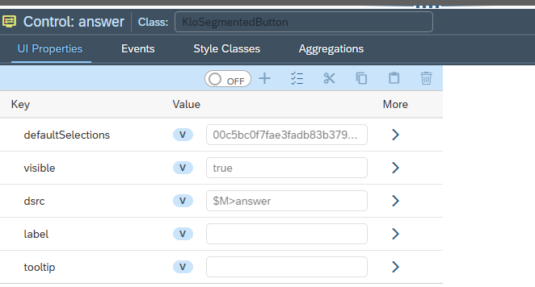
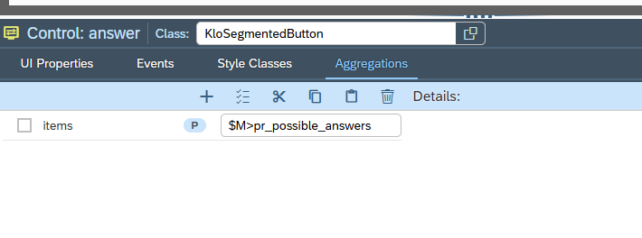
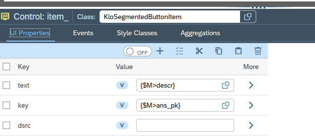

# KloSegmentedButton

## Overview

Extended from **sap.m.SegmentedButton**

**KloSegmentedButton** supports both single and multiple item selections. It is a customized control designed for use with segmented button items, making it useful in UI scenarios where users need the flexibility to select or deselect single/multiple item(s).

This control allows customization of both selection behavior and styling. It can be used to select either a single item or multiple items within a segmented button group.

## Framework Version Information

7.0

## Properties

| **Property name** | **Type** | **Default value** | **Description**                                                                                                                                                     |
|-------------------|----------|-------------------|---------------------------------------------------------------------------------------------------------------------------------------------------------------------|
| selectionType     | string   | single            | Defines whether the segmented button allows single or multiple selections.                                                                                          |
| selectedKey       | string   | \-                | The key(s) of the selected item(s). For single selection: The key of the selected item.For multiple selections: Comma-separated keys of selected items.             |
| defaultSelections | string   |                   | Default selections for the segmented button, specified as comma-separated keys. When selectedKey property is not set, the selection will be based on this property. |

## Usage

The **KloSegmentedButton** control is a customizable segmented button group that can be used for both single and multiple item selection. It can be used in scenarios where a user needs to select one or more options from a group of buttons.

- In the above picture, the “answer” is KloSegmentedButton.

- Items is the aggregation of KloSegmentedButton and item\_ is KloSegmentedButtonItem.

- The **dsrc** property binds with selectedKey property.

- DefaultSelections take the keys of the VH bound to the aggregation items

- The KloSegmentedButtonItem takes key and text.

- The Text property will be displayed as the button’s text.

> 
>
> If KloSegmentedButton is added to Card or Cardlist, then the card or cardlist can autoGrow based on the wrapping extent of the KloSegmentedButtonItems. To Enable the feature, Go to the card/cardlist config and add the property autoHeight and mark it true.
