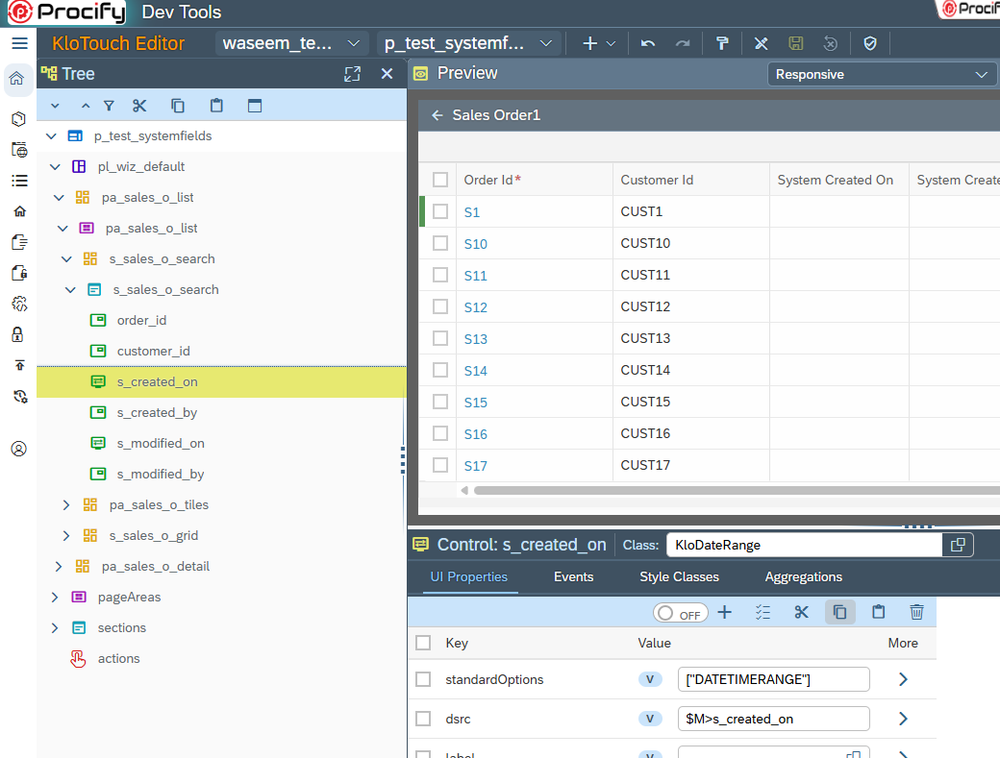
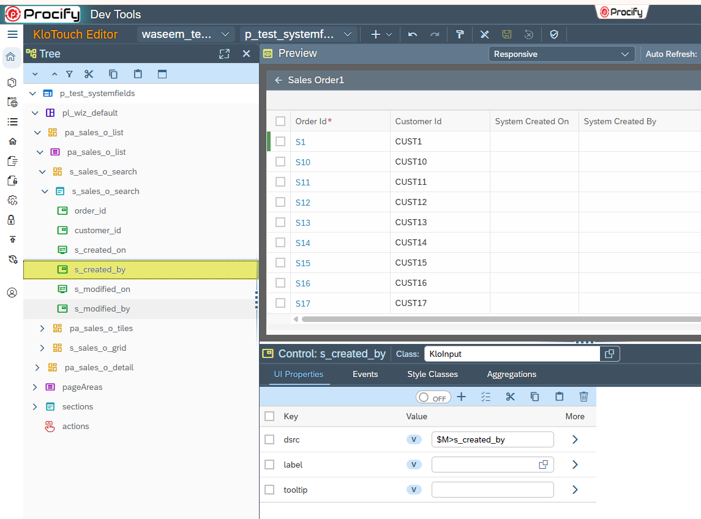
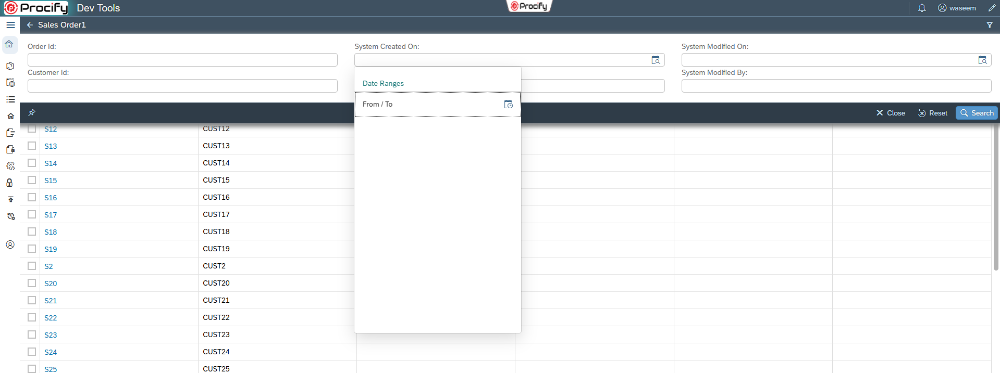
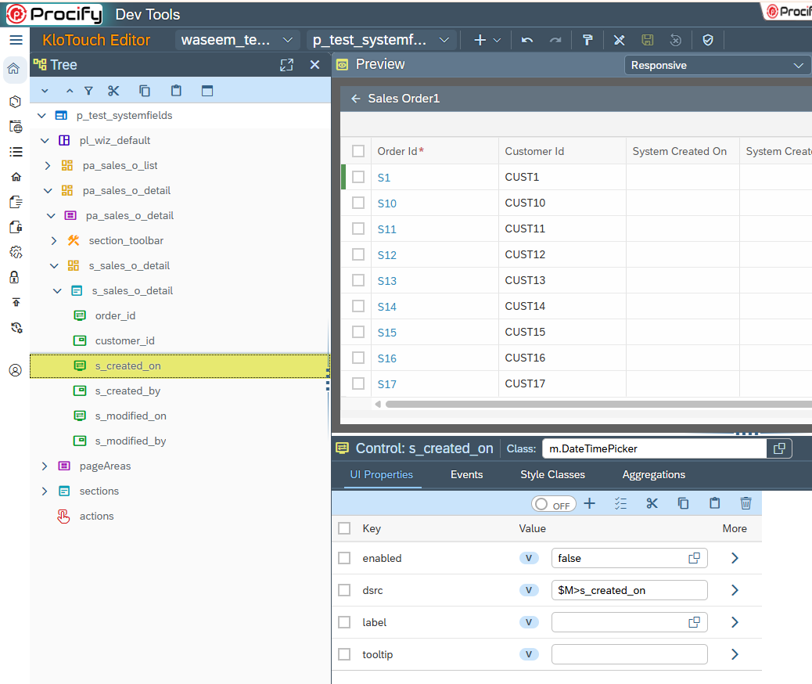
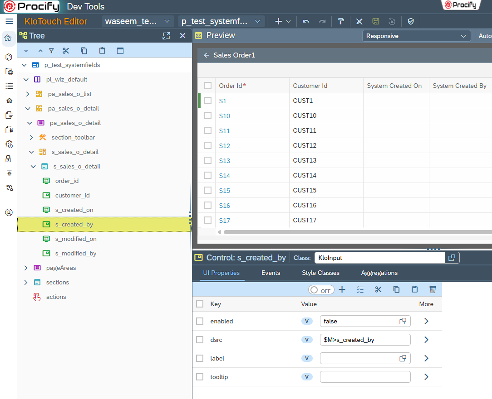
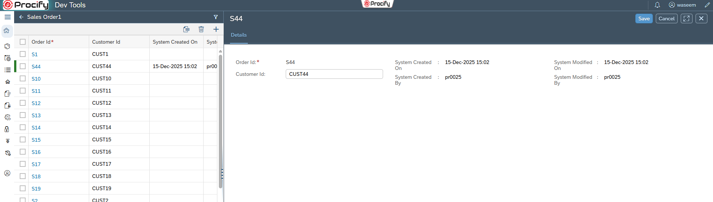

# KloDateRange

## Overview

Extended from **sap.m.DynamicDateRange**

**KloDateRange** control is extended from **sap.m.DynamicDateRange,** it is customised to support the date range selection and search in the FrameWork.

If a value is binded to the dsrc field of the control in the UIEditor, the control will be binded to \<property_id\>\_LEQ and \<property_id\>\_GEQ, these values will be set on the Query and whenever query is executed, the tokens will be generated for \<= and \>= values in the query. It also supports dateFormat property that will display the selected date values based on the given dateFormat value. KloDateRange control is only supported in the search section.

## Framework Version Information

7.0

## Properties

| **Property name**    | **Type** | **Default value** | **Description**                                                                                                                                                                                                                                                                                                                                                                                |
|----------------------|----------|-------------------|------------------------------------------------------------------------------------------------------------------------------------------------------------------------------------------------------------------------------------------------------------------------------------------------------------------------------------------------------------------------------------------------|
| endDate              | any      | null              | Binding for value set in the model, whenever value is selected from the control, the date object is updated to the path where endDate is binded in the model                                                                                                                                                                                                                                   |
| startDate            | any      | null              | Binding for value set in the model, whenever value is selected from the control, the date object is updated to the path where startDate is binded in the model                                                                                                                                                                                                                                 |
| displayFormat        | string   | undefined         | Based on the displayFormat provided, the datevalue is shown in the control after selecting a value.                                                                                                                                                                                                                                                                                            |
| defaultRangeOperator | string   | DATETIMERANGE     | Specifies the default operator to be used when reconstructing the date range value after a reset. If the control's current value does not contain an operator (e.g. after a reset clears the value), this property is used as the fallback. If not specified, DATETIMERANGE is used. Accepted values are valid DynamicDateRange operator keys such as DATETIMERANGE, DATERANGE, THISWEEK, etc. |

## Usage

Whenever a screen is created with wizard, fields that have datatype timestamp, are rendered as KloDateRange with default property standardOptions: \[“DateTimeRange”\]. In the list/detail section, the control class will be sap.m.DateTimePicker with show as label enabled.

When a property is manually dropped from the search transnode to the search section, the control class will be KloDateRange for the properties of datatype timestamp.

> 
>
> 
>
> 
>
> 
>
> 
>
> 

**Note:
When the application font size is increased, certain standard controls such as m.dateRange may not re-render all UI elements consistently. This can lead to layout issues where text is reflowed but action buttons are not, resulting in overlapping content and non-actionable buttons.**

**To avoid this behavior, it is recommended to use kloDateRange instead of m.dateRange. The kloDateRange control handles dynamic font scaling and UI re-rendering correctly, ensuring proper popup alignment, button accessibility, and consistent user interaction across different display and accessibility settings.**
