# KloRichTextEditor

**Class**: KloRichTextEditor

## Overview

Extended from **sap.m.TextArea**.

RichTextEditor is used for formatting the texts.

## Framework Version Information

5.7 and 6.0

## Properties

| **NAME**    | **TYPE**            | **DEFAULT VALUE** | **DESCRIPTION**                                                                                                                                                                                                                                                                                                                                                                                                       |
|-------------|---------------------|-------------------|-----------------------------------------------------------------------------------------------------------------------------------------------------------------------------------------------------------------------------------------------------------------------------------------------------------------------------------------------------------------------------------------------------------------------|
| **enabled** | boolean             | true              | *Indicates whether the user can interact with the control or not.*                                                                                                                                                                                                                                                                                                                          |
| **visible** | boolean             | true              | *Indicates whether this control is visible to the user or not.*                                                                                                                                                                                                                                                                                                                             |
| **height**  | sap.ui.core.CSSSize | auto              | *Sets the height of the control*                                                                                                                                                                                                                                                                                                                                                            |
| **width**   | sap.ui.core.CSSSize | auto              | *Sets the width of the control*                                                                                                                                                                                                                                                                                                                                                             |
| **value**   | string              | “”                | *Value for the control*                                                                                                                                                                                                                                                                                                                                                                     |
| **mode**    | string              | compact           | There are 3 modes of KloRichTextEditor. Inline:- In this mode formatting of the text can be done by selecting the text.Compact:- In this mode a text field toolbar will also be there with few formatting options.Full:- in this mode a text field toolbar is also there with all the formatting options |

From 6.0 onwards the expand & and collapse feature will be available for compact & and full modes.

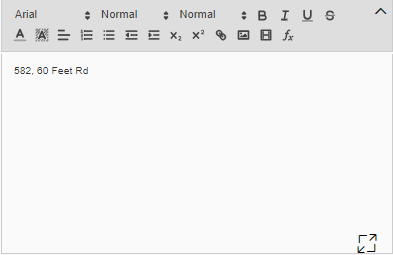

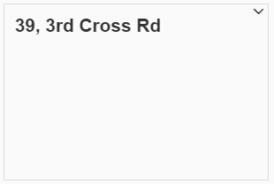

## Usage

For using KloRichTextEditor control from Page Builder, developers need to select the section in which KloRichTextEditor is needed. After selecting the section right click and then go to **New** and select **Controls**.

Provide the id to the control & and type KloRichTextEditor in the control field. Bind the value property of the control with the string / clob data type property of your entity. Developers also can drag the string / clob data type property from the trans node and drop over the section in which they want to use KloRichTextEditor control; the control generator will automatically predict the KloRichTextEditor control.

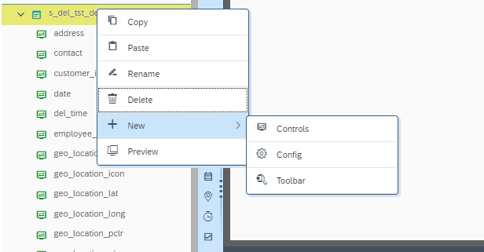

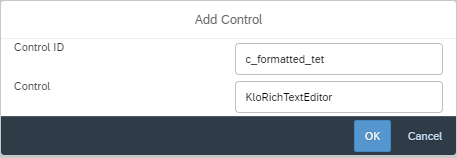

By default, KloRichTextEditor will be in compact mode.

Preview of the compact mode.

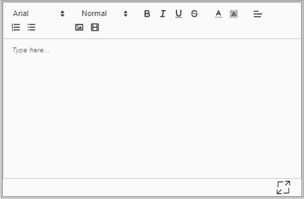

The highlighted part is a formatting toolbar which allows you to format the text colour, alignment, size, bg - colour etc.

The highlighted icon below opens the control in full-screen mode.

A preview of the full screen is given below:

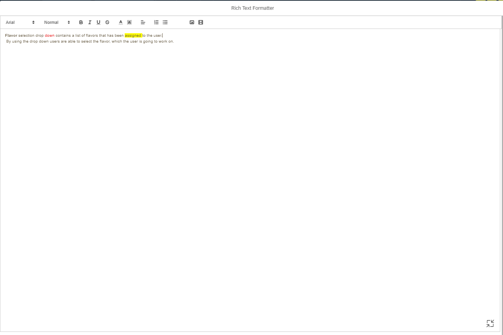

There are 3 modes of KloRichTextEditor control.

1.  **Inline:** In this mode formatting of the text can be done by selecting the text. The toolbar will be hidden.

2.  **Compact:** It is a default setting as seen above.

3.  **Full:** In this mode a text field toolbar is also there with all the formatting options.

For changing the mode of the control developers need to add a mode property in the control using Page Builder and then select the required mode from the **F4**.

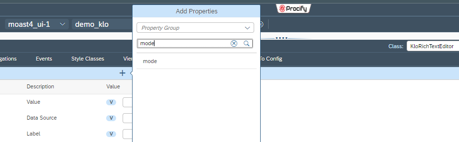

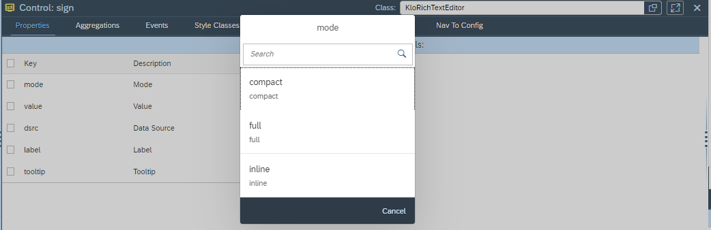

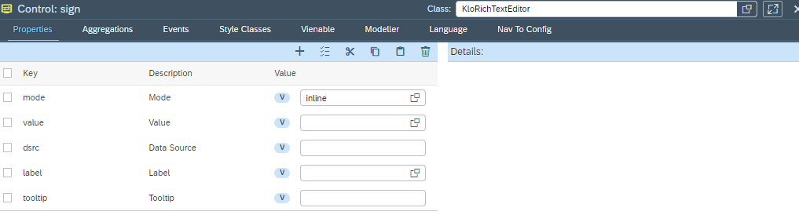

Preview of the control in inline mode:

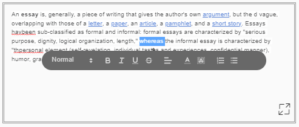

Preview of the control in full mode.

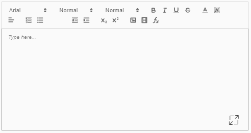

As mentioned all the snapshots belong to the control if the enabled property is true.

If the enabled property of the control is marked as false then the toolbar will be hidden in all the modes of the control. Users will not be able to format the text if the enabled property is false.

Preview of the control if enabled if marked as **false**.

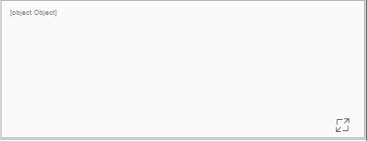
