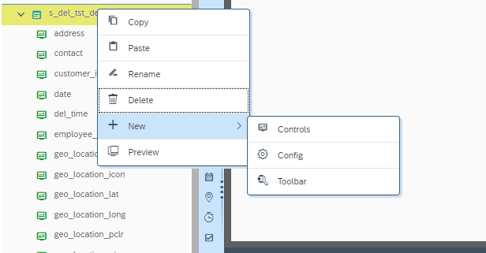
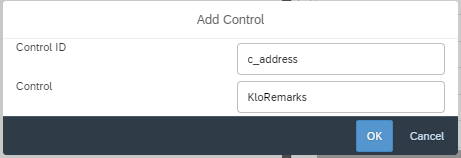
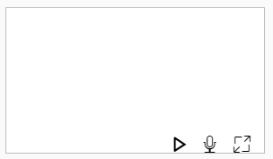
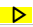
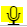
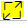
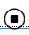
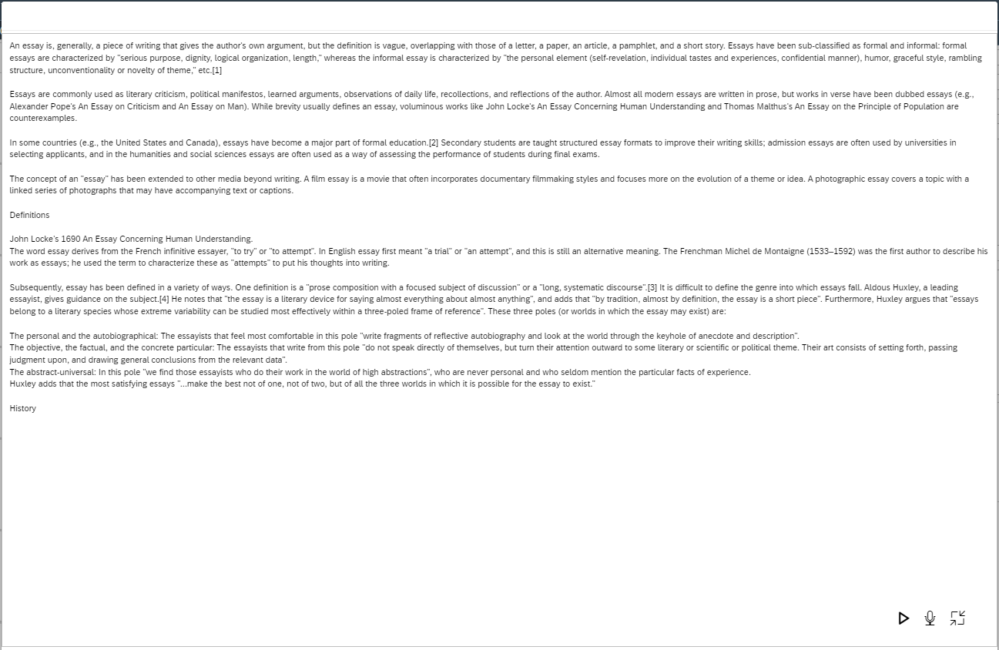

# KloRemarks

## Overview

KloRemarks control can store lengthy texts & and be able to use speech-to-text and text-to-speech features as well. Whenever the user hovers over the text field, three icons will be displayed:

- Mic is for speech-to-text.

- Play is for text-to-speech and

- The last icon is for opening the control in full-screen mode.

## Framework Version Information

5.5 and above

## Properties

| **NAME**                  | **TYPE**                  | **DEFAULT VALUE** | **DESCRIPTION**                                                                                                                                                                                                                                                                                                                                                                    |
|---------------------------|---------------------------|-------------------|------------------------------------------------------------------------------------------------------------------------------------------------------------------------------------------------------------------------------------------------------------------------------------------------------------------------------------------------------------------------------------|
| **value**                 | string                    | null              | Defines the value of the control                                                                                                                                                                                                                                                                                                                         |
| **fullScreenLabel**       | string                    | null              | Label which will display on the header of control on full-screen mode                                                                                                                                                                                                                                                                                    |
| **editable**              | boolean                   | true              | Defines whether the control can be modified by the user or not.                                                                                                                                                                                                                                                                                                                    |
| **enabled**               | boolean                   | true              | Indicates whether the user can interact with the control or not                                                                                                                                                                                                                                                                                                                    |
| **textToSpeech**          | boolean                   | true              | Indicates whether the user can use text to speech feature                                                                                                                                                                                                                                                                                                                          |
| **speechToText**          | boolean                   | true              | Indicates whether the user can use speech to text feature                                                                                                                                                                                                                                                                                                                          |
| **fullScreen**            | boolean                   | true              | Indicates whether the user can see kloRemarks control in full-screen                                                                                                                                                                                                                                                                                                               |
| **name**                  | string                    | null              | The name to be used in the HTML code (for example, for HTML forms that send data to the server via submission).                                                                                                                                                                                                                                                                    |
| **placeholder**           | string                    | null              | Defines a short hint intended to aid the user with data entry when the control has no value.                                                                                                                                                                                                                                                                                       |
| **required**              | boolean                   | false             | Indicates that user input is required                                                                                                                                                                                                                                                                                                                                              |
| **showValueStateMessage** | boolean                   | true              | Indicates whether the value state message should be shown or not.                                                                                                                                                                                                                                                                                                                  |
| **valueState**            | sap.ui.core.ValueState    | none              | Visualises the validation state of the control, e.g. Error, Warning, Success                                                                                                                                                                                                                                                                                                       |
| **valueStateText**        | string                    | null              | Defines the text that appears in the value state message pop-up.                                                                                                                                                                                                                                                                                                                   |
| **textAlign**             | sap.ui.core.TextAlign     | Initial           | Defines the horizontal alignment of the text that is shown inside the input field.                                                                                                                                                                                                                                                                                                 |
| **textDirection**         | sap.ui.core.TextDirection | Inherit           | Defines the text directionality of the input field, e.g. RTL, LTR                                                                                                                                                                                                                                                                                                                  |
| **cols**                  | int                       | 20                | Defines the visible width of the control, in average character widths. Note: The width property wins over the cols property, if both are set.                                                                                                                                                                                                                                      |
| **rows**                  | in                        | 10                | Defines the number of visible text lines for the control. Note: The height property wins over the rows property, if both are set.                                                                                                                                                                                                                                                  |
| **growing**               | boolean                   | false             | Indicates the ability of the control to automatically grow and shrink dynamically with its content. Note: This property should not be used when the height property is set.                                                                                                                                                                                                        |
| **growingMaxLines**       | int                       | 0                 | Defines the maximum number of lines that the control can grow.                                                                                                                                                                                                                                                                                                                     |
| **height**                | sap.ui.core.CSSSize       | 100%              | Defines the height of the control.                                                                                                                                                                                                                                                                                                                                                 |
| **width**                 | sap.ui.core.CSSSize       | 100%              | Defines the width of the control.                                                                                                                                                                                                                                                                                                                                                  |
| **maxLength**             | int                       | 0                 | Defines the maximum number of characters that the value can be                                                                                                                                                                                                                                                                                                                     |
| **showExceededText**      | boolean                   | false             | Determines whether the characters, exceeding the maximum allowed character count, are visible in the input field. If set to false the user is not allowed to enter more characters than what is set in the maxLength property. If set to true the characters exceeding the maxLength value are selected on paste and the counter below the input field displays their number. |
| **valueLiveUpdate**       | boolean                   | false             | Indicates when the value property gets updated with the user changes. Setting it to true updates the value property whenever the user has modified the text shown in the text area.                                                                                                                                                                                                |
| **wrapping**              | sap.ui.core.Wrapping      | none              | Indicates how the control wraps the text, e.g. Soft, Hard, Off.                                                                                                                                                                                                                                                                                                                    |

## Usage

For using KloRemarks control from Page Builder, developers need to select the section in which KloRemarks is needed. After selecting the section right click and then go to **New** and select **Controls**.

Provide the **Control ID** to the control & and type KloRemarks in the **Control Field**. Bind the value property of the control with the string data type property of your entity.

Developers can also drag the **string(255)** data type property from the transnode and drop over the section in which they want to use KloRemarks control; the control generator will automatically predict the KloRemarks control.

**Control**

Preview of KloRemarks control.

 With the click of the play icon, the control will start text-to-speech conversion.

 On clicking the mic icon, the control will start recording and converting speech-to-text.

 On clicking the expand icon, kloRemarks will open in full screen.

 While recording the mic button will be replaced by the stop button. Press stop to stop recording.

Preview of KloRemarks in full screen.

## Aggregations

| **NAME**    | **TYPE**                             | **DESCRIPTION**                                       |
|-------------|--------------------------------------|-------------------------------------------------------|
| **cssgrid** | sap.m.VBox | This aggregation is hidden. |

## KloRemarks

1\. Plugins required in APK or IPA

i\. Cordova-plugin-speech recognition

ii\. cordova-plugin-tts-advanced

2\. For text-to-speech

**Windows**: [https://developer.mozilla.org/en-US/docs/Web/API/SpeechSynthesis](https://developer.mozilla.org/en-US/docs/Web/API/SpeechSynthesis)

**Android & iOS**: [https://www.npmjs.com/package/cordova-plugin-tts-advanced](https://www.npmjs.com/package/cordova-plugin-tts-advanced)

3\. For speech-to-text

**iOS**: [https://www.npmjs.com/package/cordova-plugin-speechrecognition](https://www.npmjs.com/package/cordova-plugin-speechrecognition)

**android & windows**:

[https://developer.mozilla.org/en-US/docs/Web/API/Web_Speech_API/Using_the_Web_Speech_API](https://developer.mozilla.org/en-US/docs/Web/API/Web_Speech_API/Using_the_Web_Speech_API)

4\. CSS class

i\. overlay

ii\. overlay dialog
