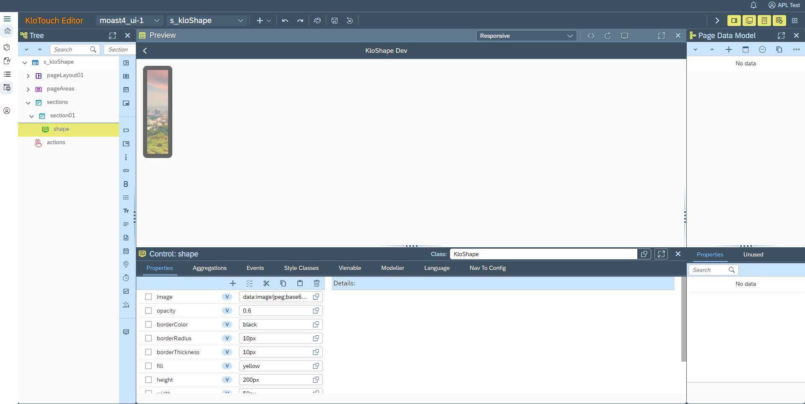
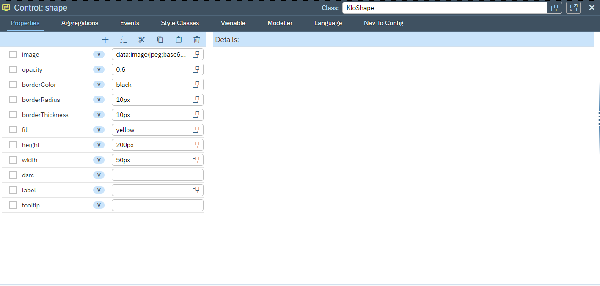
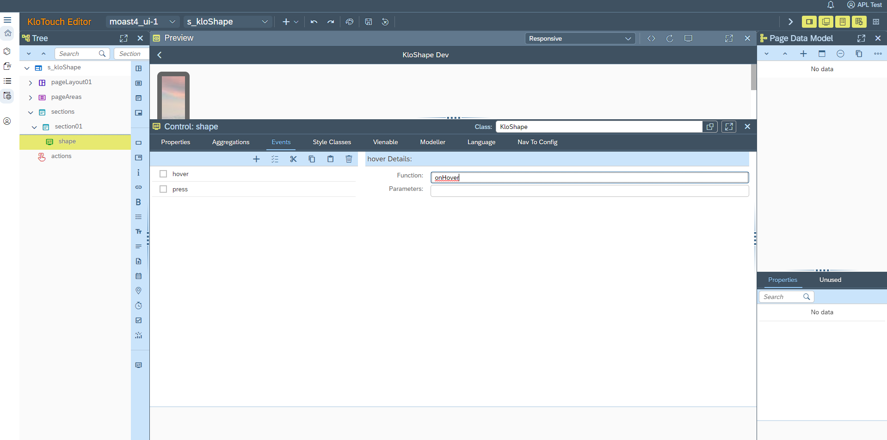

# KloShape

**Class**: KloShape

## Overview

Extended from **sap.ui.core.Control**.

KloShape lets the developer include the shape controls in the UI (rectangle and oval).

The developer can control properties like height, width, fill, border, opacity, etc.,

KloShape can also be used in the form subscreen.

## Framework Version Information

5.7 and 6.0

## Properties

| **NAME** | **TYPE** | **DEFAULT VALUE** | **DESCRIPTION** |
|---|---|---|---|
| **width** | sap.ui.core.CSSSize | 100% | Specifies the width of the control. |
| **height** | sap.ui.core.CSSSize | 100% | Specifies the height of the control. |
| **shape** | string | rectangle | Specifies the required shape.  Supported Shapes include **rectangle** and **oval**. If a square and circle are specified then the dimensions are equal to the **width** of the control. |
| **fill** | sap.ui.core.CSSColor | black | Specifies the background fill of the control. |
| **opacity** | string | 1 | Specifies the opacity of the control. |
| **borderColor** | sap.ui.core.CSSColor | #fff | Specifies the border colour of the control. |
| **borderThickness** | sap.ui.core.CSSSize | 0px | Specifies the thickness of the control. |
| **borderRadius** | sap.ui.core.CSSSize | 0px | Specifies the border radius of the control. |
| **image** | string | “” | Specifies the background image of the control. |

## Usage

KloShape control can be used if the developer requires a shape of suitable dimensions and style. The dimensions and styles can be controlled via the properties of the control.

## Events

| **NAME**  | **TYPE**                    | **DESCRIPTION**                                                                |
|-----------|-----------------------------|--------------------------------------------------------------------------------|
| **press** | - | Triggered whenever the control is clicked.           |
| **hover** | - | Triggered whenever the user hovers over the control. |

## Sample Code or Usage

**Fig:** KloShape Control to be selected in the tree for other details.

**Properties:**

**Fig:** Properties for the control can be provided under the properties panel.

**Events:**

**Fig:** Events for the control can be provided under the Events panel.
