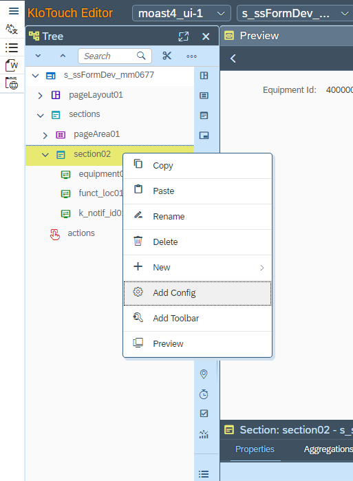
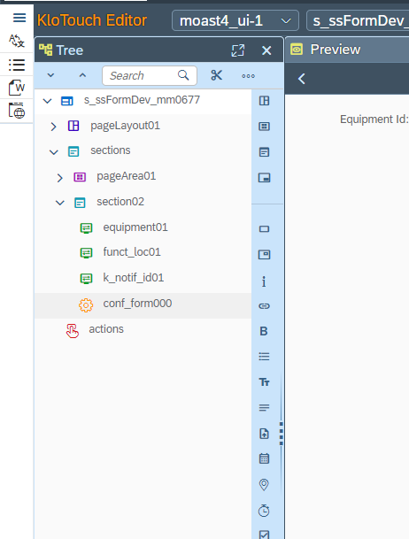
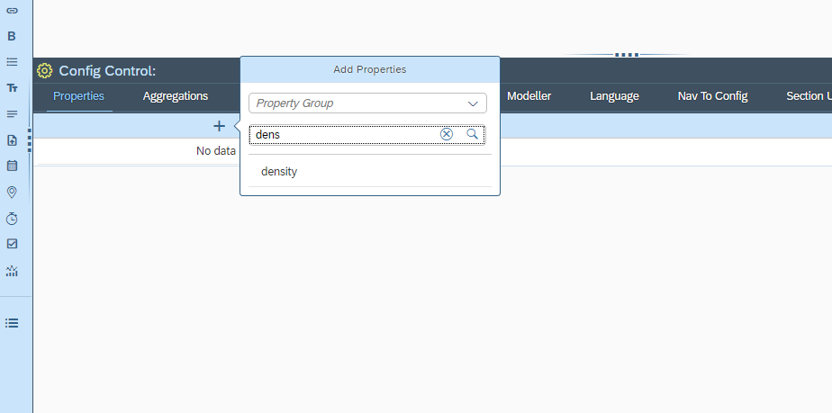
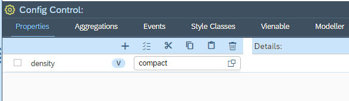
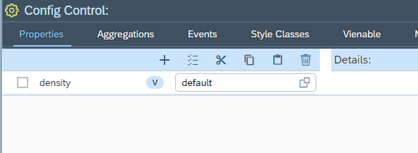
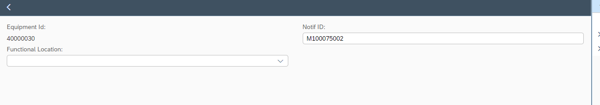
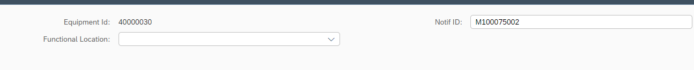

# KloConfigForm

**Class**: KloConfigForm

## Overview

Extended from **sap.ui.layout.form.SimpleForm**

KloConfigForm can be added to the form type subscreen to customise/configure it.

KloConfigForm has 2 properties: **compact** and **default**.

In compact mode, the labels take the entire column width and shift above the controls.

In default mode, the labels appear beside its control.

## Framework Version Information

6.0

## Properties

| **NAME**    | **TYPE** | **DEFAULT VALUE** | **DESCRIPTION**                                                                                       |
|-------------|----------|-------------------|-------------------------------------------------------------------------------------------------------|
| **density** | string   | default           | Specifies whether the form needs to be displayed in default or compact mode |

## Usage

KloConfigForm can be used to configure/customise the form type subscreen.

Right-click on the context menu and select the **Add config** option from there to add KloConfigForm.

**Fig:** Right Click and Add Config. (Note screenshot taken from 5.5. In 5.7 find the **New** option within the same context Menu)

**Fig:** Config Added to the form subscreen.

## Sample Code or Usage

**Fig:** property - density.

**Fig:** property density with value compact.

**Fig:** property density with value default.

**Form in compact mode:**

**Form in default mode:**

